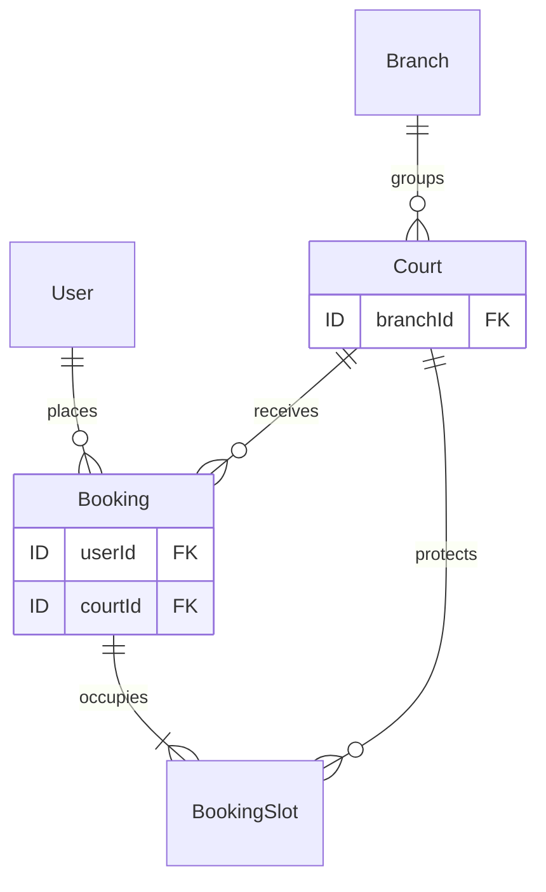
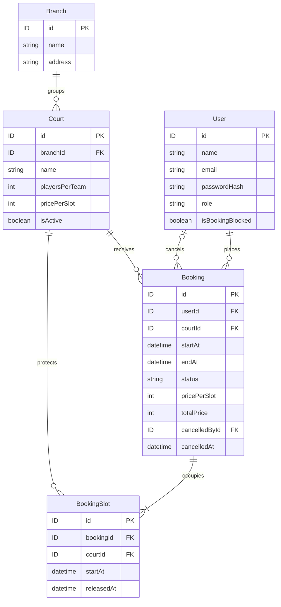
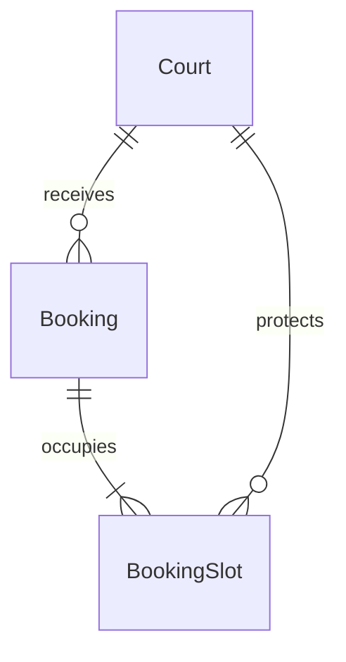

# Thiết kế dữ liệu và API — FB-002

Trạng thái: IN_PROGRESS. Đây là bản nháp từng bước từ câu trả lời người học, chưa phải schema/API hoàn chỉnh. Phạm vi theo [README](../README.md) và [REQUIREMENTS](REQUIREMENTS.md).

## Quan hệ đã review

- Người học xác định một User có nhiều Booking, mỗi Booking thuộc đúng một User.
- Người học xác định một Court có nhiều Booking, mỗi Booking thuộc đúng một Court.
- Mentor cụ thể hóa “nhiều” là 0 hoặc nhiều: tài khoản/sân mới có thể chưa có booking. Mỗi booking phải có đúng một người đặt và một sân; không phải đặt nhiều sân trong cùng một booking.



Số lượng liên kết mô tả toàn bộ dữ liệu, kể cả lịch sử. Giới hạn 3 booking tương lai chưa hủy mỗi khách là quy tắc riêng; nhiều booking trên cùng sân vẫn phải tuân thủ chống chồng lấn từng slot 30 phút. Đã chọn BookingSlot và partial unique index cho chống trùng từng slot; giới hạn 3 booking còn cần chốt cách bảo vệ khi request đồng thời.

## ERD cốt lõi — bản tổng hợp để review 2026-11-04

Tổng hợp các quyết định đã có, không thêm bảng hoặc thay quy tắc. Sơ đồ đầu tài liệu giữ vai trò phác thảo quan hệ ban đầu; bản dưới bổ sung trường liên kết và quan hệ người hủy. ID đã chốt UUID ngày 2026-11-04; ký hiệu ID trong sơ đồ tương ứng PostgreSQL uuid/Prisma String @db.Uuid. Sơ đồ này chưa là Prisma schema/migration và chưa chứng minh các ràng buộc đã hoạt động.



- Ký hiệu || là đúng một; o| là không có hoặc một; o{ là không có hoặc nhiều; |{ là một hoặc nhiều. Một booking thành công có 1–4 slot theo thời lượng, nhưng ký hiệu Mermaid chỉ biểu diễn một hoặc nhiều, không tự giới hạn tối đa 4.
- User–Booking có hai quan hệ: userId là khách đặt bắt buộc; cancelledById là người hủy có thể null. Người hủy có thể là khách hoặc admin. Với booking chưa hủy, cancelledById/cancelledAt là null; không nhầm người hủy với chủ booking.
- Court.branchId lấy địa điểm từ Branch, không lặp address trên Court. Court.pricePerSlot là giá hiện hành; Booking.pricePerSlot/totalPrice là snapshot lịch sử. Timestamps tạo/cập nhật vẫn giữ như bảng chi tiết dù lược bớt khỏi sơ đồ để dễ đọc.
- BookingSlot.courtId lặp có chủ đích để bảo vệ trùng sân/slot. FK kép đã đề xuất bảo đảm bookingId/courtId khớp Booking; partial unique index (courtId, startAt) WHERE releasedAt IS NULL bảo vệ slot hiệu lực. Quan hệ sơ đồ một mình không thay thế các ràng buộc đó.
- Sau hủy vẫn giữ Booking và các dòng BookingSlot; cập nhật status/cancelledAt/cancelledById và releasedAt của mọi slot trong cùng transaction. Không xóa dòng để giải phóng sân.

### Ví dụ dữ liệu để đọc sơ đồ, chưa phải test đã chạy

Một booking B1 của khách U1 trên sân C1, ngày 2026-11-05 từ 19:00 đến 20:30 giờ Việt Nam:

| BookingSlot | bookingId | courtId | startAt giờ Việt Nam | startAt UTC | releasedAt |
| --- | --- | --- | --- | --- | --- |
| S1 | B1 | C1 | 19:00 | 2026-11-05T12:00:00Z | null |
| S2 | B1 | C1 | 19:30 | 2026-11-05T12:30:00Z | null |
| S3 | B1 | C1 | 20:00 | 2026-11-05T13:00:00Z | null |

Booking có startAt=12:00Z, endAt=13:30Z. Không thêm slot 20:30 vì đây là giờ kết thúc của khoảng nửa mở. Chưa có BookingSlot nào được ghi thật. Giá lịch sử vẫn theo công thức giá mỗi slot tại lúc đặt nhân 3.

### Hai bảng hỗ trợ đã có trong thiết kế

- BookingBlockHistory: userId trỏ khách bị chặn/mở, actorId trỏ admin thao tác. Không gộp vào User hoặc BookingSlot; bộ trường chi tiết ở mục lịch sử chặn.
- RefreshToken: userId trỏ User, có thể nhiều dòng cho rotation/nhóm phiên. Không thêm bảng Session trong bước tổng hợp này; schema nhóm phiên và cơ chế khóa còn phải hoàn thiện theo mục auth.

Bước đọc hiểu nhỏ: người học mô tả khi hủy B1 thì dòng nào được giữ, trường nào thay đổi và vì sao sân có thể đặt lại. Đây là đọc mô hình, chưa cần SQL/Prisma. Sau đó tiếp tục chốt kiểu ID và hành vi FK theo nhu cầu lưu lịch sử; FB-002 chưa hoàn tất.

## Khóa ngoại đã review

- Người học đặt `userId` ở Booking và giải thích đúng vì một User có nhiều Booking, mỗi Booking thuộc một User.
- Mentor cụ thể hóa `Booking.userId` tham chiếu `User.id` và là trường bắt buộc theo quan hệ đã chốt. Đã chốt kiểu UUID; hành vi xóa/cập nhật còn review, chưa viết migration.
- Mỗi dòng Booking lưu một `userId`; nhiều dòng Booking có thể cùng `userId`. Khóa ngoại bảo đảm tham chiếu người dùng tồn tại, không tự giới hạn 3 booking tương lai hoặc thực hiện kiểm tra quyền.

- Người học xác định khóa ngoại Court nằm ở phía nhiều, tức Booking, vì mỗi Booking chỉ có một Court và mỗi Court có nhiều Booking. Mentor bổ sung tên `courtId`, tham chiếu `Court.id`, bắt buộc theo quan hệ; người học chưa tự nêu tên/đích tham chiếu.
- Hai liên kết ban đầu: `Booking.userId` → `User.id`, `Booking.courtId` → `Court.id`. Ký hiệu `ID` trong sơ đồ là placeholder, chưa chốt kiểu dữ liệu ID hoặc schema đầy đủ.

## Dữ liệu thời gian Booking — mentor đề xuất theo yêu cầu người học

Người học yêu cầu đề xuất trực tiếp, chưa tự giải thích lựa chọn trường. Đây là phương án thiết kế để review, chưa phải schema/migration đã triển khai.

| Trường | Ý nghĩa | Nguồn giá trị |
| --- | --- | --- |
| `startAt` | Ngày/giờ bắt đầu, một thời điểm đầy đủ | Khách chọn, backend kiểm tra |
| `endAt` | Ngày/giờ kết thúc | Backend tính `startAt + durationMinutes` |
| `createdAt` | Thời điểm tạo booking | Backend/database gán, không lấy từ khách |

- Lưu và trao đổi các thời điểm có múi giờ rõ ràng; biểu diễn lưu trữ theo UTC. Kiểu cột PostgreSQL và ánh xạ Prisma sẽ chốt khi thiết kế schema, chưa ngầm dùng chuỗi giờ địa phương làm dữ liệu chuẩn.
- Hiển thị và áp dụng giờ hoạt động/cửa sổ ngày theo `Asia/Ho_Chi_Minh`. Không tách `date`, `startTime`, `endTime` thành ba trường độc lập.
- Request vẫn gửi `courtId`, `startAt`, `durationMinutes` (tên minh họa). Backend chỉ chấp nhận thời lượng 30/60/90/120, tự tính `endAt`; không lấy `endAt` frontend làm nguồn quyết định.
- Không lưu thêm `durationMinutes` trong Booking ở phương án này; suy ra số phút bằng `endAt - startAt`, số slot bằng thời lượng / 30. Không lưu dữ liệu thời lượng lặp lại cần đồng bộ.
- Kiểm tra `endAt > startAt`, hiệu là một trong 30/60/90/120 phút, `startAt` trong tương lai và đúng mốc phút 00/30 (giây/phần lẻ giây bằng 0), khoảng trong cùng ngày Việt Nam từ 06:00 đến 22:00. Vị trí thực thi/ràng buộc DB sẽ chốt sau.
- Ví dụ minh họa: 03/11/2026 19:00–20:30 giờ Việt Nam tương ứng `startAt = 2026-11-03T12:00:00Z`, `endAt = 2026-11-03T13:30:00Z`; thời lượng suy ra 90 phút, 3 slot. Đây không phải booking thật hoặc kết quả test backend.
- Hạn tự hủy tính bằng `startAt - 60 phút`; `createdAt` không dùng để tính hạn. Chưa thêm thời gian ân hạn sau khi đặt. Trường lưu thời điểm hủy/người hủy sẽ xem xét cùng trạng thái booking ở bước sau.

## Trạng thái và thông tin hủy — đã duyệt 2026-11-02

Người học đã duyệt phương án mentor đề xuất: CONFIRMED/CANCELLED, cancelledAt/cancelledById và nhãn thời gian suy ra. Đây là quyết định thiết kế, chưa phải bằng chứng người học tự giải thích cơ chế; chưa viết schema/API.

| Trường | Phương án | Ý nghĩa |
| --- | --- | --- |
| `status` | `CONFIRMED` hoặc `CANCELLED` | Booking đã được đặt thành công hoặc đã hủy |
| `cancelledAt` | Thời điểm, có thể null | Server gán khi hủy thành công; lưu UTC |
| `cancelledById` | FK tới `User.id`, có thể null | Người thực hiện hủy: khách sở hữu booking hoặc admin |

- Tạo booking thành công thì `CONFIRMED`, hai trường hủy null; chỉ lưu khi toàn bộ slot được đặt thành công. Không có trạng thái chờ thanh toán/xác nhận trong bản đầu. Request thất bại không tạo booking giữ chỗ.
- Khi hủy hợp lệ: chuyển một chiều `CONFIRMED` → `CANCELLED`, điền cả `cancelledAt` và `cancelledById` bằng dữ liệu backend. Không nhận danh tính người hủy từ body; không xóa lịch sử, không tự khôi phục booking đã hủy. Đặt lại tạo booking mới.
- Tính nhất quán dự kiến: CONFIRMED thì hai trường hủy null; CANCELLED thì cả hai có giá trị. Chốt ràng buộc SQL/migration sau; chưa tự tuyên bố DB đã bảo vệ.
- Hủy và giải phóng toàn bộ slot phải nguyên tử; việc kiểm tra quyền/thời gian, cập nhật status và xử lý request trùng cần thiết kế khi triển khai. Khách chỉ hủy booking của mình khi còn ít nhất 60 phút; admin hủy riêng không bị giới hạn này. Hủy thất bại giữ nguyên dữ liệu.
- Chưa bắt buộc thêm lý do hủy; không suy rộng yêu cầu ghi lý do của thao tác hạn chế tài khoản sang mọi lần hủy booking. Không thêm trạng thái thanh toán hoặc no-show.
- Không lưu thêm COMPLETED làm trạng thái trong phương án này. Nhãn thời gian được suy ra tại thời điểm đọc nếu status là CONFIRMED: sắp tới khi `now < startAt`, đang diễn ra khi `startAt <= now < endAt`, đã kết thúc khi `now >= endAt`. CANCELLED luôn hiển thị đã hủy. “Đã kết thúc” chỉ mô tả khoảng giờ đã qua, không chứng minh khách đã đến hoặc đã thanh toán.
- Không cần tác vụ nền chỉ để đổi status theo đồng hồ. Giới hạn 3 booking đếm `status = CONFIRMED` và `startAt > now`; booking đã bắt đầu không còn tính. Trạng thái không tự bảo vệ chống trùng slot; cơ chế đã chọn là BookingSlot với partial unique index trên courtId/startAt khi releasedAt null; chưa triển khai.
- Ví dụ hủy booking của khách: `cancelledById` bằng ID khách. Admin hủy hộ: `cancelledById` bằng ID admin, còn `userId` vẫn giữ ID khách đặt ban đầu. Vai trò, quyền và khóa ngoại này sẽ được thể hiện đầy đủ khi hoàn thiện ERD.

## Bảng phục vụ đặt sân — đã chọn phương án BookingSlot 2026-11-03

Người học yêu cầu mentor đề xuất bảng, sau đó chọn phương án 2: BookingSlot với partial unique index để bảo vệ từng khoảng 30 phút. Xác nhận này chốt hướng mô hình, không phải bằng chứng tự giải thích cơ chế hoặc duyệt xong mọi chi tiết SQL/FK/kiểu dữ liệu. Bộ trường dưới đây là thiết kế cơ sở của phương án đã chọn. Phần này tập trung Court–Booking–BookingSlot theo bước đang học; các bảng User/Branch/BookingBlockHistory và phương án RefreshToken giữ trạng thái review đã ghi ở các mục riêng. Chưa phải schema/migration hoặc xác nhận hiểu cơ chế.

### Court — giữ bộ trường đã duyệt

`id`, `branchId`, `name`, `playersPerTeam`, `pricePerSlot`, `isActive`, `createdAt`, `updatedAt`. playersPerTeam bổ sung và duyệt ngày 2026-11-03. Không thêm ngày/giờ đặt hoặc tên người đặt vào Court. Các thông tin đó thuộc booking và các dòng chiếm slot.

### Booking — tổng hợp các trường đã review

| Trường | Ý nghĩa |
| --- | --- |
| `id` | Mã booking UUID |
| `userId` | FK tới User.id: khách đặt |
| `courtId` | FK tới Court.id: sân được đặt |
| `startAt` | Thời điểm bắt đầu toàn bộ booking |
| `endAt` | Thời điểm kết thúc toàn bộ booking |
| `status` | CONFIRMED hoặc CANCELLED |
| `pricePerSlot` | Giá mỗi 30 phút tại thời điểm đặt |
| `totalPrice` | Tổng tiền lịch sử do backend tính |
| `createdAt` | Thời điểm tạo booking |
| `cancelledAt` | Thời điểm hủy; null khi chưa hủy |
| `cancelledById` | FK tới User.id: người hủy; null khi chưa hủy |

Đây là bảng tổng hợp thiết kế hiện có, không phải yêu cầu duyệt lại các quyết định đã chốt. Một Booking đại diện toàn bộ khoảng chơi liên tục, không phải một booking riêng cho mỗi 30 phút.

### BookingSlot — bảng của phương án đã chọn

Mỗi dòng ghi một khoảng 30 phút mà một booking chiếm. Chỉ tạo khi đặt, không cần tạo sẵn mọi slot trống. Một Booking thành công có 1–4 dòng tương ứng thời lượng 30/60/90/120 phút.

| Trường | Bắt buộc | Ý nghĩa |
| --- | --- | --- |
| `id` | Có | Mã dòng slot UUID |
| `bookingId` | Có | Liên kết tới Booking.id, dùng tìm toàn bộ slot khi hủy |
| `courtId` | Có | Sân bị chiếm; phải khớp sân của Booking |
| `startAt` | Có | Thời điểm đầy đủ bắt đầu slot 30 phút, lưu UTC |
| `releasedAt` | Không | null khi chưa giải phóng; thời điểm hủy khi giải phóng slot |

- Mỗi slot là khoảng nửa mở `[startAt, startAt + 30 phút)`: kết thúc lúc 19:30 không chiếm slot bắt đầu 19:30. Không lưu thêm endAt/date/time/name trên BookingSlot; ngày/giờ Việt Nam suy ra khi hiển thị, tên sân lấy từ Court.
- courtId được lặp từ Booking có chủ đích để database kiểm tra trùng sân/thời điểm ngay trên BookingSlot. Khi viết migration, dự kiến UNIQUE(Booking.id, Booking.courtId) và FK kép BookingSlot(bookingId, courtId) → Booking(id, courtId), bảo đảm slot không gắn nhầm sân. Không cho sửa sân/khung giờ của booking đã tạo; đổi giờ theo luồng hủy rồi đặt mới đã chốt.
- UNIQUE(bookingId, startAt) ngăn tạo lặp một slot trong cùng booking. Backend phải sinh đúng và đủ dãy slot liên tiếp từ Booking.startAt đến Booking.endAt; FK/unique không tự chứng minh đủ số slot hoặc đồng bộ trạng thái hủy. Kiểm tra mốc 00/30, giây/phần lẻ giây bằng 0 và ràng buộc thời gian sẽ cụ thể hóa khi viết migration.
- releasedAt không phải trạng thái thanh toán/hoàn tất: booking đã qua giờ vẫn có thể giữ releasedAt=null. Không cần job giải phóng theo đồng hồ vì mỗi slot gắn với ngày/giờ cụ thể; giờ quá khứ đã bị chặn theo quy tắc đặt.



Sơ đồ biểu diễn mỗi Booking có ít nhất một BookingSlot; booking tạo thành công phải có đủ 1–4 dòng, kể cả sau hủy vì giữ dòng lịch sử. Số lượng đúng được bảo đảm bởi luồng ghi nguyên tử và phải kiểm thử, chưa có bằng chứng thực thi.

### Ví dụ minh họa và đặt/hủy

Booking B1 thuộc sân A ngày 03/11/2026 19:00–20:30 giờ Việt Nam, status=CONFIRMED. Các ID dưới đây chỉ là nhãn minh họa:

| id | bookingId | courtId | startAt (UTC) | releasedAt |
| --- | --- | --- | --- | --- |
| S1 | B1 | A | 2026-11-03T12:00:00Z | null |
| S2 | B1 | A | 2026-11-03T12:30:00Z | null |
| S3 | B1 | A | 2026-11-03T13:00:00Z | null |

- Đặt: ghi Booking và toàn bộ BookingSlot trong một transaction; tranh bất kỳ slot nào thì rollback tất cả, map đúng lỗi xung đột slot thành HTTP 409. Ví dụ booking khác sân A lúc 19:30–20:00 tranh S2; sân B cùng giờ không xung đột.
- Hủy hợp lệ: khóa/kiểm tra lại booking và quyền/hạn hủy, chuyển status=CANCELLED, gán cancelledAt/cancelledById và releasedAt cho mọi dòng thuộc booking trong cùng transaction. Lỗi thì giữ nguyên cả booking lẫn slot. Các request hủy trùng phải được phối hợp, chi tiết response chốt ở API.
- Giữ dòng slot đã giải phóng làm lịch sử; booking mới có thể thêm dòng cùng courtId/startAt vì dòng cũ không còn tham gia chỉ mục bảo vệ slot. Không xóa Booking hoặc slot cũ khi hủy.

### Ràng buộc chống trùng đề xuất

SQL dưới đây minh họa migration tương lai, chưa chạy:

```sql
CREATE UNIQUE INDEX booking_slot_active_unique
ON "BookingSlot" ("courtId", "startAt")
WHERE "releasedAt" IS NULL;
```

Partial unique index chỉ áp dụng tính duy nhất cho các dòng thỏa điều kiện; ở đây mỗi sân/thời điểm chỉ có một dòng chưa giải phóng. Điều kiện nằm trên BookingSlot, không đọc status từ Booking. Nguồn: [PostgreSQL CREATE INDEX](https://www.postgresql.org/docs/18/sql-createindex.html).

Chỉ unique sân/giờ bắt đầu trên Booking sẽ bỏ lọt hai booking khác giờ bắt đầu nhưng chồng lấn. Phương án từng slot bảo vệ cả slot giữa khi backend sinh đúng đầy đủ các slot và transaction ghi toàn bộ. Giới hạn 3 booking cùng tài khoản, chặn đặt đồng thời và đổi giá đồng thời vẫn cần thiết kế riêng; chỉ mục này không tự giải quyết các phần đó.

Trước khi nghiệm thu thực thi: chạy PostgreSQL test riêng, test hai request đồng thời khác giờ bắt đầu nhưng trùng slot giữa, không giữ slot rời rạc khi thua, hủy/đặt lại, khác sân cùng giờ, hai booking tiếp giáp, rollback khi hủy lỗi và FK không cho gắn sai sân. Đây là kế hoạch kiểm tra, chưa phải kết quả test.

## Giới hạn 3 booking — đã duyệt hướng khóa dòng User 2026-11-03

### Xác nhận chính sách giữ chỗ 2026-11-03

Sau khi cân nhắc hạn chế giữ giờ cao điểm và nhu cầu khách đặt nhiều buổi, người học duyệt giữ tối đa 3 booking tương lai chưa hủy trên mỗi tài khoản cho bản đầu. Đặt con số tại một cấu hình backend tập trung để dễ điều chỉnh khi có phản hồi thực tế; giá trị hiện hành vẫn là 3, không cho client tự chọn hạn mức. Chưa cần thêm bảng cấu hình, dependency hoặc API quản trị cấu hình. Không bổ sung hạn mức theo ngày/giờ cao điểm. Booking đã bắt đầu hoặc đã hủy không tính; không phải 3 lượt mỗi tuần và không ngăn nhiều tài khoản. Chưa có dữ liệu chứng minh mức 3 tối ưu.

Response lỗi hạn mức đã được duyệt riêng ở mục bên dưới. Chưa triển khai cấu hình hoặc test concurrency.


Mục tiêu: mỗi khách có tối đa 3 Booking với status=CONFIRMED và startAt lớn hơn thời điểm kiểm tra. Không cần bảng hoặc cột đếm mới. BookingSlot bảo vệ sân/slot, không bảo vệ tổng số booking của một tài khoản trên các slot khác nhau.

### Vấn đề và phương án

Khách đang có 2 booking tương lai, gửi hai request đặt các slot khác nhau. Nếu cả hai cùng đếm được 2 rồi tạo thêm thì kết quả là 4. Chỉ bọc COUNT và INSERT trong transaction ở Read Committed chưa đủ để loại bỏ tình huống này.

Người học đã duyệt luồng transaction: khóa User → đọc trạng thái chặn → đếm booking tương lai chưa hủy → kiểm tra điều kiện đặt → tạo Booking và toàn bộ BookingSlot → commit hoặc rollback. Đây là xác nhận hướng thiết kế, không phải bằng chứng thực thi hoặc hiểu độc lập mọi chi tiết isolation/SQL. Chi tiết kỹ thuật của phương án dùng dòng User làm điểm phối hợp, với transaction Read Committed:

1. Lấy userId từ danh tính đã xác thực; khóa đúng dòng User bằng SELECT ... FOR UPDATE với tham số truy vấn an toàn. Không khóa cả bảng User, không thêm trường isLocked hoặc thay đổi quyền đăng nhập.
2. Sau khi lấy được khóa, đọc trạng thái chặn hiện hành. Lấy thời điểm kiểm tra mới từ nguồn thời gian backend/database; không dùng thời điểm bắt đầu transaction trước lúc chờ khóa làm thời gian hiện tại. Khi dùng PostgreSQL cần phân biệt CURRENT_TIMESTAMP/now() cố định ở đầu transaction với clock_timestamp().
3. Bằng một câu truy vấn riêng SAU khi đã lấy được khóa, đếm Booking của khách với status=CONFIRMED và startAt > thời điểm kiểm tra. Ở Read Committed, câu đếm mới nhìn thấy booking mà request trước đã commit trước khi câu đếm bắt đầu. Không gộp khóa và đếm vào một câu dùng snapshot cũ.
4. Nếu số lượng >= 3 thì từ chối, không tạo Booking/BookingSlot. Mã lỗi giới hạn và response sẽ chốt khi thiết kế API.
5. Nếu còn chỗ trong hạn mức thì tiếp tục kiểm tra đầy đủ điều kiện đặt, tạo Booking và toàn bộ BookingSlot trong cùng transaction. Kiểm tra lại thời gian bắt đầu sau các lần chờ khóa tài nguyên liên quan; chi tiết khóa Court, giá và vô hiệu hóa sân còn phải thiết kế riêng, chưa coi phần này đã giải quyết.
6. Commit khi toàn bộ thành công; nếu lỗi thì rollback toàn bộ. Khóa được giải phóng khi transaction kết thúc; không gọi dịch vụ ngoài hoặc chờ thao tác frontend khi đang giữ khóa.

Mọi đường tạo booking đều phải tuân thủ cùng giao thức khóa User này; khóa không tự ngăn một đoạn code khác INSERT booking nếu đoạn code đó bỏ qua giao thức. Chưa có ràng buộc SQL trực tiếp bảo vệ hạn mức đếm.

Ví dụ kết quả mong đợi: R1 lấy khóa trước, đếm 2 và tạo booking thứ 3 rồi commit. R2 chờ khóa, sau đó đếm lại thấy 3 nên bị từ chối. Nếu R1 rollback do tranh slot thì R2 vẫn có thể đếm 2 và tiếp tục. Tài khoản khác khóa dòng User khác, không bị tuần tự hóa bởi cùng một khóa User.

Chặn/mở chặn phải phối hợp trên cùng dòng User: thao tác UPDATE cờ và ghi lịch sử trong transaction sẽ tranh khóa với tạo booking. Thứ tự lấy được khóa quyết định thao tác nào đi trước; nếu đặt giữ khóa trước thì có thể hoàn tất trước thao tác chặn, nếu chặn commit trước thì đặt phải đọc thấy bị chặn. Đây là đề xuất thứ tự xử lý, còn cần review riêng với luồng admin, chưa có test. Hủy chỉ giảm số booking được tính; phối hợp khóa giữa luồng hủy/đặt và thứ tự khóa toàn hệ thống cần hoàn thiện riêng để tránh deadlock.

Nguồn đã đọc: [PostgreSQL Row-Level Locks](https://www.postgresql.org/docs/current/explicit-locking.html#LOCKING-ROWS) và [Read Committed](https://www.postgresql.org/docs/current/transaction-iso.html#XACT-READ-COMMITTED). Hướng transaction/khóa User đã được duyệt; các chi tiết SQL vẫn chưa triển khai, không phải SQL đã chạy.

Kiểm tra cần làm khi triển khai trên database test riêng: tài khoản có 2 booking gửi hai request đồng thời tới slot khác nhau chỉ thêm tối đa 1 booking; rollback do tranh slot không tiêu hao hạn mức; booking hủy/đã bắt đầu không tính; tài khoản khác độc lập; thao tác chặn/đặt đồng thời tuân theo thứ tự đã chốt. Chưa thực hiện các test này.

## Court thay đổi đồng thời — chốt hướng transaction ngắn 2026-11-03

Người học làm rõ muốn bảo vệ giá trong transaction đặt chạy đồng thời với cập nhật admin. Mentor trước đó mở rộng sang báo giá trước đặt và TTL gây dư phạm vi; rút phương án báo giá/TTL khỏi thiết kế hiện hành. Không cần mã/bảng báo giá, không giữ giá từ lúc xem màn hình. Nhật ký trao đổi cũ giữ làm lịch sử, không phải yêu cầu hiện hành.

### Luồng đặt và cập nhật giá

1. BEGIN transaction Read Committed; khóa User FOR UPDATE, kiểm tra chặn và hạn mức theo luồng đã duyệt.
2. Khóa dòng Court bằng SELECT ... FOR SHARE và đọc pricePerSlot/isActive. Cách khóa chia sẻ là chi tiết kỹ thuật mentor đề xuất để nhiều khách vẫn đặt cùng Court ở các slot khác nhau; admin UPDATE Court phải chờ khóa này.
3. Nếu sân đang nhận đặt và đủ điều kiện thời gian/hạn mức/slot, tính tổng bằng giá Court vừa đọc và lưu snapshot Booking.pricePerSlot/totalPrice cùng toàn bộ BookingSlot. Lấy thời điểm kiểm tra mới sau chờ khóa; không tin userId/giá do body tự khai.
4. Commit toàn bộ khi thành công hoặc rollback toàn bộ khi lỗi; nhả khóa khi transaction kết thúc. Không chờ người dùng hoặc cổng thanh toán trong transaction.
5. Nếu đặt lấy khóa Court trước, admin cập nhật giá/isActive chờ đến khi transaction đặt kết thúc. Booking đã commit giữ nguyên giá cũ; admin đổi giá niêm yết cho các lần đặt sau. Nếu admin UPDATE và commit trước khi đặt lấy được khóa, đặt đọc giá/trạng thái mới. Không bảo đảm mọi request đặt luôn có ưu tiên so với admin.

Ví dụ: giá 150000/slot, đặt 60 phút tổng 300000. Transaction đặt đã lấy khóa trước thì Booking.totalPrice=300000; sau commit admin có thể đổi Court.pricePerSlot=180000, để booking 60 phút tạo sau dùng tổng 360000. Tổng Booking cũ không đổi thành 360000. Cách hiểu câu người học “giá sẽ thay đổi ... 360k” là giá áp dụng cho lần đặt sau; không sửa tổng lịch sử. Đơn vị niêm yết vẫn mỗi 30 phút.

### Phạm vi và kiểm chứng còn thiếu

- Giá từ frontend/Postman không phải nguồn chuẩn; backend tự đọc/tính từ Court. Snapshot bảo vệ giá sau commit.
- Khóa Court bảo vệ giá/trạng thái trong transaction, unique BookingSlot chống tranh slot, khóa User bảo vệ hạn mức; các vai trò khác nhau.
- Thứ tự khóa dự kiến User → Court → Booking/slot; phải rà cùng các luồng hủy/admin và xử lý deadlock/retry trước triển khai. Chưa có SQL thực thi hoặc test PostgreSQL.
- Thanh toán chỉ là ví dụ giả định, chưa thuộc bản đầu; không giữ khóa qua tác động ngoài database.
- Cần test đổi giá/vô hiệu hóa và đặt ở cả hai thứ tự, rollback của admin/đặt, hai khách đặt cùng Court khác slot, giữ giá Booking cũ.
- Nguồn cơ chế: [PostgreSQL Row-Level Locks — FOR SHARE](https://www.postgresql.org/docs/current/explicit-locking.html#LOCKING-ROWS).

## Giá lịch sử — đã duyệt 2026-11-02

- Người học xác định admin sửa giá Court, Booking lấy nguồn giá từ Court. Đúng về nguồn giá; câu trả lời chưa nói rõ đọc tại lúc tạo hay mỗi lần xem, không suy diễn người học đã chọn giá động hoặc đã tự đề xuất snapshot.
- Mentor cụ thể hóa: khi tạo Booking, backend đọc giá hiện hành của Court, tự tính tổng và lưu bản sao giá vào Booking. Khi đọc Booking cũ dùng giá đã lưu trong Booking, không tính lại theo Court hiện tại. Không dùng giá frontend làm nguồn quyết định.

| Trường đề xuất | Ý nghĩa |
| --- | --- |
| `Court.pricePerSlot` | Giá niêm yết hiện tại cho mỗi 30 phút |
| `Booking.pricePerSlot` | Bản sao giá mỗi 30 phút tại thời điểm đặt |
| `Booking.totalPrice` | Tổng tiền đã chốt: giá bản sao × số slot |

- Người học đã hỏi lại và xác nhận: tăng giá Court thì dữ liệu giá Booking cũ giữ nguyên. Duyệt phương án mentor đề xuất gồm Court.pricePerSlot và Booking.pricePerSlot/totalPrice; chưa có lời giải thích độc lập về schema. Đã chốt đơn vị tiền là số nguyên VND và giá mỗi slot > 0; kiểu cột/trần kỹ thuật được mentor xác định theo yêu cầu làm trực tiếp ở mục dưới. Validation/ràng buộc/schema chưa triển khai.
- Ví dụ sân 150.000đ/slot: đặt 90 phút = 3 slot, lưu Booking.pricePerSlot = 150.000 và totalPrice = 450.000. Sau khi Court.pricePerSlot thành 175.000, booking cũ vẫn 150.000/450.000; booking mới cùng thời lượng có giá 525.000 nếu đủ điều kiện đặt.
- Đây là giá đã chốt, không phải tiền đã thu; chưa có thanh toán. Hủy booking giữ nguyên thông tin giá lịch sử. Admin hủy để khách đặt lại tạo booking mới theo giá hiện hành.
- Tính nhất quán đọc giá/ghi booking khi admin đổi giá đồng thời cần chốt khi thiết kế transaction; chưa coi đã giải quyết race condition.

## Biểu diễn tiền — đã duyệt 2026-11-02

- Người học đồng ý đề xuất lưu tiền bằng số nguyên theo đơn vị VND: `150000` tương ứng 150.000đ. Áp dụng cho Court.pricePerSlot, Booking.pricePerSlot và Booking.totalPrice.
- Không dùng số thực dấu phẩy động làm dữ liệu tiền chuẩn. Giá trị số không chứa dấu phân cách nghìn, ký hiệu đ hay chuỗi định dạng giao diện; định dạng hiển thị tách riêng.
- Backend tự tính tổng từ giá hiện hành mỗi slot và số slot (1–4), lưu snapshot như đã duyệt. Tổng giá là số nguyên VND; chưa có thanh toán.
- Người học đã đồng ý giá mỗi slot phải lớn hơn 0 sau khi làm rõ slot là khoảng 30 phút và pricePerSlot là trường giá, không phải slot. Court.pricePerSlot và bản sao Booking.pricePerSlot phải là số nguyên VND > 0; từ chối giá 0, số âm, phần lẻ đồng hoặc dữ liệu không phải số. Booking.totalPrice được backend tính từ giá này và số slot 1–4 nên cũng > 0.
- Theo yêu cầu “ừm làm đi”, mentor chọn PostgreSQL `integer`, Prisma `Int` cho cả ba trường tiền; chưa chọn phiên bản Prisma hoặc khởi tạo ứng dụng. Prisma Int ánh xạ mặc định sang PostgreSQL integer; không cần thêm dependency.
- PostgreSQL integer tối đa 2.147.483.647. Để một giá mỗi slot luôn tính được booking dài nhất 4 slot, đặt trần kỹ thuật `floor(2147483647 / 4) = 536870911` VND/slot. Miền giá mỗi slot là số nguyên từ 1 đến 536.870.911; tổng giá từ 1 đến 2.147.483.644, phải đúng giá snapshot × số slot. Đây là giới hạn biểu diễn, không phải đề xuất giá bán hoặc mức giá thị trường.
- Không dùng giá bán tối đa tự đặt như 1 triệu/slot khi chưa có nhu cầu nghiệp vụ. Nếu sau này cần số tiền vượt miền trên hoặc thay thời lượng tối đa, phải xem lại kiểu cột, validation và migration; không âm thầm đổi ngưỡng.
- Backend kiểm tra kiểu số/nguyên và miền giá trước khi ghi Court, từ chối chuỗi/boolean/null, số không hữu hạn, phần lẻ đồng, giá 0/âm/vượt trần. Không tự ép chuỗi thành số, làm tròn hoặc cắt giá. Khi tạo Booking đọc giá Court, kiểm tra thời lượng, tự tính và kiểm tra tổng; không lấy giá/tổng frontend làm nguồn quyết định. Mã lỗi/response chốt ở phần API.
- Khi triển khai schema/migration: ba cột tiền NOT NULL integer; CHECK miền giá cho Court.pricePerSlot và Booking.pricePerSlot; CHECK miền tổng và tổng đúng giá snapshot × số slot (suy ra từ thời gian hợp lệ). Khi viết CHECK có phép nhân, dùng toán hạng đủ rộng nếu cần, không dựa vào thứ tự đánh giá các CHECK để tránh tràn trước khi từ chối dữ liệu sai. Không tuyên bố đã có các ràng buộc khi chưa chạy migration thật.
- Các kiểm tra cần có khi triển khai: 1/150000/536870911 được nhận, 0/âm/phần lẻ/536870912/sai kiểu bị từ chối; thời lượng 30/60/90/120 cho hệ số 1/2/3/4; tại giá trần, tổng 4 slot là 2147483644. Kiểm tra snapshot khi đổi giá sân và không ghi dữ liệu/giữ slot nếu đầu vào sai.
- Nguồn kỹ thuật đã tra cứu: [PostgreSQL Numeric Types](https://www.postgresql.org/docs/current/datatype-numeric.html) và [Prisma PostgreSQL type mappings](https://docs.prisma.io/docs/orm/core-concepts/supported-databases/postgresql). Tài liệu Prisma chỉ dùng xác minh ánh xạ; chưa chốt phiên bản framework của app.
- Đây là quyết định kỹ thuật mentor thực hiện trong phạm vi FB-002 theo yêu cầu người học, không ghi là người học tự thiết kế hoặc giải thích được. Chưa tạo schema/migration/validation code.

## Nhóm chi nhánh/địa điểm — bảng riêng đã được người học chọn

- Người học đề xuất bảng riêng cho chi nhánh rồi liên kết với Court. Dùng tên code `Branch` làm tên thiết kế do mentor đề xuất, chưa chốt các trường hoặc schema.
- Mục đích: nhiều sân tại cùng địa điểm dùng một định danh nhóm chung để khách chọn/lọc chi nhánh trước khi chọn sân; tránh lưu tên chi nhánh lặp lại trên từng Court rồi phải sửa nhiều nơi khi đổi tên.
- Đây là nhóm địa điểm trong cùng hệ thống, admin vẫn quản lý toàn bộ; không thêm chủ sân, tài khoản hoặc phân quyền admin riêng theo chi nhánh.
- Theo phản biện của người học, địa chỉ chung lưu ở Branch.address: một chi nhánh là một địa điểm có nhiều sân. Court lấy địa chỉ qua branchId; không lưu lặp Court.address. Đây là điều chỉnh cách lưu dữ liệu, khách vẫn xem được địa chỉ nơi đến khi xem sân.
- Người học tự xác định một Branch có nhiều Court, mỗi Court thuộc đúng một Branch và khóa ngoại nằm ở Court. Đúng quan hệ một–nhiều. Mentor cụ thể hóa tên `Court.branchId` tham chiếu `Branch.id`, bắt buộc theo quan hệ đã chốt; kiểu ID đã chốt UUID; hành vi xóa/cập nhật chưa chốt.
- Mermaid biểu diễn một Branch có 0 hoặc nhiều Court (mentor bổ sung: chi nhánh mới có thể chưa thêm sân), mỗi Court có đúng một Branch. Chưa thêm schema/migration hoặc tuyên bố ràng buộc đã chạy.

## Thông tin Branch và Court — đã duyệt 2026-11-02

Người học yêu cầu đề xuất trực tiếp. Người học đã duyệt toàn bộ bộ trường sau khi phản biện và sửa địa chỉ về Branch. Đây là quyết định thiết kế, chưa phải schema/migration hoàn chỉnh.

### Branch

| Trường | Ý nghĩa |
| --- | --- |
| `id` | Định danh chi nhánh UUID |
| `name` | Tên để hiển thị trong bộ chọn chi nhánh |
| `address` | Địa chỉ chung nơi khách đến cho các sân trong chi nhánh |
| `createdAt` | Thời điểm tạo, server/DB gán |
| `updatedAt` | Thời điểm cập nhật thông tin, server/DB gán |

### Court

| Trường | Ý nghĩa |
| --- | --- |
| `id` | Định danh sân UUID |
| `branchId` | FK tới Branch.id theo quan hệ đã review |
| `name` | Tên sân để khách nhận diện trong chi nhánh |
| `playersPerTeam` | Số người mỗi đội: số nguyên bắt buộc 5, 7 hoặc 11; không tự mặc định; bổ sung đã duyệt 2026-11-03 |
| `pricePerSlot` | Giá hiện tại mỗi 30 phút, theo thiết kế tiền đã có |
| `isActive` | Có nhận booking mới không; đề xuất mặc định true khi admin tạo sân |
| `createdAt` | Thời điểm tạo, server/DB gán |
| `updatedAt` | Thời điểm cập nhật thông tin, server/DB gán |

- name/address bắt buộc, bỏ khoảng trắng đầu/cuối rồi không được rỗng. Court.name đã chốt chuẩn hóa khoảng trắng và duy nhất trong chi nhánh ở mục tạo sân bên dưới; giới hạn độ dài còn review. Không tự áp quy tắc unique Court cho Branch.name. Kiểu ID đã chốt UUID; hành vi xóa/FK vẫn chưa chốt.
- Branch.address là nguồn địa chỉ duy nhất; không có Court.address. Ví dụ một Branch có ba Court A/B/C tại cùng địa điểm thì lưu địa chỉ một lần. Khi xem sân, API/giao diện lấy Branch.address qua liên kết Court.branchId; cập nhật địa chỉ chung chỉ sửa Branch. Không tự thêm địa chỉ riêng/ngoại lệ cho Court.
- Không thêm isActive cho Branch trong bản đầu: nhu cầu hiện tại vô hiệu hóa từng Court; chưa có quyết định vô hiệu hóa cả chi nhánh và tác động dây chuyền.
- Court.isActive=false chỉ ngừng nhận booking mới, giữ booking có sẵn/lịch sử. Không coi false tự chứng minh bảo trì; không tự hủy booking hoặc thêm trạng thái bảo trì riêng.
- createdAt/updatedAt lưu thời điểm UTC; không nhận giá trị do frontend gửi làm nguồn chuẩn. updatedAt chỉ là lần cập nhật gần nhất, không phải lịch sử audit hoặc snapshot giá.
- Chưa cần ảnh sân, mô tả dài, tiện ích, tọa độ, số điện thoại chi nhánh hoặc giờ mở cửa riêng. Giữ giờ chung 06:00–22:00. Nếu có nhu cầu bổ sung phải chốt nghiệp vụ trước.

## Trường User — đã duyệt 2026-11-02

Người học đã duyệt khung User sau khi bỏ mức khóa tài khoản ngày 2026-11-02; đăng nhập bằng email và lý do chặn gần nhất nằm trong khung được duyệt. Sau đó người học yêu cầu bổ sung refresh token, thiết kế riêng bên dưới; không thêm token rõ vào User.

| Trường | Ý nghĩa |
| --- | --- |
| `id` | Mã tài khoản UUID |
| `name` | Tên hiển thị, không dùng làm danh tính xác thực |
| `email` | Định danh đăng nhập duy nhất đã duyệt; chưa chốt chính sách chuẩn hóa/validation |
| `passwordHash` | Mật khẩu đã hash; không lưu/trả mật khẩu rõ hoặc hash ra API |
| `role` | CUSTOMER hoặc ADMIN; đăng ký công khai chỉ tạo CUSTOMER |
| `isBookingBlocked` | Chặn đặt mới, đề xuất mặc định false |
| `createdAt`, `updatedAt` | Thời điểm server/DB gán, lưu UTC |

- Chỉ admin được chặn/mở chặn đặt của tài khoản khách. Backend đọc isBookingBlocked hiện hành khi tạo booking, kể cả token cấp trước khi chặn; không chỉ tin role/flag cũ trong JWT. Khách bị chặn vẫn được đăng nhập/xem/hủy booking hợp lệ.
- Chặn không tự hủy booking. Mỗi lần chặn/mở chặn thành công cập nhật User.isBookingBlocked và thêm BookingBlockHistory với lý do không rỗng trong cùng transaction; lý do chỉ lưu trên lịch sử, không có trường lý do trên User.
- Ghi chú khách đã chuyển ngoài phạm vi app theo quyết định người học; không có bảng CustomerNote hoặc tích hợp bên ngoài. BookingBlockHistory giữ lịch sử thao tác, không phụ thuộc ghi chú.
- Chưa thêm phone, avatar, soft-delete hoặc chức năng quên mật khẩu. Refresh token đã được yêu cầu bổ sung, đang thiết kế riêng bên dưới. Validation đăng ký tên/email/password đã chốt ở mục auth; kiểu ID đã chốt UUID. Thuật toán hash còn cần chọn. Không dùng name/email do body đặt sân gửi để thay cho danh tính từ token đã xác thực.
- Các trường User trên đã được duyệt; schema/FK/index/ràng buộc và an toàn response chưa triển khai.

## Hạn chế tài khoản — đã chốt chỉ chặn đặt mới 2026-11-02

- Người học chủ động phản biện mức khóa dư với nhu cầu bản đầu, sau xem xét đã chốt chỉ chặn đặt mới. Khung User đã bỏ các trường dành cho khóa; không có API hoặc nút khóa/mở khóa tài khoản.
- Chặn ngăn tạo booking mới, giữ đăng nhập/xem/hủy hợp lệ, booking và lịch sử. Admin hủy booking riêng nếu cần; mở chặn cho phép đặt mới khi thỏa các điều kiện khác.
- Kiểm tra chặn ở backend tại thời điểm tạo booking có hiệu lực với token cũ; cần kiểm thử khách đăng nhập trước khi bị chặn, sau đó đặt mới bị từ chối nhưng xem/hủy hợp lệ vẫn được. Cách xử lý request đặt đồng thời với thao tác chặn cần thiết kế rõ, chưa coi đã giải quyết bằng một cờ.
- Giữ giới hạn 3 booking tương lai và 120 phút/booking. Không thêm tự chặn, chấm điểm, soft-delete hoặc tình huống tài khoản bị chiếm quyền thành yêu cầu mới.
- Đây là thay đổi có chủ đích sau nghiệm thu FB-001; README/REQUIREMENTS/ROADMAP đã đồng bộ. Các câu trả lời và nhật ký cũ về hai hạn chế giữ làm lịch sử, không còn là chính sách hiện hành.

## Refresh token — phương án cơ bản đã duyệt 2026-11-02

Người học đã duyệt phương án mentor trình bày: access JWT 15 phút, refresh token hạn tuyệt đối 7 ngày từ lúc đăng nhập, rotation, cookie HttpOnly, lưu hash trong bảng riêng và logout thu hồi refresh của phiên hiện tại. Người học đã được thông báo access token có thể còn hiệu lực tối đa 15 phút sau logout. Đây là xác nhận thiết kế, chưa phải bằng chứng hiểu cơ chế hoặc triển khai. Các chi tiết bên dưới về reuse/đa tab, CSRF và trường bảng vẫn cần hoàn thiện/review, không mặc định đã được duyệt chỉ từ câu xác nhận phương án cơ bản.

### Luồng cơ bản và chi tiết cần hoàn thiện

1. Đăng nhập tạo access token JWT 15 phút và refresh token ngẫu nhiên 32 byte (không bắt buộc là JWT). Mỗi lần đăng nhập tạo một nhóm phiên riêng, cho phép nhiều thiết bị; đề xuất hạn tuyệt đối nhóm phiên 7 ngày từ lúc đăng nhập, không tự gia hạn mãi sau mỗi refresh.
2. Access token giữ trong bộ nhớ frontend, gửi Bearer khi gọi API; reload trang xin lại qua refresh cookie. Refresh token đặt trong cookie HttpOnly, Secure khi HTTPS, SameSite=Lax, phạm vi cookie/đường dẫn nhất quán; không trả refresh token trong JSON cho JS hoặc lưu localStorage. Cấu hình dev local phải được thiết kế và kiểm chứng riêng, không hạ Secure ở production.
3. POST refresh chỉ dùng refresh token hợp lệ, chưa dùng/thu hồi và chưa quá hạn để cấp access token mới cùng refresh token mới (rotation). Token cũ được đánh dấu đã dùng; tiêu thụ token cũ/ghi token mới phải nguyên tử, cùng token không được có hai refresh thành công.
4. Giữ hash token cũ đến hạn để phát hiện dùng lại. Nếu nhận token đã dùng, đề xuất thu hồi cả nhóm phiên đó, buộc đăng nhập lại; không khóa tài khoản hoặc thu hồi nhóm phiên thiết bị khác. Hai tab/request hợp lệ refresh đồng thời cũng có thể bị xem là reuse: frontend cần phối hợp refresh một lần cho mỗi phiên, chính sách xử lý mất phản hồi/retry và phối hợp nhiều tab phải chốt trước triển khai. Không âm thầm cho grace period.
5. POST logout thu hồi mọi refresh token trong nhóm phiên hiện tại, xóa cookie đúng phạm vi và access token trong frontend. JWT access token đã cấp vẫn có thể hợp lệ tối đa 15 phút nếu chỉ xác minh chữ ký/hạn; chưa cam kết vô hiệu hóa tức thì access token bị sao chép. Không thêm denylist/check phiên mọi API khi chưa có nhu cầu riêng.
6. Khách bị chặn đặt vẫn đăng nhập/refresh/xem/hủy hợp lệ; API tạo booking kiểm tra isBookingBlocked hiện hành. Auth refresh không được vượt qua quy tắc booking hoặc tự mở chặn.

### Bảng bổ sung đề xuất: RefreshToken

| Trường | Ý nghĩa |
| --- | --- |
| `id` | Định danh bản ghi UUID |
| `userId` | FK tới User.id, một User có nhiều token theo phiên/rotation |
| `familyId` | Định danh nhóm phiên, giữ nguyên qua các lần rotation |
| `tokenHash` | Hash SHA-256 của token ngẫu nhiên đủ mạnh, unique; không lưu token rõ |
| `expiresAt` | Hạn tuyệt đối nhóm phiên, cùng giá trị qua rotation |
| `usedAt` | Thời điểm token được đổi, null khi chưa dùng |
| `revokedAt` | Thời điểm thu hồi, null khi chưa thu hồi |
| `createdAt` | Thời điểm tạo bản ghi |

Token rõ chỉ xuất hiện khi tạo và trong cookie/request cần thiết; không log, không lưu database/URL. Dữ liệu hash của token ngẫu nhiên khác passwordHash: thuật toán hash mật khẩu vẫn phải chọn riêng. TTL cơ bản đã duyệt; bảng riêng/hash đã duyệt ở mức phương án, còn tên trường/nhóm phiên và hành vi reuse cần hoàn thiện trước khi đưa đầy đủ vào ERD.

### Việc cần hoàn thiện và kiểm thử

- API đăng nhập/refresh/logout, nguồn thời gian, kiểm tra expiry tại đúng ranh giới, response không cache dữ liệu token, không log cookie/Authorization, rate limit phù hợp khi triển khai. Không dùng access token thay refresh token hoặc ngược lại.
- Thiết kế cookie và CSRF cho refresh/logout (kiểm tra nguồn request và biện pháp CSRF phù hợp), CORS allowlist/credentials nếu cần; SameSite là một lớp bảo vệ, chưa tự coi HttpOnly/SameSite đã giải quyết CSRF. Frontend và API dự kiến cùng site, topology/dev proxy phải chốt và kiểm chứng.
- Kiểm thử rotation, token hết hạn/sai/thu hồi, dùng lại token cũ thu hồi đúng nhóm phiên, hai refresh đồng thời, retry/mất kết nối/nhiều tab, logout không refresh lại được, nhóm phiên khác vẫn hoạt động, blocked user vẫn refresh nhưng không đặt mới. Dùng database test riêng, không ghi dữ liệu/token thật vào tài liệu.
- Chưa có schema/code/migration/test; nếu thêm bảng và luồng này cần đánh giá lại ước lượng dự án, không tự ghi số giờ mới.
- Tham khảo: [RFC 9700 §4.14](https://www.rfc-editor.org/rfc/rfc9700.html#section-4.14) mô tả bảo vệ refresh token/rotation trong OAuth; app này chưa triển khai OAuth, chỉ tham khảo nguyên tắc. [OWASP Session Management](https://cheatsheetseries.owasp.org/cheatsheets/Session_Management_Cheat_Sheet.html) về cookie HttpOnly/Secure/SameSite; [OWASP CSRF](https://cheatsheetseries.owasp.org/cheatsheets/Cross-Site_Request_Forgery_Prevention_Cheat_Sheet.html) để hoàn thiện bảo vệ request dùng cookie.

## Lịch sử chặn — giữ BookingBlockHistory, bỏ CustomerNote

Người học xác định ghi chú khách có thể quản lý ở app khác và chỉ giữ BookingBlockHistory trong hệ thống. Không chọn hay tích hợp app khác. Không có bảng/API/UI CustomerNote trong phạm vi bản đầu.

| Trường BookingBlockHistory | Ý nghĩa |
| --- | --- |
| `id` | Mã bản ghi UUID |
| `userId` | FK tới User.id: khách bị chặn/mở chặn |
| `actorId` | FK tới User.id: admin thao tác, backend lấy từ danh tính đã xác thực |
| `action` | BLOCK hoặc UNBLOCK |
| `reason` | Lý do không rỗng cho mỗi thao tác thành công |
| `createdAt` | Thời điểm server gán, lưu UTC |

- Các trường lịch sử đều bắt buộc; tên trường do mentor cụ thể hóa, kiểu ID đã chốt UUID, reason đã chốt 1–500; ràng buộc DB còn hoàn thiện. Hai FK cùng trỏ User nhưng có vai trò khác nhau, không nhầm actorId với khách.
- User.isBookingBlocked giữ trạng thái hiện tại; lý do từng thao tác chỉ lưu trong BookingBlockHistory.reason. Cập nhật cờ cùng việc thêm lịch sử phải nguyên tử; lỗi thì không có cập nhật hoặc lịch sử thành công một phần. Chưa triển khai transaction.
- Chỉ admin được chặn/mở chặn và xem lịch sử; lịch sử được thêm tự động từ thao tác, không có API sửa/xóa lịch sử riêng trong bản đầu. Không trả lịch sử/lý do nội bộ trong hồ sơ khách thông thường.
- Khách bị từ chối đặt đọc trạng thái chặn hiện hành của User; không ghi dòng lịch sử chặn mới cho mỗi lần thử đặt. Không tự gửi cảnh báo khi thêm lịch sử; UI đặt hiển thị thông báo bị chặn thích hợp.
- Không có noteId hoặc yêu cầu phải tạo ghi chú trước khi chặn. Lý do nhập ngay khi admin thao tác. Chính sách request chặn/mở chặn trùng/lặp còn phải chốt ở API.

## Lý do chỉ lưu trên lịch sử — đã duyệt 2026-11-02

- Sau phản biện về reason còn trên User khi mở chặn, người học duyệt bỏ User.bookingBlockReason. Khung User chỉ giữ isBookingBlocked cho trạng thái chặn; lý do mọi lần BLOCK/UNBLOCK bắt buộc lưu trong BookingBlockHistory.reason.
- BookingBlockHistory.userId → User.id đủ liên kết; không thêm FK ngược hoặc noteId. Mở chặn đặt cờ false và thêm UNBLOCK với lý do mới, giữ nguyên lý do BLOCK trước đó trong lịch sử. Cờ false nghĩa hiện không bị chặn, lý do cũ không phải hạn chế hiện hành.
- Chỉ cần đọc cờ hiện hành để kiểm tra quyền đặt; không query lịch sử cho mỗi lần đặt. Admin xem lịch sử khi cần biết ai xử lý và vì sao, không trả lý do nội bộ cho khách. Truy vấn lý do hiện hành nếu bổ sung vào UI admin phải lấy đúng sự kiện BLOCK, không dùng lý do UNBLOCK như đang bị chặn.
- Cập nhật cờ và thêm dòng lịch sử phải cùng thành công hoặc cùng thất bại. Cách sắp thứ tự sự kiện khi trùng thời điểm, index và xử lý request chặn/mở chặn đồng thời/lặp còn phải chốt cùng API/kiểu ID. Chưa có code/ràng buộc DB.

## Quy ước response — khung tạm thời đã duyệt 2026-11-03

- Người học chọn HTTP 201 với success=true/message/data khi tạo thành công; HTTP 409 với success=false/error khi tranh slot; yêu cầu chuẩn hóa response cho FE. Hai mã HTTP phù hợp tình huống đang xét, chưa phải quy tắc mọi lỗi đều trả 409.
- Mentor đề xuất data là object cho một booking mới, array dành cho danh sách. Các trường booking trả về còn chờ người học phác thảo.
- Mentor đề xuất error.code ổn định cho FE xử lý, ví dụ BOOKING_SLOT_CONFLICT, cùng error.message để hiển thị; FE không phân nhánh bằng chuỗi message. Không trả lỗi SQL/stack trace cho khách. Đây là đề xuất cụ thể hóa, chưa coi người học đã duyệt toàn bộ format hoặc mọi mã lỗi.
- Chưa triển khai API hoặc kiểm thử response. Bước nhỏ tiếp theo: người học chọn các trường trong data của booking tạo thành công.

### Chốt khung tạm thời

Người học đồng ý tạm dùng success response gồm success=true, message, data; error response gồm success=false và error với code/message. data là object cho một tài nguyên, array cho danh sách. HTTP status phản ánh kết quả thực tế, không trả mọi trường hợp bằng 200. Với tạo booking: 201 khi thành công, 409 khi tranh slot.

Cho phép mở rộng có chủ đích khi đến API liên quan: metadata phân trang ở response danh sách, chi tiết lỗi từng trường bên trong error cho validation. Chưa chốt tên trường/kiểu phân trang hoặc chọn thư viện. Cấu trúc chi tiết validation đã được duyệt ở mục Lỗi validation bên dưới. Giữ ý nghĩa và kiểu của các trường đã dùng; không yêu cầu FE phân nhánh theo message. Không trả lỗi SQL, stack trace hoặc dữ liệu nhạy cảm.

Đây là quy ước thiết kế đã duyệt, chưa có API triển khai hoặc kiểm thử. Các ghi chú mentor đề xuất phía trên là lịch sử review; khung trong mục này là quyết định hiện hành.

### Data tạo booking — đã duyệt 2026-11-03

Người học hỏi data có phải array và yêu cầu đề xuất. POST tạo một booking trả data object; API danh sách mới trả data array. Đề xuất data gồm id, court {id, name, branch {id, name, address}}, startAt, endAt, durationMinutes, status, pricePerSlot, totalPrice, createdAt. Thời điểm response dùng ISO 8601 UTC, UI hiển thị Asia/Ho_Chi_Minh; tiền số nguyên VND. Các giá trị phản ánh booking đã commit, pricePerSlot/totalPrice lấy snapshot Booking; durationMinutes suy ra từ startAt/endAt. Thông tin sân/chi nhánh lồng để FE hiển thị xác nhận, không phải snapshot lịch sử tên/địa chỉ. ID minh họa chưa quyết định kiểu ID database. Không trả passwordHash hoặc token. Người học đã duyệt bộ trường này bằng phản hồi “Ok được rồi đó”. Đây là hợp đồng thiết kế, chưa triển khai/test; kiểu ID đã chốt UUID ngày 2026-11-04.

### Lỗi validation — đã duyệt 2026-11-03

Dùng HTTP 400 Bad Request cho lỗi validation đầu vào. Response giữ success=false, error.code=VALIDATION_ERROR, error.message là thông báo chung; thêm error.details khi có lỗi cụ thể theo trường. details là array các object field/message, cho phép FE gắn thông báo vào ô tương ứng và trả nhiều lỗi cùng lúc.

Ví dụ durationMinutes=45:

```json
{
  "success": false,
  "error": {
    "code": "VALIDATION_ERROR",
    "message": "Dữ liệu không hợp lệ",
    "details": [
      {
        "field": "durationMinutes",
        "message": "Thời lượng phải là 30, 60, 90 hoặc 120 phút."
      }
    ]
  }
}
```

Người học xác nhận “Đồng ý” với đề xuất này. Chưa triển khai/test và chưa chọn thư viện validation. Không áp dụng 400 cho mọi lỗi nghiệp vụ: tranh slot vẫn là 409 theo quyết định trước.

### Lỗi đạt giới hạn booking — đã duyệt 2026-11-03

Khi khách đã có đủ số booking CONFIRMED với startAt trong tương lai theo hạn mức cấu hình hiện hành (3), POST tạo booking trả HTTP 409 Conflict:

```json
{
  "success": false,
  "error": {
    "code": "BOOKING_LIMIT_REACHED",
    "message": "Bạn đã đạt giới hạn 3 booking chưa bắt đầu và chưa hủy."
  }
}
```

Số trong message lấy từ cấu hình backend cùng nguồn với hạn mức kiểm tra; code giữ ổn định. Không có details vì đây là lỗi hạn mức nghiệp vụ, không phải lỗi từng trường. Không tạo Booking hoặc giữ slot nào khi từ chối. Kiểm tra hạn mức dưới khóa User theo hướng transaction đã duyệt để xử lý request đồng thời.

Người học xác nhận “Oke duyệt”. Đây là hợp đồng thiết kế; chưa triển khai hoặc kiểm thử API/database.

### Lỗi tài khoản bị chặn đặt mới — đã duyệt 2026-11-03

POST tạo booking trả HTTP 403 Forbidden khi khách đã được xác thực nhưng trạng thái hiện hành isBookingBlocked=true:

```json
{
  "success": false,
  "error": {
    "code": "BOOKING_BLOCKED",
    "message": "Tài khoản của bạn hiện bị chặn đặt mới. Vui lòng liên hệ quản trị viên."
  }
}
```

Không trả lý do nội bộ trong BookingBlockHistory. Khách vẫn được đăng nhập, xem và hủy booking đúng quy định. Đọc trạng thái hiện hành trong transaction theo hướng khóa User đã duyệt, kể cả khi dùng access token được cấp trước lúc chặn; không tạo booking hoặc giữ slot khi từ chối. Người học phản hồi đồng ý, hỏi ý nghĩa 403/Forbidden rồi xác nhận đã hiểu và yêu cầu tiếp tục. Chưa triển khai/test.

### Lỗi sân vô hiệu hóa — đã duyệt 2026-11-03

POST tạo booking trả HTTP 409 Conflict khi sân tồn tại nhưng isActive=false tại lúc kiểm tra trạng thái hiện hành dưới khóa Court:

```json
{
  "success": false,
  "error": {
    "code": "COURT_INACTIVE",
    "message": "Sân hiện không nhận booking mới. Vui lòng chọn sân khác."
  }
}
```

Không tạo booking hoặc giữ slot nào khi từ chối. Booking có sẵn và lịch sử vẫn giữ nguyên. Phối hợp với cập nhật admin theo thứ tự khóa Court đã chốt; không bảo đảm mọi request đặt luôn đi trước thao tác vô hiệu hóa. Người học xác nhận “Ok duyệt”. Đây là hợp đồng thiết kế, chưa triển khai/test.

### Lỗi không tìm thấy sân — đã duyệt 2026-11-03

POST tạo booking trả HTTP 404 Not Found khi courtId đúng định dạng đã quy định nhưng không có sân tương ứng:

```json
{
  "success": false,
  "error": {
    "code": "COURT_NOT_FOUND",
    "message": "Không tìm thấy sân."
  }
}
```

courtId sai định dạng trả 400/VALIDATION_ERROR theo quy ước validation; kiểu ID đã chốt UUID ngày 2026-11-04. Không tạo booking hoặc giữ slot khi từ chối. Người học xác nhận “Ok duyệt.”. Đây là hợp đồng thiết kế, chưa triển khai/test.

### Lỗi giờ bắt đầu không ở tương lai — đã duyệt 2026-11-03

POST tạo booking trả HTTP 400 với success=false, error.code=VALIDATION_ERROR, error.message="Dữ liệu không hợp lệ", error.details=[{"field":"startAt","message":"Giờ bắt đầu phải nằm trong tương lai."}] khi startAt <= thời điểm backend kiểm tra.

Kiểm tra lại thời gian sau các lần chờ khóa database; không chỉ dựa vào thời điểm client gửi hoặc thời điểm transaction bắt đầu. Không tạo booking hoặc giữ slot nào khi từ chối. Người học xác nhận “Ừm ok.”. Đây là hợp đồng thiết kế, chưa triển khai/test.

### Các lỗi thời gian còn lại — đã duyệt 2026-11-03

POST tạo booking dùng HTTP 400/VALIDATION_ERROR, message chung “Dữ liệu không hợp lệ”, details array gồm field/message theo khung đã duyệt:

| field | Điều kiện không hợp lệ | message |
| --- | --- | --- |
| startAt | Ngày ngoài hôm nay đến hôm nay + 7 ngày (bao gồm hai đầu) theo Asia/Ho_Chi_Minh | Chỉ được đặt từ hôm nay đến hết ngày thứ 7 tính từ hôm nay. |
| startAt | Không đúng mốc 00/30 phút hoặc giây/phần lẻ giây khác 0 | Giờ bắt đầu phải đúng mốc 00 hoặc 30 phút, với giây bằng 0. |
| startAt | Bắt đầu trước 06:00 | Giờ bắt đầu không được trước 06:00. |
| durationMinutes | endAt do backend tính vượt 22:00 cùng ngày | Vui lòng chọn thời lượng để booking kết thúc không muộn hơn 22:00 cùng ngày. |

Các quy tắc ngày/giờ tính theo Asia/Ho_Chi_Minh, dữ liệu thời điểm lưu/trả UTC. Mốc giờ phải khớp chính xác slot cơ sở 30 phút; không tự làm tròn input. Không tạo booking hoặc giữ slot khi từ chối. Người học xác nhận “Ok.” với nhóm lỗi; chưa triển khai/test. Thông báo gắn durationMinutes cho lỗi kết thúc sau giờ đóng cửa theo đề xuất đã duyệt; FE có thể cần người dùng điều chỉnh cả giờ bắt đầu nếu không còn thời lượng hợp lệ.

### Lỗi chưa xác thực hợp lệ — đã duyệt 2026-11-03

POST tạo booking yêu cầu access token hợp lệ. Thiếu token, token không hợp lệ hoặc hết hạn trả HTTP 401 Unauthorized:

```json
{
  "success": false,
  "error": {
    "code": "UNAUTHENTICATED",
    "message": "Phiên đăng nhập không hợp lệ hoặc đã hết hạn. Vui lòng đăng nhập lại."
  }
}
```

Từ chối trước khi xử lý đặt sân, không tạo booking hoặc giữ slot. FE có thể thử refresh khi nhận 401 và chỉ yêu cầu đăng nhập lại nếu refresh thất bại; cơ chế phối hợp refresh/retry vẫn cần hoàn thiện trong phần auth, không coi đã triển khai hoặc tự động an toàn để retry mọi request. Người học xác nhận “Ok”. Chưa triển khai/test.

### Request tạo booking — đã duyệt 2026-11-03

POST /bookings yêu cầu access token hợp lệ và body JSON object chỉ gồm ba trường bắt buộc:

| Trường | Quy tắc |
| --- | --- |
| courtId | Chuỗi UUID hợp lệ theo định dạng đã chọn. |
| startAt | Chuỗi ISO 8601 biểu diễn thời điểm hợp lệ, có múi giờ rõ ràng (Z hoặc offset), ví dụ 2026-11-04T19:00:00+07:00 hoặc thời điểm UTC tương đương. Áp dụng thêm quy tắc ngày/giờ đã duyệt. |
| durationMinutes | JSON number, một trong 30/60/90/120; không ép chuỗi "60" thành số. |

Thiếu trường, null, sai kiểu, thời điểm không hợp lệ/thiếu múi giờ hoặc trường ngoài hợp đồng trả 400/VALIDATION_ERROR theo khung details đã chốt. Backend lấy userId từ access JWT đã xác thực, tự tính endAt và giá, tự gán trạng thái; client không gửi userId/endAt/pricePerSlot/totalPrice/status. Không làm tròn hoặc tự sửa thời điểm đầu vào. Chi tiết parser ISO 8601 và định dạng ID cần kiểm chứng khi triển khai; không thêm dependency lúc này.

Người học xác nhận “Ok được.” với nhóm quy tắc. Đây là hợp đồng thiết kế, chưa triển khai/test. Quyền theo vai trò đã duyệt ở mục bên dưới; thứ tự trả lỗi khi có nhiều điều kiện không hợp lệ đã được duyệt ở mục Thứ tự xử lý POST /bookings.

### Quyền tạo booking — đã duyệt 2026-11-03

POST /bookings chỉ dành cho CUSTOMER đã xác thực. ADMIN không được tạo booking qua endpoint này; bản đầu chưa có admin đặt hộ. Tài khoản đã xác thực nhưng sai vai trò trả HTTP 403 Forbidden:

```json
{
  "success": false,
  "error": {
    "code": "FORBIDDEN",
    "message": "Bạn không có quyền thực hiện thao tác này."
  }
}
```

Phân biệt với 401/UNAUTHENTICATED khi chưa xác thực hợp lệ và 403/BOOKING_BLOCKED khi CUSTOMER bị chặn đặt mới. Không tạo booking hoặc giữ slot khi từ chối. Người học xác nhận “Ok phần quyền như vậy đi.”. Chưa triển khai/test middleware hoặc API.

### Thứ tự xử lý POST /bookings — đã duyệt 2026-11-03

1. Xác thực access token; không hợp lệ trả 401/UNAUTHENTICATED.
2. Kiểm tra vai trò CUSTOMER; sai vai trò trả 403/FORBIDDEN.
3. Validate body theo hợp đồng; lỗi trả 400/VALIDATION_ERROR.
4. Bắt đầu transaction, khóa User theo hướng đã chốt rồi kiểm tra trạng thái chặn hiện hành; bị chặn trả 403/BOOKING_BLOCKED.
5. Đọc Court dưới khóa; không tồn tại trả 404/COURT_NOT_FOUND, không hoạt động trả 409/COURT_INACTIVE.
6. Kiểm tra lại thời gian sau các lần chờ khóa; không hợp lệ trả 400/VALIDATION_ERROR. Sau đó đếm booking CONFIRMED có startAt trong tương lai bằng câu truy vấn riêng sau khóa User; đủ hạn mức trả 409/BOOKING_LIMIT_REACHED.
7. Tính/lưu giá snapshot, tạo Booking và toàn bộ BookingSlot trong cùng transaction; tranh slot rollback toàn bộ và trả 409/BOOKING_SLOT_CONFLICT; chỉ sau commit thành công mới trả 201.

Nếu nhiều điều kiện nghiệp vụ cùng không hợp lệ, trả lỗi ở bước gặp trước; ví dụ khách bị chặn đồng thời đủ hạn mức nhận BOOKING_BLOCKED. Validation có thể trả nhiều lỗi theo trường trong details như khung đã duyệt. Từ chối trong transaction phải kết thúc transaction và nhả khóa, không để lại booking/slot. Không map mọi lỗi database thành tranh slot; lỗi kỹ thuật ngoài các tình huống này chưa được chốt trong mục này.

Người học xác nhận “Ok.” với thứ tự. Đây là thiết kế chưa triển khai/test, chưa phải bằng chứng chạy PostgreSQL hoặc request đồng thời.

## API lịch đặt cá nhân — GET /bookings/me

### Phạm vi và quyền — đã duyệt 2026-11-03

- Chỉ CUSTOMER đã xác thực được gọi. Áp dụng khung lỗi 401/UNAUTHENTICATED và 403/FORBIDDEN cho xác thực/vai trò không hợp lệ.
- Lấy userId từ access JWT đã xác thực; không nhận userId từ query để chọn chủ sở hữu danh sách. Backend luôn giới hạn truy vấn theo khách đang đăng nhập, không chỉ lọc ở FE.
- Trả booking của chính khách, gồm cả booking đã hủy và đã qua. Khách bị chặn đặt mới vẫn được xem lịch cá nhân theo quy tắc hiện hành.
- Thành công trả HTTP 200 với success=true, message, data là array; chưa có booking trả data=[] (không phải 404).
- Người học xác nhận “Ok duyệt.”. Bộ trường, sắp xếp và phân trang đã duyệt ở các mục bên dưới; bộ lọc chưa chốt, chưa triển khai/test.

### Dữ liệu và sắp xếp lịch cá nhân — đã duyệt 2026-11-03

Mỗi phần tử data của GET /bookings/me dùng bộ trường như response tạo booking: id, court {id, name, branch {id, name, address}}, startAt, endAt, durationMinutes, status, pricePerSlot, totalPrice, createdAt; thêm cancelledAt (thời điểm UTC hoặc null khi chưa hủy). Giá lấy snapshot Booking, tên/địa chỉ sân/chi nhánh không được cam kết là snapshot lịch sử. Không trả thông tin người hủy hoặc lý do nội bộ trong bộ trường này.

Sắp xếp createdAt DESC, id làm tiêu chí phụ (đề xuất cụ thể hướng id DESC khi chốt phân trang). status lưu vẫn là CONFIRMED/CANCELLED; nhãn Sắp diễn ra/Đang diễn ra/Đã kết thúc suy ra từ thời gian cho booking chưa hủy, không thêm trạng thái database mới. Người học xác nhận “Ok duyệt.”. Phân trang đã duyệt ở mục bên dưới; bộ lọc chưa chốt, chưa triển khai/test.

### Phân trang lịch cá nhân — đã duyệt 2026-11-03

GET /bookings/me?page=1&limit=10 dùng phân trang theo trang:

- page mặc định 1; limit mặc định 10, tối đa 50. Giá trị query phải biểu diễn số nguyên dương hợp lệ; không chấp nhận giá trị rác bằng cách parse một phần hoặc làm tròn. Sai trả HTTP 400/VALIDATION_ERROR với details trỏ page/limit. Query HTTP là chuỗi nên cần parse/validate rõ ràng, khác quy tắc durationMinutes trong JSON body.
- Sắp xếp createdAt DESC, id DESC.
- Response HTTP 200 giữ success/message/data; thêm meta cùng cấp data gồm page, limit, total, totalPages. total chỉ đếm booking của khách đang đăng nhập; totalPages=ceil(total/limit), bằng 0 khi total=0.
- Trang vượt số trang hiện có trả 200/data=[] và metadata tương ứng, không trả 404.

Ví dụ danh sách rỗng:

```json
{
  "success": true,
  "message": "Lấy lịch đặt thành công",
  "data": [],
  "meta": {
    "page": 1,
    "limit": 10,
    "total": 0,
    "totalPages": 0
  }
}
```

Người học xác nhận “Ok duyệt.”. Không tự áp dụng cấu hình limit này cho mọi endpoint danh sách chưa được thiết kế. Chưa triển khai/test; cách bảo đảm data/total cùng snapshot khi có thay đổi đồng thời cần quyết định khi triển khai, không cam kết phân trang giữ nguyên kết quả qua nhiều request.

## API khách hủy booking — POST /bookings/:bookingId/cancel

### Hợp đồng cơ bản — đã duyệt 2026-11-03

- CUSTOMER đã xác thực chỉ được hủy booking của chính mình; danh tính lấy từ JWT. Không cần body. Admin dùng API quản trị riêng, chưa thiết kế tại mục này.
- Booking còn hiệu lực và khách còn ít nhất 60 phút trước startAt tại thời điểm backend kiểm tra mới được hủy; đúng 60 phút vẫn hợp lệ. Kiểm tra lại trạng thái/quyền/thời gian trong transaction sau chờ khóa; chi tiết phối hợp khóa và hủy trùng còn cần hoàn thiện.
- Thành công trả HTTP 200, success=true, message="Hủy booking thành công", data là object booking sau cập nhật, tái dùng bộ trường booking đã chốt và thêm cancelledAt. status=CANCELLED, cancelledAt là thời điểm hủy UTC; database ghi cancelledById theo thiết kế hiện có, không mặc định trả trường này cho khách.
- Giữ lịch sử Booking/BookingSlot, không xóa booking. Trong cùng transaction: cập nhật status/cancelledAt/cancelledById và gán releasedAt cho mọi BookingSlot của booking để giải phóng chỗ. Commit toàn bộ mới trả thành công; lỗi rollback toàn bộ, giữ trạng thái/slot trước thao tác hủy.
- Ví dụ booking 19:00–20:00 giữ slot 19:00 và 19:30: nếu giải phóng một slot lỗi, rollback cả cập nhật booking và giải phóng slot còn lại. Ví dụ là mô phỏng, chưa phải test thực tế.

Người học yêu cầu giải thích response sau cập nhật và transaction hủy; sau giải thích xác nhận “Ok được duyệt.”. Hợp đồng cơ bản đã duyệt; lỗi không tìm thấy/không sở hữu/quá hạn/hủy trùng và thứ tự kiểm tra còn cần chốt. Chưa triển khai/test API hoặc PostgreSQL.

### Không tìm thấy booking thuộc khách — đã duyệt 2026-11-03

Với POST /bookings/:bookingId/cancel, backend lấy bookingId từ URL, userId từ JWT đã xác thực, tìm booking theo cả hai giá trị. Booking không tồn tại hoặc thuộc người khác đều trả HTTP 404 Not Found:

```json
{
  "success": false,
  "error": {
    "code": "BOOKING_NOT_FOUND",
    "message": "Không tìm thấy booking."
  }
}
```

Không tiết lộ booking của khách khác có tồn tại hay không; không sửa booking/slot khi từ chối. bookingId sai định dạng trả 400/VALIDATION_ERROR; kiểu ID đã chốt UUID ngày 2026-11-04. FE gửi ID của booking được bấm Hủy nhưng backend phải tự bảo vệ quyền sở hữu, kể cả request bị sửa qua Postman. Người học hỏi ai tìm booking; sau giải thích luồng FE → backend → database xác nhận “Ok được duyệt.”. Chưa triển khai/test.

### Lỗi quá hạn tự hủy — đã duyệt 2026-11-03

Với booking còn hiệu lực thuộc CUSTOMER đang đăng nhập, nếu thời gian còn lại đến startAt nhỏ hơn 60 phút tại lúc backend kiểm tra sau chờ khóa, POST /bookings/:bookingId/cancel trả HTTP 409 Conflict:

```json
{
  "success": false,
  "error": {
    "code": "CANCELLATION_DEADLINE_PASSED",
    "message": "Đã quá hạn tự hủy. Booking chỉ được hủy trước giờ bắt đầu ít nhất 60 phút."
  }
}
```

Đúng 60 phút vẫn được hủy: booking 19:00 hủy lúc 18:00 hợp lệ, lúc 18:00:01 bị từ chối. Booking đã bắt đầu cũng đã qua hạn. Không đổi booking hoặc giải phóng slot khi từ chối. Mã 409 là lựa chọn hợp đồng cho xung đột với điều kiện hiện tại của booking, không phải khẳng định HTTP bắt buộc mọi API dùng mã này. Admin hủy riêng không bị hạn 60 phút theo phạm vi hiện hành.

Người học hỏi vì sao dùng 409; sau giải thích xác nhận “Ok duyệt.”. Chưa triển khai/test; hành vi hủy lặp và thứ tự kiểm tra trạng thái/thời gian cần chốt tiếp.

### Hủy lặp và hủy đồng thời — đã duyệt 2026-11-03

Với booking thuộc CUSTOMER đang đăng nhập đã ở trạng thái CANCELLED, POST /bookings/:bookingId/cancel trả HTTP 200, success=true, message="Booking đã được hủy.", data là booking hiện có theo bộ trường response hủy đã chốt.

- Giữ nguyên cancelledAt/cancelledById ban đầu; không cập nhật hoặc giải phóng slot thêm lần nữa. Áp dụng cả khi lần hủy trước do admin thực hiện.
- Kiểm tra quyền sở hữu trước khi trả dữ liệu. Kiểm tra CANCELLED trước hạn 60 phút; gửi lại sau hạn vẫn nhận 200 nếu đã hủy. Booking không thuộc khách vẫn trả 404 theo hợp đồng.
- Hai request hủy đồng thời phối hợp bằng khóa dòng Booking trong transaction: request sau chờ request trước kết thúc rồi đọc/kiểm tra lại trạng thái, chỉ một lần chuyển CONFIRMED → CANCELLED. Nếu request trước rollback, request sau kiểm tra lại trạng thái và thời gian hiện hành, không mặc định thành công.
- Hữu ích khi hủy lần đầu đã commit nhưng response bị mất và client gửi lại. Không cam kết mọi request lỗi mạng đã hủy thành công; client dựa vào response thành công hoặc truy vấn lại.

Người học xác nhận “Ok duyệt.”. Chưa triển khai/test PostgreSQL; thứ tự khóa chung giữa tạo/hủy/admin và SQL cụ thể vẫn cần hoàn thiện để tránh xung đột khóa.

## API admin hủy booking — POST /admin/bookings/:bookingId/cancel

### Hợp đồng cơ bản — đã duyệt 2026-11-03

- Chỉ ADMIN đã xác thực; sai xác thực/vai trò áp dụng 401/UNAUTHENTICATED hoặc 403/FORBIDDEN theo khung đã chốt. Admin được hủy booking của mọi khách, không kiểm tra booking.userId bằng danh tính admin.
- Không cần body. Lưu cancelledById từ JWT admin đã xác thực; không nhận danh tính người hủy từ client.
- Không bị giới hạn trước startAt ít nhất 60 phút như CUSTOMER. Chưa thêm hạn thời gian khác tại hợp đồng này.
- Thành công trả HTTP 200, success=true, message="Hủy booking thành công", data là booking CANCELLED/cancelledAt theo bộ trường response hủy đã chốt. Không tự bổ sung trường customer hoặc cancelledById vào response khi chưa thiết kế.
- Cập nhật Booking và giải phóng toàn bộ BookingSlot trong cùng transaction; chỉ trả thành công sau commit, lỗi rollback. Phối hợp khóa Booking với thao tác hủy của khách, kiểm tra lại trạng thái sau chờ khóa; thứ tự khóa chung/SQL còn cần hoàn thiện.
- Booking đã CANCELLED trả 200, message="Booking đã được hủy.", giữ cancelledAt/cancelledById ban đầu, không giải phóng slot lần nữa.
- Booking không tồn tại trả 404/BOOKING_NOT_FOUND. bookingId sai định dạng trả 400/VALIDATION_ERROR; kiểu ID đã chốt UUID.

Người học xác nhận “Ok duyệt.”. Đây là hợp đồng cơ bản đã duyệt, chưa triển khai/test. Không thêm yêu cầu lý do hủy hoặc admin đặt hộ.

## API danh sách booking quản trị — GET /admin/bookings

### Phạm vi cơ bản — đã duyệt 2026-11-03

- Chỉ ADMIN đã xác thực; áp dụng 401/UNAUTHENTICATED hoặc 403/FORBIDDEN khi không đủ điều kiện.
- Xem booking toàn hệ thống, gồm booking đã hủy và đã qua, không giới hạn theo userId của admin.
- GET /admin/bookings?page=1&limit=10: page mặc định 1, limit mặc định 10/tối đa 50; validation số nguyên dương và lỗi 400/VALIDATION_ERROR như GET /bookings/me.
- Sắp xếp createdAt DESC, id DESC. Trả HTTP 200 với success/message/data array và meta {page, limit, total, totalPages}; total đếm trong phạm vi toàn hệ thống (và theo bộ lọc nếu sau này được chốt). Danh sách rỗng/trang vượt phạm vi trả data=[], không phải 404.
- Bộ trường khách và các bộ lọc đã duyệt ở các mục bên dưới. Không tự trả passwordHash/token hoặc toàn bộ User.

Người học xác nhận “Ok duyệt.”. Đây là hợp đồng cơ bản, chưa triển khai/test.

### Dữ liệu booking quản trị — đã duyệt 2026-11-03

Mỗi phần tử data của GET /admin/bookings tái dùng bộ trường lịch cá nhân đã chốt (gồm cancelledAt), thêm customer object gồm id, name, email, isBookingBlocked. Thông tin customer là dữ liệu tài khoản hiện hành, không phải snapshot lúc đặt. Giá vẫn lấy snapshot Booking; không trả passwordHash hoặc token, không trả toàn bộ User tự động.

Ví dụ phần bổ sung:

```json
{
  "customer": {
    "id": "user-example",
    "name": "Nguyễn Văn A",
    "email": "a@example.com",
    "isBookingBlocked": false
  }
}
```

Người học xác nhận “Ok luôn.”. Bộ lọc đã duyệt ở mục bên dưới; chưa triển khai/test.

### Bộ lọc booking quản trị — đã duyệt 2026-11-03

GET /admin/bookings hỗ trợ các query tùy chọn, kết hợp bằng AND:

| Query | Ý nghĩa |
| --- | --- |
| branchId | Booking tại chi nhánh, qua Court.branchId. |
| courtId | Booking của sân. |
| userId | Booking của khách. |
| status | CONFIRMED hoặc CANCELLED. |
| date | Ngày bắt đầu booking, YYYY-MM-DD theo Asia/Ho_Chi_Minh. |

Không truyền bộ lọc thì xem toàn hệ thống theo phân trang đã chốt. Giá trị sai định dạng trả 400/VALIDATION_ERROR với details tương ứng. Không có kết quả trả 200/data=[]; meta.total đếm sau khi áp dụng toàn bộ bộ lọc. Bộ lọc ID đúng định dạng nhưng không khớp dữ liệu trả danh sách rỗng, không phải thao tác truy xuất một tài nguyên riêng. date phải là ngày lịch hợp lệ, chuyển khoảng đầu ngày đến đầu ngày kế tiếp theo giờ Việt Nam sang UTC để lọc startAt theo [đầu ngày, đầu ngày kế tiếp); không lọc theo ngày UTC hoặc createdAt.

Người học xác nhận “Ok duyẹt.”. Chưa thêm tìm kiếm tự do/khoảng ngày/lọc theo nhãn thời gian; chưa triển khai/test.

## API danh sách chi nhánh — GET /branches

### Hợp đồng — đã duyệt 2026-11-03

- Cho phép xem khi chưa đăng nhập; thao tác đặt sân vẫn yêu cầu CUSTOMER đã xác thực theo hợp đồng riêng.
- Trả HTTP 200 với success=true, message="Lấy danh sách chi nhánh thành công", data array; mỗi phần tử chỉ gồm id, name, address.
- Không có chi nhánh trả data=[], không phải 404. Sắp xếp name ASC, id ASC.
- Bản đầu trả toàn bộ chi nhánh, chưa phân trang theo phạm vi một hệ thống nhỏ. Branch chưa có isActive theo thiết kế đã chốt; không tự thêm lọc chi nhánh đang hoạt động hoặc ẩn chi nhánh không có sân hoạt động.

Người học xác nhận “OK duyệt.”. Đây là hợp đồng thiết kế, chưa triển khai/test.

## Loại sân — trường và cách lưu đã duyệt 2026-11-03

Người học yêu cầu Court có loại 5/7/11, biểu thị số người mỗi đội. Người học xác nhận “Ok lưu cách này đi.”, chốt trường playersPerTeam và cách lưu trực tiếp trên Court; đã cập nhật bộ trường Court.

playersPerTeam: số nguyên bắt buộc, chỉ nhận 5, 7 hoặc 11, không tự mặc định; admin khai báo khi tạo/cập nhật sân. Lưu trực tiếp trên Court, không cần bảng loại sân riêng. Khi triển khai bảo vệ bằng validation backend và ràng buộc database. Thông tin sân hiển thị playersPerTeam để FE trình bày loại. Đề xuất bổ sung trường vào các object court lồng trong response booking sẽ đồng bộ khi rà soát hợp đồng API; chưa yêu cầu snapshot loại trên Booking.

Chưa chốt thêm query lọc loại sân. Giá vẫn theo Court.pricePerSlot, không suy giá từ loại; chưa thêm chiều dài/rộng hoặc mô hình sân lớn chia sân nhỏ/chiếm chỗ liên sân. GET /courts đang ở bước đề xuất, chưa coi toàn bộ hợp đồng danh sách sân đã duyệt. Chưa có schema/migration/code/test.

## API danh sách sân — GET /courts (đã duyệt 2026-11-03)

Người học xác nhận “Ok duyệt.” với toàn bộ hợp đồng danh sách sân và bộ lọc playersPerTeam sau khi đã chốt trường trên Court.

- Công khai, chỉ trả Court có isActive=true. API quản trị danh sách sân vô hiệu hóa thiết kế riêng.
- Query tùy chọn branchId và playersPerTeam, kết hợp AND. Không có branchId thì xem sân hoạt động toàn hệ thống; không có playersPerTeam thì không lọc loại. playersPerTeam chỉ nhận biểu diễn query của 5/7/11, parse/validate rõ ràng vì query HTTP là chuỗi. Không tự mặc định loại sân.
- Phân trang page=1/limit=10 mặc định, limit tối đa 50; page/limit số nguyên dương. Sắp xếp name ASC, id ASC.
- Mỗi phần tử data gồm id, name, playersPerTeam, pricePerSlot, isActive, branch {id, name, address}. Giá là giá niêm yết hiện hành mỗi 30 phút; không phải báo giá giữ giá hoặc dữ liệu giờ trống.
- Thành công HTTP 200, success=true, message="Lấy danh sách sân thành công", data array, meta {page, limit, total, totalPages}; total chỉ đếm sân hoạt động sau bộ lọc.
- Query sai định dạng/giá trị trả 400/VALIDATION_ERROR với details tương ứng. Không khớp bộ lọc (kể cả branchId đúng định dạng nhưng không tồn tại), không có sân hoạt động hoặc trang vượt phạm vi đều trả 200/data=[] và meta tương ứng.
- Xem giờ trống theo ngày qua API riêng, chưa thiết kế trong mục này. Chưa triển khai/test.

## API chi tiết sân — GET /courts/:courtId

### Hợp đồng — đã duyệt 2026-11-03

- Công khai. Thành công HTTP 200, success=true, message="Lấy thông tin sân thành công", data object dùng bộ trường sân như GET /courts: id, name, playersPerTeam, pricePerSlot, isActive, branch {id, name, address}.
- courtId sai định dạng trả 400/VALIDATION_ERROR; đúng định dạng nhưng không tồn tại trả 404/COURT_NOT_FOUND. Kiểu ID đã chốt UUID ngày 2026-11-04.
- Sân vô hiệu hóa vẫn trả 200/isActive=false để khách mở đường dẫn cũ biết sân đã ngừng nhận đặt; không đồng nghĩa được tạo booking. POST tạo booking vẫn kiểm tra trạng thái hiện hành và từ chối 409/COURT_INACTIVE.
- Chỉ trả thông tin sân, không gộp giờ trống theo ngày; API availability thiết kế riêng.

Người học xác nhận “Ok duyệt.”. Chưa triển khai/test.

## API giờ trống — hợp đồng đã duyệt 2026-11-03

### Luồng chọn giờ — đã duyệt 2026-11-03

Khách chọn sân và ngày → chọn thời lượng 30/60/90/120 phút → backend lọc các giờ bắt đầu đủ toàn bộ thời lượng trống liên tục → khách chọn giờ và xác nhận đặt. Giao diện có thể chỉ hiển thị giờ hợp lệ hoặc vô hiệu hóa giờ không hợp lệ. Backend kiểm tra lại khi tạo booking vì availability không giữ chỗ.

Người học diễn giải luồng chọn thời lượng trước rồi chọn giờ và xác nhận “đúng rồi” sau khi mentor làm rõ hệ thống lọc trước. Ghi nhận duyệt luồng này; response availableStarts và các lỗi đã được duyệt riêng bên dưới; endpoint/quyền công khai và các trường response bao ngoài đã được duyệt sau đó bằng phản hồi “Oke.”. Chưa triển khai/test.

### Hợp đồng API — đã duyệt 2026-11-03

Đã duyệt endpoint công khai (không yêu cầu đăng nhập), đầu vào và các lỗi sau:

- GET /courts/:courtId/availability?date=2026-11-04&durationMinutes=90, công khai.
- date bắt buộc, ngày lịch hợp lệ YYYY-MM-DD theo Asia/Ho_Chi_Minh, từ hôm nay đến hôm nay + 7 ngày (gồm hai đầu). Đã duyệt 2026-11-03.
- durationMinutes bắt buộc, chỉ nhận 30/60/90/120; backend parse/validate rõ ràng. Đã duyệt 2026-11-03.
- Xác định giờ bắt đầu còn đủ slot 30 phút liên tiếp cho thời lượng chọn; vẫn áp dụng tương lai, mở cửa/kết thúc cùng ngày theo quy tắc hiện hành.
- Đã duyệt 2026-11-03: date/durationMinutes thiếu hoặc sai trả 400/VALIDATION_ERROR, kèm details theo trường. Nếu chọn hôm nay, chỉ trả giờ bắt đầu trong tương lai. Người học xác nhận “Ok.”; chưa triển khai/test.
- Đã duyệt 2026-11-03: courtId sai định dạng trả 400/VALIDATION_ERROR; sân không tồn tại trả 404/COURT_NOT_FOUND; sân vô hiệu hóa trả 409/COURT_INACTIVE. Validate đầu vào trước, sau đó tìm sân và kiểm tra isActive. Sân hoạt động nhưng hết giờ phù hợp trả 200 với availableStarts=[]. Người học xác nhận “Ok hợp lý.”. Kiểu ID đã chốt UUID; chưa triển khai/test.
- Availability chỉ phản ánh lúc truy vấn, không giữ slot; POST đặt vẫn bảo vệ bằng transaction và ràng buộc database.

### Danh sách giờ bắt đầu — đã duyệt 2026-11-03

Người học xác nhận “Ok được duyệt.” cho response availableStarts: array các object gồm startAt và endAt theo thời lượng chọn, sắp từ sớm đến muộn; không có giờ phù hợp trả []. Giao diện dùng danh sách rỗng để báo “Không còn giờ trống cho thời lượng này”. Cấu trúc danh sách được duyệt trước; endpoint, các trường bao ngoài và mã lỗi được duyệt riêng ở các mục tương ứng. Chưa triển khai/test.

### Cách xác định giờ trống và response — đã duyệt 2026-11-03

- Khoảng đặt tính từ giờ bắt đầu, không chiếm thời điểm kết thúc: hai booking tiếp giáp được phép. Cùng sân, booking chưa hủy có khoảng cũ và khoảng mới trùng khi newStart < existingEnd và newEnd > existingStart.
- Ví dụ sân có booking 19:00–20:00, khách chọn 90 phút: 17:30–19:00 và 20:00–21:30 không trùng; 18:00–19:30 và 18:30–20:00 trùng. Vẫn phải đáp ứng các điều kiện thời gian/trạng thái sân khác.
- Backend duyệt các giờ bắt đầu cách nhau 30 phút, chỉ trả khoảng đủ toàn bộ slot liên tiếp cho durationMinutes; bỏ khoảng quá khứ, trùng hoặc kết thúc sau 22:00.
- Đã duyệt thành công HTTP 200 với success=true, message="Lấy giờ trống thành công", data object gồm courtId, date, durationMinutes, availableStarts. availableStarts là array các object {startAt, endAt}, sắp tăng dần theo startAt; thời điểm ISO 8601 UTC, date là ngày theo Asia/Ho_Chi_Minh. Không có khoảng phù hợp trả array rỗng.
- Kết quả phục vụ chọn giờ; không giữ chỗ hoặc bảo đảm request đặt sau đó thành công. POST đặt kiểm tra lại và trả 409 nếu slot đã bị chiếm.

Người học hỏi có tính là trùng và yêu cầu đề xuất phương án; mentor cung cấp giải thích/đề xuất trên. Luồng chọn thời lượng/lọc giờ đã được duyệt ở trên; danh sách availableStarts cũng đã duyệt; endpoint công khai và khung response đã được duyệt bằng phản hồi “Oke.”. Thiết kế hợp đồng availability đã duyệt; chưa có code hoặc kết quả test, kiểu ID toàn hệ thống đã chốt UUID ngày 2026-11-04.

## API admin tạo sân — POST /admin/courts (hợp đồng đã duyệt 2026-11-03)

Người học nêu tên/địa chỉ/giá và yêu cầu mentor bổ sung dựa trên Court để duyệt. Địa chỉ đã chốt ở Branch; tạo Court chọn branchId, không gửi địa chỉ riêng.

- Đã duyệt 2026-11-03: POST /admin/courts chỉ dành cho ADMIN. Mã lỗi đã duyệt theo quy ước hiện hành: CUSTOMER trả 403/FORBIDDEN, thiếu/sai/hết hạn xác thực trả 401/UNAUTHENTICATED; kiểm tra xác thực → quyền → validation body. Chưa triển khai/test.
- Body đã duyệt 2026-11-03 qua phản hồi “Ok hợp lý.”: branchId bắt buộc, tham chiếu chi nhánh tồn tại; name bắt buộc, string trim rồi không rỗng; playersPerTeam bắt buộc, số nguyên 5/7/11; pricePerSlot bắt buộc, số nguyên VND từ 1 đến 536870911, giá mỗi 30 phút; isActive tùy chọn, boolean, bỏ qua thì mặc định true, cho phép false để tạo sân chưa nhận đặt.
- Không nhận id/createdAt/updatedAt do client tự gán; backend/database sinh. Body không có address vì nguồn địa chỉ là Branch.address. Không thêm ảnh/mô tả/tiện ích/giờ mở cửa riêng.
- Ví dụ body: {"branchId":"<branch-id>","name":"Sân A","playersPerTeam":7,"pricePerSlot":150000,"isActive":true}. ID minh họa chưa chốt kiểu.
- Validation tên và field ngoài hợp đồng đã duyệt ở dưới; chưa triển khai unique/schema/code/test hoặc thêm dependency.

### Response và lỗi — đã duyệt 2026-11-03

- Thành công HTTP 201, success=true, message="Tạo sân thành công", data object gồm id, name, playersPerTeam, pricePerSlot, isActive, branch {id, name, address}; nhất quán bộ trường GET /courts/:courtId. Phản ánh sân đã lưu thành công, không phải body được echo lại.
- Body thiếu/sai trường hoặc branchId sai định dạng: 400/VALIDATION_ERROR, details theo field/message hiện hành.
- branchId đúng định dạng nhưng không tồn tại: 404/BRANCH_NOT_FOUND; không tạo Court.
- Xác thực/quyền thất bại dùng mã đã duyệt ở trên; không đọc chi nhánh hoặc tạo sân khi bị từ chối.
- Validation chi tiết và lỗi trùng đã được duyệt bên dưới; chưa triển khai ràng buộc hoặc test.

Người học xác nhận “Ok duyệt.” cho response 201, các mã lỗi 400/404/401/403 và thứ tự xác thực → quyền ADMIN → validation body → tìm Branch → tạo Court. Chưa triển khai/test.

### Tên sân duy nhất — đã duyệt 2026-11-03

- Người học yêu cầu cấm trùng để tránh hiểu lầm, sau đó đồng ý “Ừm.” với khuyến nghị chỉ duy nhất trong mỗi chi nhánh. Thay thế đề xuất duy nhất toàn hệ thống.
- Cùng Branch không được có hai sân trùng tên, kể cả Court.isActive=false; khác Branch được trùng. Chuẩn hóa khoảng trắng: trim và gộp khoảng trắng liên tiếp; so sánh không phân biệt hoa/thường, vẫn phân biệt dấu tiếng Việt. Giữ chữ hoa/thường cho tên hiển thị. Ví dụ “ Sân  A ” và “sân a” là trùng nếu cùng chi nhánh.
- Khi triển khai, database phải bảo vệ tính duy nhất trên branchId và tên chuẩn hóa, kể cả request đồng thời. Áp dụng cùng quy tắc khi tạo/đổi tên, cập nhật thông tin liên quan nguyên tử; bản đầu không cho đổi branchId theo quyết định ở mục sửa sân. Kiểm tra trước bằng SELECT không thay thế ràng buộc database. Chưa chốt biểu thức/cột/index SQL hoặc chạy migration.
- Giao diện xác nhận/xem booking hiển thị tên sân cùng chi nhánh, dùng dữ liệu court/branch đã có; không bổ sung snapshot tên/địa chỉ.
- Mã lỗi trùng đã duyệt 2026-11-03: 409/COURT_NAME_CONFLICT, message="Tên sân đã tồn tại trong chi nhánh này. Vui lòng chọn tên khác." Chỉ map vi phạm ràng buộc tên tương ứng sang mã này, không map mọi lỗi DB thành trùng tên.

### Validation chi tiết — đã duyệt 2026-11-03

- name sau chuẩn hóa khoảng trắng dài từ 1 đến 100 ký tự.
- Body chỉ nhận branchId/name/playersPerTeam/pricePerSlot/isActive. Gửi field ngoài danh sách (kể cả address/id/createdAt/updatedAt) trả 400/VALIDATION_ERROR với details theo trường; không âm thầm lưu hoặc bỏ qua. Chưa triển khai/test.


Người học xác nhận “Ok.” cho tên 1–100 ký tự sau chuẩn hóa, từ chối field thừa bằng 400/VALIDATION_ERROR với details và lỗi trùng 409/COURT_NAME_CONFLICT. Hợp đồng tạo sân đã duyệt; chưa triển khai/test.

## API admin sửa sân — hợp đồng đã duyệt 2026-11-03

- Đã duyệt 2026-11-03: PATCH /admin/courts/:courtId, chỉ ADMIN; PATCH nhận những trường cần đổi, trường không gửi giữ nguyên.
- Body đã duyệt cho bản đầu: name, playersPerTeam, pricePerSlot, isActive; ít nhất một trường, không nhận null hoặc field thừa. Khi gửi field phải validate theo quy tắc tạo sân; không áp mặc định isActive=true trong PATCH.
- Đã duyệt không cho đổi branchId qua API này: booking liên kết Court và đọc Branch hiện hành, đổi chi nhánh có thể làm địa điểm booking hiện có thay đổi. Người học xác nhận “Ok.” cho bộ trường và giới hạn sửa sân. Không thêm snapshot/chuyển sân.
- Đổi giá không đổi snapshot giá booking cũ; isActive=false không tự hủy booking. Các quy tắc đã chốt này giữ nguyên.

### Response và lỗi sửa sân — đã duyệt 2026-11-03

- Thành công HTTP 200, success=true, message="Cập nhật sân thành công", data object sân sau cập nhật theo bộ trường API chi tiết/tạo sân: id/name/playersPerTeam/pricePerSlot/isActive/branch {id,name,address}.
- 401/UNAUTHENTICATED nếu thiếu/sai/hết hạn token; 403/FORBIDDEN nếu không phải ADMIN.
- 400/VALIDATION_ERROR với details khi courtId sai định dạng, body rỗng, field không hợp lệ/null/thừa, hoặc gửi branchId.
- 404/COURT_NOT_FOUND nếu courtId đúng định dạng nhưng không tồn tại.
- 409/COURT_NAME_CONFLICT nếu tên sau chuẩn hóa trùng với sân khác trong cùng chi nhánh, kể cả sân vô hiệu hóa. Giữ nguyên tên hiện có của chính sân không tính là trùng.
- Thứ tự: xác thực → quyền ADMIN → validate ID/body → tìm Court → cập nhật và bảo vệ unique tên tại database → trả dữ liệu sau lưu. Cập nhật nhiều trường nguyên tử: bất kỳ lỗi nào không được để lại thay đổi một phần. Chi tiết SQL/khóa và test concurrent update vẫn còn thiết kế/kiểm chứng khi triển khai.
- Người học xác nhận “Ok.” cho response, các lỗi và quy tắc cập nhật nhiều trường thành công toàn bộ hoặc không đổi gì. Chưa triển khai/test; không coi đã kiểm chứng SQL/khóa hoặc request đồng thời.


## API admin danh sách sân — GET /admin/courts (đã duyệt 2026-11-03)

- Chỉ ADMIN; 401/UNAUTHENTICATED nếu thiếu/sai/hết hạn token, 403/FORBIDDEN nếu không phải ADMIN; xác thực/quyền trước validation query.
- Mặc định xem tất cả sân, gồm isActive=true và false. Query tùy chọn branchId, playersPerTeam (5/7/11), isActive (chuỗi chính xác true/false); các bộ lọc kết hợp AND. Bỏ isActive thì không lọc trạng thái, không tự hiểu false là bỏ bộ lọc.
- Phân trang như GET /courts: page mặc định 1, limit mặc định 10/tối đa 50; số nguyên dương, name ASC rồi id ASC.
- 200/success=true/message="Lấy danh sách sân thành công", data array theo bộ trường GET /courts, meta {page,limit,total,totalPages}; total đếm sau tất cả bộ lọc, totalPages=ceil(total/limit). Không khớp hoặc trang vượt phạm vi trả data=[]; branchId đúng định dạng nhưng không tồn tại cũng trả danh sách rỗng.
- Query sai định dạng/giá trị trả 400/VALIDATION_ERROR với details. Người học xác nhận “Ok.” cho hợp đồng danh sách sân admin. Chưa triển khai/test.

## API admin danh sách khách — GET /admin/customers (đã duyệt 2026-11-03)

- Chỉ ADMIN; 401/UNAUTHENTICATED nếu thiếu/sai/hết hạn token, 403/FORBIDDEN nếu không phải ADMIN; xác thực/quyền trước validation query. Chỉ lấy User.role=CUSTOMER, không liệt kê ADMIN.
- Query tùy chọn isBookingBlocked, chỉ chuỗi true/false; không gửi thì lấy cả khách bị chặn và không bị chặn đặt mới.
- page mặc định 1, limit mặc định 10/tối đa 50, số nguyên dương; sắp createdAt DESC, id DESC. Chưa thêm tìm kiếm tên/email ở bước này.
- 200/success=true/message="Lấy danh sách khách thành công", data array gồm id/name/email/isBookingBlocked/createdAt (UTC), meta {page,limit,total,totalPages}. total đếm CUSTOMER sau bộ lọc, totalPages=ceil(total/limit); rỗng hoặc trang vượt phạm vi trả data=[].
- Không trả passwordHash/token, không thêm lý do chặn trên User; tra lịch sử chặn qua API riêng sau đó.
- Query sai trả 400/VALIDATION_ERROR/details. Người học xác nhận “Ok.” cho hợp đồng danh sách khách. Chưa triển khai/test.

## Tạo tài khoản khách — quyết định phạm vi cập nhật 2026-11-03

- Người học hỏi mật khẩu khi admin tạo khách. Mentor nêu bất tiện admin biết mật khẩu trong khi bản đầu chưa có đổi mật khẩu, khuyên lấy khách tự đăng ký làm luồng chính. Người học yêu cầu làm theo đề xuất; áp dụng phương án khách tự đăng ký và bỏ chức năng admin tạo khách trong bản đầu.
- Bỏ POST /admin/customers cùng body/response/lỗi từng đề xuất cho endpoint này. Các phê duyệt trước về admin tạo khách đã được thay thế, không phải chức năng cần triển khai.
- Khách tự nhập name/email/password khi đăng ký; backend gán CUSTOMER và isBookingBlocked=false, sinh id/timestamps, hash mật khẩu; không nhận role/passwordHash/trạng thái chặn do client tự gán. Validation và hợp đồng đăng ký còn thiết kế với auth.
- Không thêm cấp/gửi mật khẩu, email lời mời, bắt buộc đổi mật khẩu, đổi mật khẩu hoặc quên mật khẩu trong quyết định này. Admin ban đầu vẫn tạo qua seed theo cấu hình khi đến ticket liên quan.
- Admin vẫn được xem CUSTOMER, chặn/mở chặn đặt mới và tra lịch sử; không sửa tên/email/mật khẩu/role hoặc chặn ADMIN. Các hợp đồng GET /admin/customers và API booking-block/history đã duyệt giữ hiệu lực.
- Chưa có code/schema/test; đây là thay đổi phạm vi tài liệu.

## Đăng ký khách — hợp đồng API đã duyệt 2026-11-03

- Đã duyệt 2026-11-03: POST /auth/register công khai; body chỉ name/email/password, tất cả bắt buộc và đúng kiểu string; không nhận null hoặc field thừa (kể cả role/isBookingBlocked/passwordHash).
- name: trim, gộp khoảng trắng liên tiếp, sau chuẩn hóa dài 1–100 ký tự; tên hiển thị không unique, khách được trùng tên.
- email: trim, chuyển chữ thường toàn bộ theo chính sách đăng nhập của app; định dạng email hợp lệ, dài tối đa 254 ký tự. Lưu giá trị chuẩn hóa và dùng cùng quy tắc khi đăng nhập/seed/kiểm tra unique database; không tự bỏ dấu chấm hoặc phần +tag. Không tự coi validation định dạng chứng minh chủ sở hữu email; xác minh email chưa thuộc phạm vi.
- password: string dài 15–128 ký tự, cho phép khoảng trắng/Unicode, không trim/gộp khoảng trắng/chuyển hoa thường hoặc âm thầm cắt ngắn. Không ép tổ hợp chữ hoa/chữ thường/số/ký tự đặc biệt. Giới hạn độ dài tính theo Unicode code point, cần dùng thống nhất frontend/backend khi triển khai.
- Lựa chọn 15 ký tự vì bản đầu không có MFA, tham khảo [OWASP Authentication Cheat Sheet](https://cheatsheetseries.owasp.org/cheatsheets/Authentication_Cheat_Sheet.html): khuyến nghị tối thiểu 15 khi không MFA, cho phép ít nhất 64 ký tự và không ép thành phần mật khẩu. Trần 128 là lựa chọn của project đã duyệt; không tuyên bố tuân thủ đầy đủ mọi khuyến nghị bảo mật chỉ nhờ bộ validation này. Hash/tham số và biện pháp chống đoán mật khẩu còn chốt riêng; chưa thêm dependency/dịch vụ.
- Thiếu/sai/thừa field: 400/VALIDATION_ERROR với details theo field/message. Backend tự gán CUSTOMER/isBookingBlocked=false như phạm vi đã chốt. Response thành công, lỗi trùng email và đăng nhập riêng sau đăng ký đã duyệt ở dưới.
- Người học xác nhận “Ok.” cho bộ validation trên. Chưa triển khai/test; không áp validation đăng ký cho login một cách tự động.

### Response và hành vi sau đăng ký — đã duyệt 2026-11-03

- Thành công HTTP 201, success=true, message="Đăng ký thành công. Vui lòng đăng nhập.", data object gồm id/name/email/role/isBookingBlocked/createdAt. role=CUSTOMER, isBookingBlocked=false; email/name đã chuẩn hóa, createdAt UTC. Không trả password/passwordHash/token.
- Đã duyệt không tự đăng nhập sau đăng ký: không cấp access/refresh token hoặc đặt cookie phiên mới; giao diện chuyển sang màn hình đăng nhập. Nếu client đã có phiên, endpoint đăng ký không thay cookie/phiên hiện tại. Login/refresh giữ luồng riêng đã lên kế hoạch.
- Email đã tồn tại sau chuẩn hóa, dù tài khoản CUSTOMER hay ADMIN: 409/EMAIL_ALREADY_EXISTS, message="Email đã được sử dụng. Vui lòng đăng nhập hoặc dùng email khác." Không tạo User thứ hai. Database phải bảo vệ unique email, map đúng xung đột email kể cả đăng ký đồng thời; không chỉ kiểm tra SELECT trước insert.
- Body sai/thiếu/thừa: 400/VALIDATION_ERROR/details theo validation đã duyệt. Endpoint công khai không đòi access token.
- Cần hash mật khẩu trước lưu; thuật toán/tham số/rate limit và chi tiết triển khai còn chốt trong phần auth. Người học xác nhận “Ok.” cho response/lỗi và hành vi đăng nhập riêng sau đăng ký. Chưa triển khai/test.

## Đăng nhập — POST /auth/login (hợp đồng chính đã duyệt 2026-11-03)

- Công khai, dùng chung CUSTOMER/ADMIN; body chỉ email/password, bắt buộc string, không null/field thừa. email chuẩn hóa/validate theo đăng ký; password giữ nguyên, không trim, không ép kiểm tra độ mạnh khi đăng nhập: đề xuất nhận 1–128 Unicode code point để so khớp, không áp tối thiểu 15 của đăng ký thành một lỗi validation ở login.
- Thành công 200/success=true/message="Đăng nhập thành công", data {accessToken,tokenType:"Bearer",expiresIn:900,user:{id,name,email,role,isBookingBlocked}}. Access JWT 15 phút theo phương án đã duyệt.
- Cấp refresh token hạn tuyệt đối 7 ngày qua cookie HttpOnly, lưu hash token vào DB theo mô hình phiên đã đề xuất; không trả refresh token trong JSON, không trả password/hash. Chi tiết cookie/CSRF, nhóm phiên và trường token còn review riêng, không coi đã chốt từ response này.
- Email không có hoặc mật khẩu không khớp cùng trả 401/INVALID_CREDENTIALS, message="Email hoặc mật khẩu không đúng." Không cấp token khi thất bại. Body sai/thiếu/thừa trả 400/VALIDATION_ERROR/details.
- isBookingBlocked=true vẫn đăng nhập được; không tự đổi trạng thái chặn khi đăng nhập. Tạo booking luôn kiểm tra cờ hiện hành, không chỉ tin bản sao trong token/response.
- Hash/tham số, rate limit và xử lý phiên hiện tại khi đăng nhập lại còn thiết kế/kiểm chứng. Người học xác nhận “Ok.” cho body email/password, response 200/access token 15 phút/user, refresh cookie HttpOnly 7 ngày, lỗi 401/INVALID_CREDENTIALS và 400 validation, cho khách bị chặn đăng nhập. Chưa triển khai/test; giới hạn password ở login và chi tiết kỹ thuật phiên/cookie còn review riêng.

## Tài khoản hiện tại — GET /auth/me (đã duyệt 2026-11-03)

- CUSTOMER/ADMIN có access token hợp lệ gọi bằng Authorization: Bearer <accessToken>; không nhận userId từ body/query để chọn tài khoản khác.
- Backend lấy userId từ JWT đã xác thực rồi đọc User hiện hành trong database; 200/success=true/message="Lấy thông tin tài khoản thành công", data {id,name,email,role,isBookingBlocked}, không trả passwordHash/token/lý do chặn/lịch sử.
- isBookingBlocked phản ánh lúc đọc database, giúp UI cập nhật trạng thái; khách bị chặn vẫn được gọi API này. Trạng thái có thể đổi sau response; API tạo booking luôn kiểm tra hiện hành độc lập.
- Thiếu/sai/hết hạn access token hoặc user không còn tồn tại: 401/UNAUTHENTICATED theo khung lỗi hiện có. Không yêu cầu refresh cookie để gọi /me và không dùng refresh token thay access token.
- Người học xác nhận “Ok.” cho endpoint, bộ trường, dùng access token lấy User hiện hành, lỗi 401 và khách bị chặn vẫn xem được. Chưa triển khai/test.

## Gia hạn phiên — POST /auth/refresh (đề xuất hợp đồng cơ bản chờ duyệt)

### Làm rõ đề xuất người học 2026-11-03

Người học tự đề xuất refresh cấp mới cả accessToken và refreshToken, refresh token được lưu database. Đúng hướng rotation và quản lý phía server, nhất quán phương án cơ bản đã duyệt. Không coi là đã duyệt toàn bộ lỗi/cookie/CSRF/concurrency của hợp đồng refresh.

Mentor cụ thể hóa: access token mới trả trong JSON; refresh token mới gửi qua Set-Cookie HttpOnly. Database lưu hash token mới và metadata phiên/hạn, không lưu token rõ; đánh dấu token cũ usedAt và lưu hash token mới trong cùng transaction. Giữ hash token cũ đến hạn phục vụ phát hiện dùng lại, thay vì xóa dấu vết sau rotation. Chi tiết reuse/khóa/nhóm phiên vẫn cần review. Tham khảo cơ chế rotation trong RFC 9700 §4.14.2; app không tự nhận là triển khai OAuth.


- Không yêu cầu access token còn hạn, không dùng access token làm refresh; backend đọc refresh token từ cookie HttpOnly. Body không có token/userId; đề xuất cho phép không body hoặc {}, từ chối field thừa bằng 400/VALIDATION_ERROR/details.
- Refresh token phải khớp hash trong database, chưa dùng/thu hồi, chưa hết hạn và thuộc User còn tồn tại. Chỉ rotate thành công nếu các điều kiện hợp lệ; kiểm tra/tiêu thụ token cũ/tạo token mới phải nguyên tử.
- Thành công 200/success=true/message="Gia hạn phiên thành công", data {accessToken,tokenType:"Bearer",expiresIn:900}; thay refresh cookie bằng token mới và làm token cũ không còn dùng để refresh thành công. Không trả refresh token trong JSON, không tạo User hoặc đổi trạng thái chặn.
- Refresh giữ hạn tuyệt đối nhóm phiên 7 ngày tính từ lần đăng nhập, không kéo dài thêm 7 ngày sau mỗi lần đổi. CUSTOMER bị chặn đặt vẫn refresh được.
- Cookie thiếu/token sai/hết hạn/thu hồi hoặc User không còn tồn tại: 401/UNAUTHENTICATED; client cần đăng nhập lại nếu không gia hạn được. Không cấp token mới khi thất bại.
- Phát hiện dùng lại token đã rotate, thu hồi nhóm phiên, request đồng thời/mất phản hồi/retry/đa tab và cookie/CSRF còn phải review riêng; chưa cam kết xử lý toàn bộ bởi hợp đồng cơ bản này. Không tự chốt xóa cookie trên mọi 401 trước khi thiết kế đầy đủ concurrency.
- Chưa triển khai/test; các mục trên là đề xuất chờ duyệt. Quy tắc cốt lõi 15 phút/7 ngày/rotation/HttpOnly đã duyệt trước đó.

### Rotation/hash — xác nhận tiếp tục 2026-11-03

Người học trả lời “Ok đi tiếp phần tiếp theo” sau giải thích cấp mới cả hai token, access JSON/refresh HttpOnly, DB lưu hash và đánh dấu cũ/ghi mới nguyên tử, giữ hash cũ đến hạn, hạn phiên tuyệt đối 7 ngày. Ghi nhận đồng ý hướng này, chưa suy ra duyệt toàn bộ lỗi/cookie/CSRF/concurrency.

### Dùng lại refresh token cũ — hành vi đã duyệt 2026-11-03

- Mỗi lần đăng nhập tạo nhóm phiên riêng (familyId); các refresh token qua rotation trong lần đăng nhập đó thuộc cùng nhóm. Dùng lại token đã usedAt, còn trong hạn và thuộc nhóm chưa thu hồi: từ chối 401/UNAUTHENTICATED và thu hồi quyền refresh của toàn nhóm đó, gồm refresh token mới đã cấp. Không thu hồi nhóm của lần đăng nhập/thiết bị khác, không khóa tài khoản/chặn đặt.
- Không thể khẳng định đây là kẻ tấn công: retry mất phản hồi hoặc hai tab cùng gửi token cũ cũng có thể gây tình huống này. Frontend phải phối hợp một refresh cho mỗi phiên và không tự động retry refresh bằng token cũ; phối hợp đa tab/khóa và kiểm thử chi tiết để buổi sau.
- Không vô hiệu hóa tức thì access JWT đã cấp; theo giới hạn đã chốt, token đó có thể còn hợp lệ đến hết hạn (tối đa 15 phút). Không thêm denylist/kiểm tra phiên mọi API.
- Chưa thiết kế hoàn chỉnh cookie clearing/CSRF/grace period; không thêm grace period hoặc idempotency key trong đề xuất này. Không coi kiểm tra usedAt ngoài transaction đủ an toàn; revoke/rotate phải phối hợp khóa nhóm phiên khi triển khai.
- Người học xác nhận “Ok.” cho hành vi reuse: 401, thu hồi quyền refresh cả nhóm phiên liên quan, nhóm khác không ảnh hưởng, access đã cấp có thể còn hạn tối đa 15 phút. Dừng buổi tại đây theo yêu cầu; không giao thêm việc. Cách phối hợp nhiều tab/retry/khóa/cookie-CSRF còn phải thiết kế, không coi đã duyệt hoặc kiểm chứng chi tiết kỹ thuật. Hợp đồng refresh đầy đủ và logout còn hoàn thiện; FB-002 chưa DONE, chưa triển khai/test.

## API admin chặn/mở chặn đặt — hợp đồng API đã duyệt, còn chi tiết concurrency

- Đã duyệt 2026-11-03: PATCH /admin/customers/:customerId/booking-block, chỉ ADMIN; đích phải là tài khoản CUSTOMER.
- Body chỉ gồm isBookingBlocked (boolean bắt buộc, true để chặn/false để mở) và reason (string bắt buộc, trim không rỗng). Không nhận role/name/email/password/actorId hoặc field thừa.
- Backend lấy actorId từ danh tính admin đã xác thực, action=BLOCK khi chuyển sang true và UNBLOCK khi chuyển sang false; cập nhật cờ và thêm BookingBlockHistory nguyên tử. Không lưu reason trên User.
- Khách vẫn đăng nhập/refresh/xem/hủy hợp lệ; booking hiện có không tự hủy. Tạo booking phải đọc trạng thái hiện hành, không chỉ dựa JWT cũ.
- Người học xác nhận “Ok.” cho endpoint/body/quyền và cập nhật cờ/lịch sử nguyên tử. Trạng thái đã giống yêu cầu được duyệt bên dưới; response chi tiết/lỗi và reason 1–500 đã được duyệt; concurrency còn review/kiểm chứng. Chưa triển khai/test.

### Trạng thái đã giống yêu cầu — đã duyệt 2026-11-03

- Nếu trạng thái hiện tại khác isBookingBlocked yêu cầu: cập nhật và thêm một dòng BLOCK/UNBLOCK với reason trong cùng transaction; 200 với data {id,isBookingBlocked,changed:true}.
- Nếu trạng thái đã giống yêu cầu: 200 với data {id,isBookingBlocked,changed:false}, message="Trạng thái chặn đặt đã đúng yêu cầu"; không update User/updatedAt và không thêm lịch sử. Đây là xác nhận trạng thái, không ghi nhận một lần chặn/mở chặn mới; reason vẫn phải hợp lệ nhưng không lưu cho thao tác không đổi trạng thái.
### Phối hợp request đồng thời — đề xuất còn cần review/kiểm chứng

- Đề xuất transaction khóa dòng User đích trước khi đọc trạng thái/so sánh, phối hợp với khóa User của đặt booking; hai request cùng đặt một trạng thái khi không có thao tác xen giữa chỉ tạo một sự kiện thay đổi.
- Không cam kết nhận diện mọi retry: nếu đã có thao tác đảo trạng thái xen giữa, request đặt trạng thái lại có thể là thay đổi mới. Chưa thêm idempotency key/version. Hai admin gửi trạng thái đối nghịch xử lý theo thứ tự lấy khóa, lịch sử ghi mỗi thay đổi thực sự; cần review/kiểm chứng riêng.
- Người học xác nhận “Ok.” cho bảng hành vi trạng thái và 200/changed=true hoặc false, reason vẫn hợp lệ. Quy tắc mọi lần chặn/mở chặn thành công ghi lịch sử áp dụng cho thay đổi thực sự, không cho xác nhận trạng thái đã đúng. Phối hợp request đồng thời ở trên vẫn là đề xuất, chưa có code/database để test.

### Response/lỗi và độ dài lý do — đã duyệt 2026-11-03

- 200, success=true, data {id,isBookingBlocked,changed}; message theo thao tác: "Chặn đặt sân thành công", "Mở chặn đặt sân thành công" hoặc "Trạng thái chặn đặt đã đúng yêu cầu" khi changed=false.
- Đã duyệt reason sau trim dài 1–500 ký tự, không gộp khoảng trắng bên trong.
- 400/VALIDATION_ERROR/details nếu customerId sai định dạng, body thiếu/sai/null/thừa hoặc reason không hợp lệ.
- 404/CUSTOMER_NOT_FOUND nếu ID đúng định dạng nhưng không có CUSTOMER tương ứng, gồm trường hợp ID thuộc ADMIN; không thay trạng thái/ghi lịch sử.
- 401/UNAUTHENTICATED nếu thiếu/sai/hết hạn token; 403/FORBIDDEN nếu người gọi không phải ADMIN. Xác thực/quyền trước validation và tra tài khoản đích.
- Chưa triển khai/test; không trả reason/lịch sử trong data cập nhật trạng thái, tra qua API lịch sử riêng.

Người học xác nhận “Ok.” cho response data id/isBookingBlocked/changed, các lỗi 400/404/401/403, thứ tự xác thực → quyền ADMIN → đầu vào → tài khoản đích → xử lý trạng thái/lịch sử và giới hạn reason 1–500 ký tự. Chưa triển khai/test.

## API admin lịch sử chặn đặt — đã duyệt 2026-11-03

- GET /admin/customers/:customerId/booking-block-history, chỉ ADMIN; khách không được xem lịch sử/lý do nội bộ.
- Validate customerId, page/limit; xác thực/quyền trước validation/tra đích. Đích phải là CUSTOMER; ID đúng định dạng nhưng không tồn tại hoặc thuộc ADMIN trả 404/CUSTOMER_NOT_FOUND.
- page mặc định 1, limit mặc định 10/tối đa 50, số nguyên dương. Sắp createdAt DESC rồi id DESC để phân trang có thứ tự ổn định; thứ tự phụ này không cam kết suy ra thứ tự transaction khi timestamp trùng. Chưa thêm bộ lọc action/date.
- 200/success=true/message="Lấy lịch sử chặn đặt thành công", data array gồm id/action/reason/createdAt (UTC)/actor {id,name}, meta {page,limit,total,totalPages}. actor là ADMIN đã thực hiện, thông tin tên hiện hành, không thêm snapshot tên hoặc email/hash/token.
- Chỉ lấy BookingBlockHistory.userId=customerId. total đếm lịch sử của khách đó, totalPages=ceil(total/limit); khách tồn tại chưa có lịch sử hoặc trang vượt phạm vi trả data=[].
- ID/query sai trả 400/VALIDATION_ERROR/details; xác thực sai 401/UNAUTHENTICATED, người gọi không phải ADMIN 403/FORBIDDEN. Không có API sửa/xóa lịch sử. Chưa triển khai/test.

Người học hỏi mục đích tra lịch sử; mentor giải thích dùng để biết ai chặn/mở chặn, khi nào và vì sao, trong khi User chỉ giữ trạng thái hiện tại. Người học xác nhận “À Ok hiểu rồi chốt đi.”, ghi duyệt hợp đồng API trên; chưa có câu trả lời giải thích độc lập hoặc code/test.

## Bước thiết kế tiếp theo

Đã chọn phương án BookingSlot và partial unique index để chống trùng từng slot. Đã duyệt luồng transaction khóa User trước khi đếm và tạo booking để bảo vệ giới hạn 3. Hợp đồng POST tạo booking đã được review ở các mục trên. Hợp đồng GET /courts/:courtId/availability đã duyệt. Đã review tình huống availability thay đổi; người học nêu đúng thông báo/chọn lại, còn ôn cập nhật lịch và mã lỗi (xem INTERVIEW_PREP). Hợp đồng POST /admin/courts đã duyệt, gồm validation chi tiết/lỗi trùng. Hợp đồng PATCH sân đã duyệt, gồm body/quyền/response/lỗi và cập nhật nguyên tử. Hợp đồng GET /admin/courts đã duyệt. Hợp đồng GET /admin/customers đã duyệt. Admin tạo khách đã bỏ theo quyết định mới; khách tự đăng ký. Phạm vi cập nhật tài khoản vẫn chỉ chặn/mở chặn. Endpoint/body API chặn/mở chặn đã duyệt. Hành vi trạng thái không đổi đã duyệt. Hợp đồng API chặn/mở chặn đã duyệt, concurrency chi tiết còn review/kiểm chứng. Hợp đồng API lịch sử chặn đặt đã duyệt. Hợp đồng đăng ký đã duyệt. Hợp đồng chính login đã duyệt. Hợp đồng GET /auth/me đã duyệt. Đã tiếp tục ngày 2026-11-04 và duyệt luồng chính POST /auth/logout. Response/logout lặp đã duyệt. Chính sách cookie/CSRF đã duyệt. Bước nhỏ tiếp theo: phối hợp refresh đồng thời; sau đó hoàn thiện refresh/cookie-CSRF/phối hợp đa tab; không tiếp tục POST /admin/customers. Phần ôn không chặn thiết kế độc lập tiếp theo. Sau đó hoàn thiện chi tiết ràng buộc/FK/kiểu ID, cookie/CSRF và reuse/refresh đồng thời. Chưa viết code.

## Phần còn phải thiết kế trong FB-002

- Các trường bắt buộc, trạng thái, UTC, giá lịch sử và cách lưu tiền/validation.
- Hoàn thiện FK/validation của BookingBlockHistory và chặn đặt mới kiểm tra trạng thái hiện hành kể cả token cũ; không có CustomerNote.
- Hoàn thiện chi tiết ràng buộc/migration của mô hình BookingSlot đã chọn, transaction đặt/hủy và bảo vệ giới hạn 3 booking khi request đồng thời.
- Hợp đồng API, quyền, ví dụ request/response/lỗi; mô phỏng các tình huống nghiệp vụ bằng dữ liệu mẫu.

Chưa có migration/code/test; sơ đồ này chỉ là phần quan hệ ban đầu, chưa phải thiết kế đủ để triển khai.

## Logout phiên hiện tại — luồng chính đã duyệt 2026-11-04

- Người học đề xuất thu hồi refresh ở A và giữ phiên B; xóa access token phía frontend A. Phạm vi này phù hợp phương án cơ bản đã duyệt.
- Luồng đã duyệt POST /auth/logout: backend lấy refresh token từ cookie HttpOnly, tra hash để xác định nhóm phiên A và thu hồi quyền refresh cả nhóm đó trong database. Không nhận userId/familyId do frontend chọn để quyết định nhóm bị thu hồi.
- Sau khi thu hồi thành công, backend gửi Set-Cookie hết hạn đúng tên/Path/Domain của cookie đã đặt để trình duyệt xóa cookie; JavaScript không tự xóa cookie HttpOnly. Frontend dọn access token trong bộ nhớ và trạng thái đăng nhập.
- Phiên đăng nhập B thuộc nhóm khác giữ nguyên. Xóa access token ở frontend A không thu hồi bản sao token đã cấp: bản sao còn có thể dùng tới expiresAt, tối đa phần thời gian còn lại của hạn 15 phút. Giữ lựa chọn hiện tại, chưa thêm denylist hoặc kiểm tra phiên cho mọi API.
- Người học xác nhận “Ok đồng ý.” cho luồng trên. Response/logout lặp đã được duyệt ở mục dưới; CSRF, mã lỗi hệ thống chi tiết và phối hợp logout-refresh đồng thời còn thiết kế; chưa triển khai/test.

### Response và logout lặp — đã duyệt 2026-11-04

- POST /auth/logout không cần body hoặc access token còn hạn; định danh nhóm phiên bằng refresh cookie. Áp dụng kiểm tra nguồn request/CSRF sẽ chốt riêng; không bỏ kiểm tra này vì không yêu cầu Bearer.
- Sau khi thu hồi thành công nhóm phiên xác định được, trả 204 No Content (không JSON), kèm Set-Cookie xóa refresh cookie đúng phạm vi.
- Nếu cookie thiếu, token không khớp bản ghi hoặc nhóm đã thu hồi: vẫn trả 204 và gửi xóa cookie; không có nhóm nhận diện được thì không thu hồi nhóm khác. Token đã hết hạn hoặc đã dùng mà còn tra được nhóm vẫn thu hồi nhóm đó trước khi trả thành công.
- Logout gửi lại sau lần thành công vẫn 204: kết quả mong muốn là phiên không refresh được nữa. Không yêu cầu access token còn hạn để người dùng đăng xuất.
- Lỗi database/hệ thống khi cần tra hoặc thu hồi không được báo 204 như thể đã thu hồi thành công. Mã lỗi hệ thống/CSRF chi tiết và phối hợp transaction với refresh còn thiết kế.

- Người học xác nhận “Ok.” cho response 204/no body, logout lặp/cookie thiếu/không khớp/đã thu hồi, không cần access còn hạn và lỗi DB không báo thành công. Chỉ ghi duyệt phần đã trình bày; mã lỗi/CSRF/concurrency còn thiết kế.

## Cookie và CSRF — chính sách đã duyệt 2026-11-04

Người học nói chưa rành CSRF, yêu cầu đề xuất phù hợp và giải thích lý do. Yêu cầu ban đầu không tự là bằng chứng đã hiểu. Sau phần giải thích và câu hỏi xác nhận rõ cả ba lớp, người học trả lời “Ok.”; ghi duyệt chính sách bên dưới, chưa có bằng chứng triển khai hoặc giải thích độc lập.

### Giả định triển khai và phạm vi

- Đề xuất frontend và API cùng origin: ví dụ minh họa https://booking.example, frontend ở /, API ở /api/* (prefix public minh họa, chưa đổi các route /auth/* trong tài liệu thành code). Caddy định tuyến API đến Express. Local dùng Vite proxy để trình duyệt gọi API qua cùng origin frontend — người học đã duyệt riêng lựa chọn này bằng “Ok dùng vite proxy”. Chưa thuê/chọn domain hoặc triển khai proxy.
- Origin là bộ scheme/host/port. Backend cấu hình APP_ORIGIN cho từng môi trường; không suy ra giá trị tin cậy từ Host/X-Forwarded-Host tùy ý. Proxy giữ nguyên Origin/Referer của trình duyệt. Không rewrite nguồn không tin cậy thành origin của app.
- Bảo vệ POST register/login/refresh/logout trước khi tạo/rotate/thu hồi phiên hoặc set/xóa cookie, gồm cả logout không có cookie. Các API đặt/hủy dùng Bearer vẫn kiểm tra xác thực/quyền như đã chốt; không chuyển chúng sang xác thực bằng cookie.

### Cơ chế đề xuất

1. Refresh cookie host-only (không Domain), Path=/, HttpOnly, SameSite=Lax và Secure trên HTTPS production. Thời hạn không vượt expiresAt tuyệt đối 7 ngày của nhóm phiên; rotation dùng thời gian còn lại. Cookie xóa cùng tên/Path/Domain. Local HTTP có cấu hình riêng không Secure, chỉ dùng local; không hạ Secure production. Tên cookie cụ thể chốt khi triển khai.
2. FE gửi header X-CSRF-Protection: 1 trên các POST auth được bảo vệ. Backend bắt buộc đúng header; đây là giá trị cố định công khai, không phải token bí mật và không thay thế refresh/access token. Áp dụng cả refresh/logout không body. Login/register chỉ nhận application/json, không ngầm nhận form hoặc text/plain.
3. Backend kiểm tra Origin khớp chính xác APP_ORIGIN (scheme/host/port). Nếu không có Origin, parse Referer và so sánh origin. Origin null, sai định dạng, khác cấu hình hoặc thiếu cả hai thì từ chối; không fallback Referer để bỏ qua Origin đã có nhưng sai. Không so khớp bằng includes/đuôi tên miền.
4. Same-origin không cần mở CORS cho website khác. Không phản chiếu Origin tùy ý hoặc allowlist wildcard subdomain; nếu topology thay đổi phải review lại allowlist/preflight/credentials trước khi mở cross-origin. Custom header chặn form thường; browser muốn gửi header này cross-origin phải được CORS preflight cho phép, API không cấp phép nguồn lạ.
5. Vi phạm header/nguồn trả 403/CSRF_VALIDATION_FAILED theo khung error; không rotate/thu hồi/set/xóa cookie. Vì vậy quy tắc logout 204 chỉ áp dụng sau khi qua bảo vệ request, không miễn CSRF cho logout lặp.
6. Postman/curl/integration test gửi Origin hợp lệ và custom header để mô phỏng hợp đồng; không bypass bảo vệ chỉ vì thiếu Origin. Header có thể bị client ngoài trình duyệt giả mạo; cơ chế này ngăn CSRF bằng trình duyệt, không thay thế xác thực.

### Lý do và giới hạn

- HttpOnly ngăn JS đọc refresh cookie; nó không cấm trình duyệt gửi cookie. SameSite là lớp bổ sung, không đủ để tự chốt toàn bộ CSRF.
- OWASP nêu custom header là phương án cho AJAX/API không cần lưu thêm CSRF token; tính an toàn phụ thuộc CORS chặt. Kết hợp kiểm tra nguồn chính xác và same-origin phù hợp frontend React/Express nhỏ, không thêm kho token/endpoint cấp CSRF token trong phương án này.
- Không bảo đảm chống XSS: mã độc chạy ngay trong origin app có thể gửi request đúng header/nguồn. CSRF và XSS là hai vấn đề khác nhau.
- Đây là đề xuất có điều kiện, không tuyên bố tối ưu mọi hệ thống. Nếu bổ sung form submit trực tiếp, frontend khác origin hoặc client mới phải đánh giá lại.
- Nguồn đã đọc: https://cheatsheetseries.owasp.org/cheatsheets/Cross-Site_Request_Forgery_Prevention_Cheat_Sheet.html, các mục Custom Request Headers, SameSite, Verify Origin.

### Kiểm chứng khi có ứng dụng (chưa chạy)

- Request auth nguồn hợp lệ + header đúng hoạt động; thiếu/sai header, nguồn lạ, Origin null và thiếu cả Origin/Referer đều 403 trước thay đổi phiên/cookie; Referer hợp lệ chỉ dùng khi Origin vắng.
- Kiểm tra browser thật: form từ origin lạ không thay đổi phiên; fetch kèm custom header từ origin lạ bị chặn; nguồn cùng site khác subdomain cũng bị từ chối. Kiểm tra localhost qua Vite proxy và HTTPS qua Caddy không sửa sai Origin.
- Kiểm tra cookie flags, host-only/path, TTL còn lại, xóa cookie và logout 204 sau lớp bảo vệ. Dùng browser thật bên cạnh API test vì Supertest không mô phỏng SameSite/CORS.

### Vite proxy local — đã duyệt 2026-11-04

- FE gọi đường dẫn tương đối /api/* qua Vite; Vite chuyển tiếp tới Express. Port 5173/3000 chỉ là ví dụ, chưa có cấu hình hoặc tiến trình thực tế. Không hardcode FE gọi trực tiếp origin backend.
- Khi triển khai FB-003, xác định prefix/rewrite nhất quán với Express và bảo toàn Origin/Referer, kiểm tra Set-Cookie qua proxy. Vite proxy là công cụ local; production dự kiến dùng Caddy như roadmap, chưa triển khai.
- Lựa chọn proxy không tự cung cấp bảo vệ CSRF; custom header, kiểm tra nguồn và cookie flags đã được duyệt riêng sau phần giải thích cả ba lớp. Chưa thêm vite.config hoặc ứng dụng vì vẫn ở FB-002.

### Thứ tự kiểm tra CSRF — tóm tắt để review

- Sau khi chốt Vite proxy, người học trả lời “Ok.” cho việc tiếp tục review CSRF; chưa diễn giải xác nhận đó thành duyệt toàn bộ chính sách.
- Với POST auth được bảo vệ: kiểm tra nguồn Origin/Referer đúng APP_ORIGIN và X-CSRF-Protection: 1 trước; không đạt trả 403/CSRF_VALIDATION_FAILED, không thay đổi cookie/phiên. Qua lớp này mới xử lý validation/auth/refresh/logout theo từng hợp đồng.
- Vì vậy POST logout hợp lệ về nguồn/header nhưng cookie đã mất trả 204; logout từ nguồn lạ trả 403 dù cookie có hay không. Frontend thêm header ở hàm gọi API dùng chung khi triển khai để tránh quên.
- Người học xác nhận “Ok.” sau câu hỏi rõ về áp dụng cả ba lớp cookie/header/kiểm tra nguồn. Ghi duyệt chính sách CSRF và thứ tự trên; chưa có code/test.

## Phối hợp refresh đồng thời — bước giải thích tiếp theo, chưa chốt đầy đủ

- Một tab có thể đồng thời gọi nhiều API bằng access token đã hết hạn. Nếu mỗi request tự refresh, chúng có thể cùng gửi refresh token R1; request đầu rotate thành R2, request sau dùng lại R1 kích hoạt thu hồi nhóm phiên theo chính sách đã duyệt.
- Hướng trong một tab đã được người học duyệt bằng “Ok.” sau giải thích Promise/Axios: giữ chung một Promise refresh đang chạy (single flight); request khác chờ kết quả, nhận access mới rồi gửi lại request bị từ chối xác thực tối đa một lần. Không refresh cho 403/lỗi nghiệp vụ, không tự lặp refresh khi endpoint refresh thất bại.
- Chỉ gửi lại sau lỗi xác thực được backend trả trước xử lý nghiệp vụ; không tự retry mutation sau timeout/mất response vì không biết thao tác đã commit hay chưa. Mất response refresh không tự retry token cũ theo chính sách reuse nghiêm ngặt.
- Promise trong một tab chưa phối hợp được các tab khác. Khóa xuyên tab, cập nhật access trong bộ nhớ mỗi tab, logout đồng thời và khóa nhóm phiên trong DB còn phải thiết kế riêng. Chưa ghi toàn bộ concurrency đã duyệt hoặc giải quyết.

### Nhiều tab — hướng Web Locks đã được đồng ý tiếp tục 2026-11-04

- Các tab cùng origin trong cùng browser profile/storage context thường dùng chung refresh cookie, nhưng có bộ nhớ/Promise riêng. Khác trình duyệt/profile là nhóm phiên khác khi đăng nhập riêng, không nhầm với hai tab chia sẻ cookie.
- Đề xuất Web Locks API: các tab xin cùng tên khóa auth trước khi gửi refresh; một tab giữ khóa qua toàn bộ request/response, tab khác chờ. Sau khi browser đã xử lý Set-Cookie mới, nhả khóa. Tab kế tiếp gửi request mới bằng cookie hiện hành do browser tự gắn; không chụp token/cookie cũ trước khi chờ khóa.
- Bản đơn giản không cần truyền access token giữa các tab: tab chờ có thể refresh tiếp bằng cookie mới để lấy access riêng. Có thể nhiều lần rotation nối tiếp, nhưng tránh hai refresh đồng thời gửi cùng cookie. Chưa thêm cache access token trong localStorage hoặc BroadcastChannel truyền token.
- Web Locks yêu cầu secure context và hỗ trợ trình duyệt. Khi triển khai phải kiểm tra localhost/HTTPS và browser mục tiêu. Chưa chốt fallback cho trình duyệt không hỗ trợ, không âm thầm chạy refresh không khóa như thể đa tab vẫn an toàn.
- Đây là phối hợp client, không thay thế transaction/khóa nhóm phiên trong DB. Tab bị đóng hoặc mất response giữa request có thể để lại kết quả không xác định; không khẳng định khóa browser giải quyết retry/reuse mọi trường hợp. Theo hướng fail closed, không tự retry refresh đã mất response; chi tiết khôi phục/logout còn review.
- Logout/login dùng cùng vùng điều phối và thông báo thay đổi đăng nhập giữa tab còn thiết kế ở bước sau. Chưa ghi đa tab đầy đủ đã hoàn tất.
- Đã đọc MDN Web Locks API: https://developer.mozilla.org/en-US/docs/Web/API/Web_Locks_API và Broadcast Channel API: https://developer.mozilla.org/en-US/docs/Web/API/Broadcast_Channel_API. Chưa triển khai/test.

### Giải thích đề xuất Web Locks theo yêu cầu người học

- Người học chưa biết chọn cách phối hợp nhiều tab và yêu cầu mentor đề xuất/giải thích; chưa duyệt Web Locks chỉ từ yêu cầu này.
- Khuyến nghị giữ hai lớp FE: Promise dùng chung xử lý nhiều request trong một tab; Web Locks cho các tab của app lần lượt thực hiện refresh. Không thêm dependency để thực hiện hai cơ chế này; Axios chưa phải dependency đã cài/chốt của workspace.
- Ví dụ hai tab A1/A2 cùng browser profile chia sẻ refresh cookie R1: A1 giữ khóa và gửi refresh, nhận Set-Cookie R2; A2 chờ khóa, sau đó browser gửi cookie hiện hành R2 để lấy access riêng. Đây là hai lần refresh nối tiếp hợp lệ, không phải hai refresh cùng token R1. Browser tự quản lý cookie HttpOnly; FE không đọc hoặc chuyển refresh token.
- Web Lock là khóa điều phối JavaScript của browser, không phải khóa dòng DB. Request đi từ client khác vẫn có thể bỏ qua điều phối FE nên backend phải bảo đảm rotation nguyên tử và reuse theo chính sách đã chốt.
- Phần đề xuất này chỉ là luồng thành công của refresh đa tab; không hứa giải quyết request mất response, tab chết hoặc logout đồng thời. Các tình huống đó và browser thiếu Web Locks còn phải chốt, không coi toàn bộ auth hoàn tất.

### Ví dụ token nối tiếp giữa hai tab

- A1 giữ khóa: cookie R1 → refresh → access AT1 trong bộ nhớ A1, cookie chung R2; A1 nhả khóa.
- A2 được cấp khóa: cookie hiện hành R2 → refresh → access AT2 trong bộ nhớ A2, cookie chung R3; A2 nhả khóa.
- Kết quả: A1 dùng AT1, A2 dùng AT2; request refresh tiếp theo của bất kỳ tab nào gửi cookie hiện hành R3 khi được cấp khóa. Rotation refresh không tự thu hồi access AT1 đã cấp; access vẫn có thể hợp lệ tới expiresAt theo thiết kế stateless hiện tại.
- Dùng lại AT1 qua kênh liên tab là một phương án khác, không phải hướng đang đề xuất; hiện chưa thêm giao thức chia sẻ access. Ví dụ này làm rõ đề xuất, không tự ghi xác nhận câu hỏi của người học thành duyệt phương án.

### Xác nhận hướng đa tab và bước logout tiếp theo

- Sau ví dụ AT1/AT2 và R1/R2/R3, người học tự tóm tắt “mỗi tab sẽ có một AT riêng còn R là chung”, rồi yêu cầu “Ok tiếp tục đi”. Ghi nhận đúng mô hình và đồng ý tiếp tục theo hướng Web Locks/refresh nối tiếp, access riêng; chưa coi đã duyệt toàn bộ failure/fallback/concurrency DB.
- Đề xuất logout phải áp dụng cho mọi tab đang dùng cùng nhóm phiên/cookie trong cùng browser context. Không nhầm với trình duyệt/profile khác đăng nhập thành nhóm phiên khác, vốn giữ nguyên theo phạm vi logout hiện tại.
- Refresh/logout dùng chung tên Web Lock auth để không chạy song song giữa các tab hợp tác. Logout chờ refresh đã gửi hoàn tất nếu refresh giữ khóa trước; sau đó dùng cookie hiện hành để thu hồi nhóm và xóa cookie.
- Tab chủ động logout dừng tự refresh/retry và dọn access trong bộ nhớ; đề xuất dùng BroadcastChannel thông báo logout để các tab đang mở dọn access/trạng thái, hủy nhu cầu refresh đang chờ. Sau khi lấy khóa, request chờ phải kiểm tra lại trạng thái logout trước khi gửi; callback/response cũ không được khôi phục đăng nhập sau logout.
- BroadcastChannel chỉ gửi sự kiện đăng xuất, không truyền refresh/access token. Nó là thông báo giữa các tab đang tham gia, không phải cơ chế thu hồi server; race/sự kiện bỏ lỡ/tab bị treo cần cơ chế phiên bản trạng thái và kiểm chứng riêng trước triển khai. Chưa chốt giao thức chi tiết hoặc claim an toàn mọi interleaving.
- Nếu logout lỗi mạng/DB, FE có thể dọn trạng thái local nhưng không được tuyên bố đã thu hồi refresh thành công ở server. Quy tắc access đã cấp vẫn có thể hợp lệ tới expiresAt không thay đổi.
- Đây là đề xuất hành vi logout đa tab để review, chưa duyệt/triển khai/test. Nguồn BroadcastChannel đã đọc ở bước trước: https://developer.mozilla.org/en-US/docs/Web/API/Broadcast_Channel_API.

## Refresh/logout thất bại — chính sách đề xuất để review 2026-11-04

### Phân biệt phản hồi xác định với kết quả chưa biết

- Refresh trả 401/UNAUTHENTICATED: server từ chối gia hạn theo hợp đồng. FE dừng refresh và request đang chờ, dọn access/trạng thái đăng nhập, thông báo các tab cùng phiên cần đăng nhập lại; không tự retry refresh. Không tự suy ra mọi 401 đã thu hồi cả nhóm (thu hồi nhóm là hành vi riêng khi reuse).
- Refresh lỗi mạng/timeout hoặc 5xx: không kết luận token hết hạn hoặc transaction chưa commit. Ví dụ server đã rotate R1 thành R2 nhưng client không nhận response; tự gửi lại R1 có thể kích hoạt reuse. Đề xuất bản đầu không tự retry refresh, dừng luồng request đang chờ và yêu cầu đăng nhập lại khi kết nối ổn định, kèm thông báo lỗi kết nối/xác minh phiên thay vì khẳng định phiên hết hạn.
- Refresh/logout trả 403/CSRF_VALIDATION_FAILED: không refresh tiếp để chữa lỗi. Thông báo không thực hiện được và kiểm tra cấu hình nguồn/header khi phát triển; không suy ra tài khoản bị chặn hoặc refresh hết hạn. Lớp CSRF từ chối trước thay đổi phiên/cookie.
- Logout nhận 204: xác nhận server đã xử lý theo hợp đồng, dọn trạng thái FE/các tab. Logout lỗi mạng/5xx: FE vẫn có thể dọn access local và dừng tự refresh, nhưng hiển thị chưa xác nhận đăng xuất trên server; cho phép người dùng gửi lại logout khi có mạng, vì logout đã chốt hành vi lặp. Không báo “đã thu hồi phiên” chỉ từ việc dọn FE.

### Ranh giới cần giữ khi triển khai

- Dọn bộ nhớ FE không xóa được cookie HttpOnly. Việc chặn tự refresh sau lỗi/ý định logout cần tồn tại qua reload và giữa tab; giao thức trạng thái không chứa token, đối chiếu thế hệ đăng nhập và khôi phục đăng nhập mới phải thiết kế trước code, không giả định BroadcastChannel một lần là đủ.
- Request đã gửi nhưng timeout/abort có thể vẫn chạy trên server. Không bắt đầu luồng đăng nhập mới hoặc cho response auth cũ ghi đè phiên mới mà chưa có quy tắc điều phối/đối chiếu; timeout không phải bằng chứng request server đã kết thúc. Chi tiết này còn thiết kế cùng khóa nhóm phiên và xử lý response cũ.
- Không tự retry thao tác tạo booking sau lỗi mạng/5xx. Retry request nghiệp vụ sau refresh thành công chỉ theo quy tắc lỗi xác thực trước xử lý và tối đa một lần đã chốt.
- Đây là đề xuất hành vi lỗi cho người học review, chưa duyệt toàn bộ hoặc triển khai/test; giữ chính sách reuse nghiêm ngặt, chưa thêm grace period.

## Điều chỉnh nhịp học auth — yêu cầu người học 2026-11-04

- Người học thấy phần lỗi refresh/logout rối, muốn học thêm và quan sát trực tiếp khi code sản phẩm. Đồng ý dời phần giải thích chi tiết và review hiểu sang lúc triển khai auth/FE liên quan; không yêu cầu học thuộc bảng lỗi để tiếp tục phần thiết kế độc lập.
- Chính sách lỗi phía trên vẫn là đề xuất chưa duyệt, không tự bỏ yêu cầu an toàn hoặc coi concurrency đã giải quyết. Trước khi triển khai các luồng đó, phải hoàn thiện quyết định còn mở và kiểm chứng browser/DB phù hợp.
- Khi code: chạy luồng login → API hết hạn → refresh thành công trước; tiếp đến mở hai tab, rồi mô phỏng lỗi mạng/logout trong lúc refresh. Mỗi lần chỉ thêm một tình huống, giải thích trạng thái FE/cookie/DB bằng dữ liệu test không lộ token. Không thêm giao thức phức tạp trước khi người học quan sát được vấn đề cụ thể.
- FB-002 vẫn IN_PROGRESS; bước độc lập kế tiếp là tổng hợp ERD cốt lõi theo các quyết định đã có. Chưa khởi tạo app hoặc tự đánh dấu nghiệm thu thiết kế hoàn tất.

## Review cách biểu diễn slot được đặt lại — 2026-11-04

- Người học đề xuất kiểm tra có/không BookingSlot và dùng status đã hủy/đã đặt để quyết định đặt lại. Đúng về phân biệt hiệu lực với lịch sử; không cần đổi mô hình đã chọn chỉ để thêm tên trạng thái.
- Khuyến nghị giữ BookingSlot.releasedAt: null là bản ghi chưa giải phóng, có timestamp là đã giải phóng. Không thêm status đồng thời lưu releasedAt, tránh hai nguồn mô tả cùng trạng thái bị lệch. Đây là khuyến nghị phù hợp phạm vi hiện tại, không tuyên bố timestamp luôn tối ưu mọi hệ thống.
- Với mỗi courtId/startAt cơ sở, chỉ dòng releasedAt IS NULL mới gây xung đột; chỉ có dòng đã giải phóng tương đương không còn chiếm chỗ. Không có dòng chưa giải phóng chỉ là điều kiện slot trống, vẫn phải qua thời gian/quyền/hạn mức/sân hoạt động và các điều kiện đặt khác.
- Khi hủy, cập nhật Booking.status=CANCELLED, cancelledAt/cancelledById và releasedAt cho mọi slot trong một transaction; không xóa hoặc chuyển dòng cũ sang booking mới. Khi đặt lại tạo Booking/BookingSlot mới, giữ dòng cũ cho lịch sử.
- Query kiểm tra trống giúp xử lý nghiệp vụ/hiển thị nhưng không tự bảo vệ request đồng thời. Partial unique index trên courtId/startAt WHERE releasedAt IS NULL là ràng buộc DB đã chọn; tạo tất cả slot trong một transaction, xung đột trả 409 và rollback toàn bộ booking/slot.
- Bước review tiếp: vì sao hai request đều thấy trống vẫn cần unique index. Chưa có code/test; phần trả lời của người học không được ghi thành đã hiểu toàn bộ transaction/concurrency.

## Kiểu ID — đã duyệt UUID 2026-11-04

- Người học xác nhận “Ok UUID.”, chốt UUID. Các ví dụ B1/C1/U1 trước đây là nhãn minh họa, không phải định dạng request thật. Dùng UUID nhất quán cho PK của User/Branch/Court/Booking/BookingSlot/BookingBlockHistory/RefreshToken và các FK tương ứng.
- PostgreSQL dùng uuid; Prisma biểu diễn String với @db.Uuid; API nhận/trả chuỗi UUID. Có thể dùng @default(uuid()) để Prisma tạo UUID khi create; đây là default ở Prisma, không tự trở thành default sinh ID khi insert SQL trực tiếp. Chốt cơ chế sinh cụ thể/migration cùng môi trường thực tế trước triển khai; chưa cần dependency UUID riêng.
- So sánh để review: số nguyên tự tăng ngắn/dễ đọc; UUID dài hơn nhưng không thể hiện thứ tự tăng 1/2/3 và thuận tiện khi muốn cấp ID ngẫu nhiên. Cả hai đều đủ dùng cho quy mô app; chọn UUID là khuyến nghị nhất quán, không yêu cầu phân tán hoặc giả định số tự tăng không an toàn.
- ID khó đoán không thay thế xác thực/kiểm tra chủ sở hữu; query Booking của khách vẫn ràng buộc userId từ JWT. UUID cũng không dùng làm refresh token: token ngẫu nhiên/hash vẫn theo thiết kế auth riêng.
- Theo lựa chọn UUID: input ID sai định dạng trả 400/VALIDATION_ERROR, UUID hợp lệ nhưng không tìm thấy trả 404 theo hợp đồng endpoint đã chốt; bộ lọc danh sách có thể trả data rỗng như hợp đồng riêng. Các placeholder trong ví dụ không phải ID thật; chưa có schema được triển khai.
- Nguồn đã đọc: https://www.prisma.io/docs/orm/v7/prisma-schema/data-model/unsupported-database-features (Prisma-level uuid() so với default DB). Chưa tạo schema/chạy migration/test. Phiên bản dependency của project chưa chốt/cài.
- Bước tiếp theo: review hành vi khóa ngoại khi xóa bản ghi có liên kết, ưu tiên giữ lịch sử theo nghiệp vụ; chưa triển khai code.

## Xóa Court có lịch sử — đã duyệt RESTRICT 2026-11-04

- Người học cân nhắc RESTRICT giữ sân ngừng hoạt động dễ gây rối/nhầm, CASCADE mất dữ liệu hoạt động và thống kê; giả định quy mô 10–20 sân và yêu cầu khuyến nghị. Đây là quy mô giả định, không phải người dùng/số sân thật đã đo.
- Đã duyệt ON DELETE RESTRICT với Booking.courtId → Court.id và BookingSlot.courtId → Court.id: từ chối xóa Court còn được tham chiếu. Không dùng CASCADE từ Court xuống lịch sử đặt. Chưa tự chốt hành vi mọi FK khác từ bước này.
- Tách hai ý: RESTRICT là ràng buộc DB khi DELETE bản ghi được tham chiếu; ngừng nhận booking là UPDATE Court.isActive=false. RESTRICT không tự đặt isActive=false, không bắt buộc giữ bản ghi không có tham chiếu và không bảo vệ khỏi việc ai đó chủ động xóa lịch sử trước. Bản đầu chỉ có tạo/sửa/vô hiệu hóa Court, chưa thêm DELETE endpoint hoặc quy trình dọn dữ liệu.
- Với 10–20 sân giả định, chọn giải pháp giữ thông tin sân/lịch sử và phân biệt rõ trạng thái trên UI, không thêm bảng archive/deletedAt hay chuyển lịch sử sang kho khác. Đó là đánh giá phù hợp phạm vi, không phải benchmark dung lượng/hiệu năng.
- Khách xem danh sách chỉ sân isActive=true theo hợp đồng đã duyệt; admin có nhãn “Đang nhận đặt”/“Ngừng nhận đặt” và bộ lọc Tất cả/Đang nhận đặt/Ngừng nhận đặt ánh xạ query hiện có. API GET /admin/courts bỏ isActive vẫn trả tất cả như đã duyệt; không âm thầm đổi default API thành chỉ sân hoạt động. Chi tiết UI là khuyến nghị, chưa có FE.
- Ví dụ C1 ngừng hoạt động: UPDATE isActive=false; lịch sử B1 vẫn tham chiếu C1, truy xuất tên/chi nhánh và giá snapshot Booking như cũ; khách không tạo booking mới ở C1. Booking tương lai đã có không tự bị hủy, admin xử lý hủy riêng nếu cần theo quy tắc đã chốt.
- Giữ Booking giúp thống kê giá trị đặt/lịch sử hoạt động; app chưa có thanh toán nên Booking.totalPrice chưa chứng minh doanh thu thực thu. Chưa thêm báo cáo doanh thu vào phạm vi.
- Người học hỏi có thể xóa các dòng liên quan trước rồi xóa Court không; mentor xác nhận và phân biệt bảo vệ tham chiếu với cấm xóa lịch sử tuyệt đối. Người học sau đó xác nhận “Ok chọn RESTRICT.”, ghi duyệt hai FK tới Court nêu trên. Chưa tạo migration/test; không suy ra mọi FK khác đã chốt.
- Nguồn đã đọc: https://www.postgresql.org/docs/current/ddl-constraints.html#DDL-CONSTRAINTS-FK — RESTRICT ngăn xóa bản ghi được tham chiếu, CASCADE xóa các dòng tham chiếu. Khi triển khai cần test xóa sân có/không có tham chiếu và ngừng nhận đặt vẫn giữ lịch sử trên DB test.

## Khóa ngoại Court → Branch — đã duyệt RESTRICT 2026-11-04

- Người học xác nhận “Ok.”, chốt Court.branchId → Branch.id dùng ON DELETE RESTRICT: không xóa Branch còn Court tham chiếu, kể cả Court.isActive=false.
- Lý do: Branch giữ địa chỉ chung, Court/booking cần liên kết này để truy xuất địa điểm; ngừng nhận đặt ở Court không làm mất tham chiếu đến Branch. Giữ quy tắc không chuyển Court sang Branch khác đã chốt.
- Không thêm DELETE /branches, Branch.isActive hoặc tự xóa Court dây chuyền. Nếu Branch không còn tham chiếu, bản thân FK không cấm xóa, nhưng chưa cung cấp luồng xóa trong app. Đã duyệt hành vi xóa; chưa triển khai/test quan hệ này.

## Khóa ngoại lịch sử → User — đã duyệt RESTRICT 2026-11-04

Người học xác nhận “Ok chọn RESTRICT luôn đi.”, chốt ON DELETE RESTRICT cho bốn liên kết sau, giữ User còn được lịch sử tham chiếu:

| FK | Thông tin được bảo toàn |
| --- | --- |
| Booking.userId → User.id | Khách đặt booking |
| Booking.cancelledById → User.id | Người hủy booking khi đã hủy |
| BookingBlockHistory.userId → User.id | Khách được chặn/mở chặn |
| BookingBlockHistory.actorId → User.id | Admin thực hiện chặn/mở chặn |

- cancelledById vẫn có thể null khi booking chưa hủy; nullable không có nghĩa bắt buộc dùng SET NULL khi xóa User. Với bản ghi đã có người hủy, giữ liên kết thay vì làm mất actor theo lựa chọn đã duyệt.
- Không thêm chức năng xóa/khóa tài khoản hoặc soft delete vào bản đầu. isBookingBlocked vẫn chỉ chặn đặt mới, không phải cờ xóa/vô hiệu hóa đăng nhập.
- Hành vi RefreshToken.userId và BookingSlot → Booking còn review riêng, chưa tự chốt từ lựa chọn giữ lịch sử User. Bốn FK lịch sử đến User đã duyệt hành vi xóa; chưa triển khai/test.

### Nếu bổ sung xóa tài khoản sau này — lưu ý thiết kế, ngoài bản đầu

- Người học hỏi nếu tương lai có chức năng xóa tài khoản thì xử lý thế nào. Đây là câu hỏi về khả năng mở rộng, chưa yêu cầu thêm chức năng hoặc duyệt nhóm FK → User.
- Cần chốt nghĩa “xóa”: ngừng sử dụng tài khoản, ẩn danh thông tin cá nhân nhưng giữ lịch sử, hay xóa vật lý bản ghi. Không tự dùng isBookingBlocked cho việc vô hiệu hóa tài khoản; cờ này chỉ chặn đặt mới theo phạm vi hiện tại.
- Hướng khuyến nghị nếu cần giữ lịch sử booking: giữ dòng User.id làm điểm tham chiếu, ngăn đăng nhập/refresh/khôi phục tài khoản theo chính sách riêng và xử lý thông tin cá nhân bằng quy tắc ẩn danh đã chốt. RESTRICT vẫn phù hợp vì không DELETE User. Chi tiết trường/trạng thái, email unique/đăng ký lại, booking tương lai và dữ liệu audit phải thiết kế khi phát sinh nhu cầu; chưa thêm deletedAt/isActive hay cập nhật schema hiện tại.
- Với ngừng sử dụng tài khoản: cần thu hồi các phiên refresh liên quan, xác định cách xử lý access JWT còn hạn và response auth đang chạy; không hứa vô hiệu hóa access tức thì chỉ bằng thu hồi refresh. Cơ chế khóa tài khoản bị bỏ trong bản đầu không tự được khôi phục từ phần thảo luận này.
- Nếu bắt buộc DELETE vật lý User có lịch sử: phải chủ đích chọn giữ dữ liệu bằng thiết kế FK nullable/SET NULL kèm snapshot phù hợp, hoặc quy trình khác đáp ứng mục tiêu đã xác định; thay FK bằng migration và kiểm chứng trước. SET NULL làm mất liên kết tới người dùng nên không tự phù hợp với yêu cầu truy ai thao tác; CASCADE không được chọn mặc định vì mất lịch sử. Không áp dụng máy móc một chính sách cho mọi quan hệ.
- Giữ User.id đã ẩn danh không tự chứng minh toàn bộ thông tin cá nhân biến mất, vì các nơi lưu khác/log/backup có thể còn dữ liệu. Chưa thiết kế quy trình dữ liệu cá nhân hoặc cam kết pháp lý.

## BookingSlot → Booking — đã duyệt RESTRICT 2026-11-04

- Người học xác nhận “Ok.”, chốt ON DELETE RESTRICT cho FK kép BookingSlot(bookingId, courtId) → Booking(id, courtId) đã có trong thiết kế. Đích UNIQUE(id, courtId) và FK kép vẫn cần triển khai bằng migration.
- Booking còn dòng slot tham chiếu thì không DELETE được; hủy booking là UPDATE status/thông tin hủy và releasedAt mọi slot trong một transaction, không xóa Booking hoặc slot. Quy tắc giữ dòng sau hủy đã chốt, RESTRICT là lớp bảo vệ tham chiếu được đề xuất thêm.
- Không hiểu RESTRICT là cấm mọi lệnh DELETE tuyệt đối: nếu chủ động xóa các slot trước thì FK này không tự bảo vệ lịch sử Booking; app vẫn không cung cấp API xóa lịch sử.
- Hành vi xóa này đã duyệt, chưa triển khai/test; FK RefreshToken → User còn cần review riêng, không áp dụng lựa chọn của nhóm lịch sử sang token mặc định.

## RefreshToken → User — đã duyệt CASCADE 2026-11-04

- Người học xác nhận “Ok.” sau khi kiểm tra lại ý nghĩa, chốt RefreshToken.userId → User.id dùng ON DELETE CASCADE: nếu sau này có quy trình được phép xóa vật lý User thì xóa cả token thuộc User, không giữ token mồ côi. Bản đầu không thêm chức năng xóa User.
- Đây là dữ liệu phiên phụ thuộc tài khoản, khác lịch sử Booking/BookingBlockHistory. Các FK lịch sử RESTRICT đã duyệt vẫn ngăn xóa User khi còn tham chiếu; CASCADE của bảng token không vượt qua RESTRICT ở bảng khác. Nếu DELETE thất bại, không có phần xóa token thành công riêng được commit từ cùng lệnh đó.
- CASCADE chỉ tác động khi DELETE User; logout/reuse vẫn cập nhật thu hồi nhóm phiên, không DELETE User và không tự xóa dấu vết hash token cũ trước hạn. Không dùng CASCADE để thay thế rotation/revocation.
- Lựa chọn này không tự vô hiệu hóa access JWT đã cấp. Xóa tài khoản tương lai vẫn phải thiết kế xử lý access và dữ liệu riêng khi có yêu cầu. Đã duyệt hành vi xóa, chưa triển khai/test FK này.

## Tổng hợp ON DELETE đã duyệt — 2026-11-04

| Bảng/trường tham chiếu | Bảng/trường được tham chiếu | ON DELETE |
| --- | --- | --- |
| Court.branchId | Branch.id | RESTRICT |
| Booking.userId | User.id | RESTRICT |
| Booking.courtId | Court.id | RESTRICT |
| Booking.cancelledById | User.id | RESTRICT |
| BookingSlot(bookingId,courtId) | Booking(id,courtId) | RESTRICT |
| BookingSlot.courtId | Court.id | RESTRICT |
| BookingBlockHistory.userId | User.id | RESTRICT |
| BookingBlockHistory.actorId | User.id | RESTRICT |
| RefreshToken.userId | User.id | CASCADE |

Đây là tổng hợp các FK hiện có, không phải bằng chứng schema/migration đã chạy. FK kép bảo đảm slot khớp sân của booking; UNIQUE Booking(id,courtId) cần triển khai cùng FK. familyId hiện là mã nhóm phiên, chưa có bảng nhóm riêng hoặc FK mới để tự thêm vào bảng này.

## ON UPDATE và tính bất biến của ID — đã duyệt 2026-11-04

- Người học xác nhận “Ok..”: UUID id của bản ghi được cấp một lần, không có API sửa id. Dùng ON UPDATE RESTRICT cho các FK trong bảng tổng hợp để từ chối đổi khóa được tham chiếu khi còn bản ghi con; không tự cập nhật dây chuyền ID.
- ON UPDATE RESTRICT chỉ bảo vệ các giá trị khóa được FK tham chiếu, không cấm sửa tên/giá/trạng thái. Với FK kép Booking(id,courtId), thay đổi giá trị cặp được tham chiếu khi còn slot cũng bị chặn; app vốn không cho đổi sân của booking.
- Ràng buộc FK không tự cấm đổi ID của bản ghi chưa có tham chiếu; tính bất biến vẫn là hợp đồng app, không tuyên bố RESTRICT khóa toàn bộ mọi thay đổi ID. Chưa đề xuất thêm trigger cho mục đích này.
- Đã duyệt ON UPDATE RESTRICT cho chín FK trong bảng tổng hợp; chưa triển khai/test. Tiếp tục kiểu cột thời gian/ràng buộc và nghiệm thu thiết kế, không tự đánh dấu FB-002 hoàn tất chỉ vì xong hành vi FK.

## Kiểu cột thời gian — đề xuất để review 2026-11-04

- Giữ quy tắc đã chốt: lưu thời điểm theo UTC, API trả ISO 8601 UTC với Z; hiển thị và tính quy tắc ngày/giờ theo Asia/Ho_Chi_Minh. Đề xuất cụ thể hóa mọi trường là thời điểm thành PostgreSQL timestamptz(3), tức timestamp with time zone với độ chính xác 3 chữ số phần lẻ giây.
- Áp dụng cho createdAt/updatedAt, Booking.startAt/endAt/cancelledAt, BookingSlot.startAt/releasedAt, BookingBlockHistory.createdAt, RefreshToken.createdAt/expiresAt/usedAt/revokedAt ở những bảng có các trường đó. Giữ nullable/required theo thiết kế, không thêm trường mới chỉ vì danh sách này.
- timestamptz biểu diễn một thời điểm, lưu nội bộ UTC, không giữ nguyên tên múi giờ hoặc offset đầu vào; khi query bằng công cụ DB có thể hiển thị theo timezone phiên kết nối. Chuẩn hóa timezone kết nối UTC khi triển khai để dễ quan sát, không nhầm đó là điều kiện duy nhất để lưu đúng.
- Ví dụ 2026-11-06T19:00:00+07:00 và 2026-11-06T12:00:00Z là cùng thời điểm. Không lưu mỗi chuỗi 19:00 hoặc tách date/time thành nguồn chuẩn của booking.
- Kiểu cột không tự bảo vệ mốc slot 00/30, giờ hoạt động/cửa sổ ngày hoặc hạn hủy; vẫn cần validation/ràng buộc tương ứng. Độ chính xác cột không thay cho validation input trước khi làm tròn/lưu. Không cộng thêm 7 giờ trước khi ghi một Date đã biểu diễn đúng instant.
- Đề xuất chưa duyệt; ánh xạ native type Prisma và default timestamps sẽ xác nhận với phiên bản project khi triển khai. Chưa có schema/migration/DB để kiểm thử.
- Nguồn đã đọc: https://www.postgresql.org/docs/current/datatype-datetime.html mục Time Stamps và precision. Kiểm thử sau này cần round-trip cùng instant từ hai offset và kiểm tra giờ Việt Nam/UTC ở biên ngày; đây là kế hoạch, chưa chạy.
