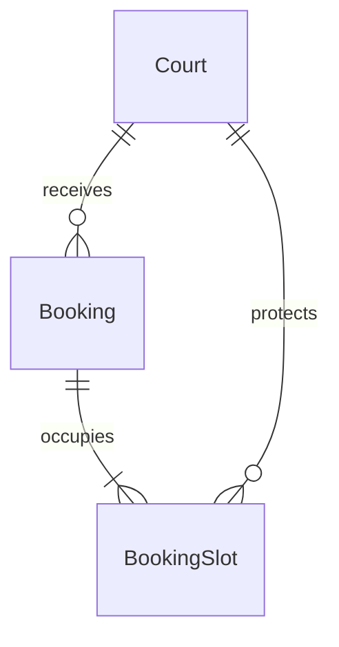

# BookingSlot và chống trùng

[Chỉ mục thiết kế](../DESIGN.md) · Cập nhật 2026-11-04 · Chưa có code/migration/test.

Đã chọn mô hình từng slot 30 phút, releasedAt và partial unique index. Ví dụ/SQL là thiết kế, chưa chạy. Cần demo trực quan khi code; xem [nhu cầu học](../INTERVIEW_PREP.md).

## Bảng phục vụ đặt sân — đã chọn phương án BookingSlot 2026-11-03

Người học yêu cầu mentor đề xuất bảng, sau đó chọn phương án 2: BookingSlot với partial unique index để bảo vệ từng khoảng 30 phút. Xác nhận này chốt hướng mô hình, không phải bằng chứng tự giải thích cơ chế hoặc duyệt xong mọi chi tiết SQL/FK/kiểu dữ liệu. Bộ trường dưới đây là thiết kế cơ sở của phương án đã chọn. Phần này tập trung Court–Booking–BookingSlot theo bước đang học; các bảng User/Branch/BookingBlockHistory và phương án RefreshToken giữ trạng thái review đã ghi ở các mục riêng. Chưa phải schema/migration hoặc xác nhận hiểu cơ chế.

### Court — giữ bộ trường đã duyệt

`id`, `branchId`, `name`, `playersPerTeam`, `pricePerSlot`, `isActive`, `createdAt`, `updatedAt`. playersPerTeam bổ sung và duyệt ngày 2026-11-03. Không thêm ngày/giờ đặt hoặc tên người đặt vào Court. Các thông tin đó thuộc booking và các dòng chiếm slot.

### Booking — tổng hợp các trường đã review

| Trường | Ý nghĩa |
| --- | --- |
| `id` | Mã booking UUID |
| `userId` | FK tới User.id: khách đặt |
| `courtId` | FK tới Court.id: sân được đặt |
| `startAt` | Thời điểm bắt đầu toàn bộ booking |
| `endAt` | Thời điểm kết thúc toàn bộ booking |
| `status` | CONFIRMED hoặc CANCELLED |
| `pricePerSlot` | Giá mỗi 30 phút tại thời điểm đặt |
| `totalPrice` | Tổng tiền lịch sử do backend tính |
| `createdAt` | Thời điểm tạo booking |
| `cancelledAt` | Thời điểm hủy; null khi chưa hủy |
| `cancelledById` | FK tới User.id: người hủy; null khi chưa hủy |

Đây là bảng tổng hợp thiết kế hiện có, không phải yêu cầu duyệt lại các quyết định đã chốt. Một Booking đại diện toàn bộ khoảng chơi liên tục, không phải một booking riêng cho mỗi 30 phút.

### BookingSlot — bảng của phương án đã chọn

Mỗi dòng ghi một khoảng 30 phút mà một booking chiếm. Chỉ tạo khi đặt, không cần tạo sẵn mọi slot trống. Một Booking thành công có 1–4 dòng tương ứng thời lượng 30/60/90/120 phút.

| Trường | Bắt buộc | Ý nghĩa |
| --- | --- | --- |
| `id` | Có | Mã dòng slot UUID |
| `bookingId` | Có | Liên kết tới Booking.id, dùng tìm toàn bộ slot khi hủy |
| `courtId` | Có | Sân bị chiếm; phải khớp sân của Booking |
| `startAt` | Có | Thời điểm đầy đủ bắt đầu slot 30 phút, lưu UTC |
| `releasedAt` | Không | null khi chưa giải phóng; thời điểm hủy khi giải phóng slot |

- Mỗi slot là khoảng nửa mở `[startAt, startAt + 30 phút)`: kết thúc lúc 19:30 không chiếm slot bắt đầu 19:30. Không lưu thêm endAt/date/time/name trên BookingSlot; ngày/giờ Việt Nam suy ra khi hiển thị, tên sân lấy từ Court.
- courtId được lặp từ Booking có chủ đích để database kiểm tra trùng sân/thời điểm ngay trên BookingSlot. Khi viết migration, dự kiến UNIQUE(Booking.id, Booking.courtId) và FK kép BookingSlot(bookingId, courtId) → Booking(id, courtId), bảo đảm slot không gắn nhầm sân. Không cho sửa sân/khung giờ của booking đã tạo; đổi giờ theo luồng hủy rồi đặt mới đã chốt.
- UNIQUE(bookingId, startAt) ngăn tạo lặp một slot trong cùng booking. Backend phải sinh đúng và đủ dãy slot liên tiếp từ Booking.startAt đến Booking.endAt; FK/unique không tự chứng minh đủ số slot hoặc đồng bộ trạng thái hủy. Kiểm tra mốc 00/30, giây/phần lẻ giây bằng 0 và ràng buộc thời gian sẽ cụ thể hóa khi viết migration.
- releasedAt không phải trạng thái thanh toán/hoàn tất: booking đã qua giờ vẫn có thể giữ releasedAt=null. Không cần job giải phóng theo đồng hồ vì mỗi slot gắn với ngày/giờ cụ thể; giờ quá khứ đã bị chặn theo quy tắc đặt.



Sơ đồ biểu diễn mỗi Booking có ít nhất một BookingSlot; booking tạo thành công phải có đủ 1–4 dòng, kể cả sau hủy vì giữ dòng lịch sử. Số lượng đúng được bảo đảm bởi luồng ghi nguyên tử và phải kiểm thử, chưa có bằng chứng thực thi.

### Ví dụ minh họa và đặt/hủy

Booking B1 thuộc sân A ngày 03/11/2026 19:00–20:30 giờ Việt Nam, status=CONFIRMED. Các ID dưới đây chỉ là nhãn minh họa:

| id | bookingId | courtId | startAt (UTC) | releasedAt |
| --- | --- | --- | --- | --- |
| S1 | B1 | A | 2026-11-03T12:00:00Z | null |
| S2 | B1 | A | 2026-11-03T12:30:00Z | null |
| S3 | B1 | A | 2026-11-03T13:00:00Z | null |

- Đặt: ghi Booking và toàn bộ BookingSlot trong một transaction; tranh bất kỳ slot nào thì rollback tất cả, map đúng lỗi xung đột slot thành HTTP 409. Ví dụ booking khác sân A lúc 19:30–20:00 tranh S2; sân B cùng giờ không xung đột.
- Hủy hợp lệ: khóa/kiểm tra lại booking và quyền/hạn hủy, chuyển status=CANCELLED, gán cancelledAt/cancelledById và releasedAt cho mọi dòng thuộc booking trong cùng transaction. Lỗi thì giữ nguyên cả booking lẫn slot. Các request hủy trùng phải được phối hợp, chi tiết response chốt ở API.
- Giữ dòng slot đã giải phóng làm lịch sử; booking mới có thể thêm dòng cùng courtId/startAt vì dòng cũ không còn tham gia chỉ mục bảo vệ slot. Không xóa Booking hoặc slot cũ khi hủy.

### Ràng buộc chống trùng đề xuất

SQL dưới đây minh họa migration tương lai, chưa chạy:

```sql
CREATE UNIQUE INDEX booking_slot_active_unique
ON "BookingSlot" ("courtId", "startAt")
WHERE "releasedAt" IS NULL;
```

Partial unique index chỉ áp dụng tính duy nhất cho các dòng thỏa điều kiện; ở đây mỗi sân/thời điểm chỉ có một dòng chưa giải phóng. Điều kiện nằm trên BookingSlot, không đọc status từ Booking. Nguồn: [PostgreSQL CREATE INDEX](https://www.postgresql.org/docs/18/sql-createindex.html).

Chỉ unique sân/giờ bắt đầu trên Booking sẽ bỏ lọt hai booking khác giờ bắt đầu nhưng chồng lấn. Phương án từng slot bảo vệ cả slot giữa khi backend sinh đúng đầy đủ các slot và transaction ghi toàn bộ. Giới hạn 3 booking cùng tài khoản, chặn đặt đồng thời và đổi giá đồng thời vẫn cần thiết kế riêng; chỉ mục này không tự giải quyết các phần đó.

Trước khi nghiệm thu thực thi: chạy PostgreSQL test riêng, test hai request đồng thời khác giờ bắt đầu nhưng trùng slot giữa, không giữ slot rời rạc khi thua, hủy/đặt lại, khác sân cùng giờ, hai booking tiếp giáp, rollback khi hủy lỗi và FK không cho gắn sai sân. Đây là kế hoạch kiểm tra, chưa phải kết quả test.

## Review cách biểu diễn slot được đặt lại — 2026-11-04

- Người học đề xuất kiểm tra có/không BookingSlot và dùng status đã hủy/đã đặt để quyết định đặt lại. Đúng về phân biệt hiệu lực với lịch sử; không cần đổi mô hình đã chọn chỉ để thêm tên trạng thái.
- Khuyến nghị giữ BookingSlot.releasedAt: null là bản ghi chưa giải phóng, có timestamp là đã giải phóng. Không thêm status đồng thời lưu releasedAt, tránh hai nguồn mô tả cùng trạng thái bị lệch. Đây là khuyến nghị phù hợp phạm vi hiện tại, không tuyên bố timestamp luôn tối ưu mọi hệ thống.
- Với mỗi courtId/startAt cơ sở, chỉ dòng releasedAt IS NULL mới gây xung đột; chỉ có dòng đã giải phóng tương đương không còn chiếm chỗ. Không có dòng chưa giải phóng chỉ là điều kiện slot trống, vẫn phải qua thời gian/quyền/hạn mức/sân hoạt động và các điều kiện đặt khác.
- Khi hủy, cập nhật Booking.status=CANCELLED, cancelledAt/cancelledById và releasedAt cho mọi slot trong một transaction; không xóa hoặc chuyển dòng cũ sang booking mới. Khi đặt lại tạo Booking/BookingSlot mới, giữ dòng cũ cho lịch sử.
- Query kiểm tra trống giúp xử lý nghiệp vụ/hiển thị nhưng không tự bảo vệ request đồng thời. Partial unique index trên courtId/startAt WHERE releasedAt IS NULL là ràng buộc DB đã chọn; tạo tất cả slot trong một transaction, xung đột trả 409 và rollback toàn bộ booking/slot.
- Cần demo lúc code: query rỗng, đặt/hủy/đặt lại và hai request cùng thấy trống; đối chiếu ràng buộc DB/rollback. Chưa có code/test; không coi giải thích mentor là bằng chứng đã hiểu toàn bộ concurrency.
