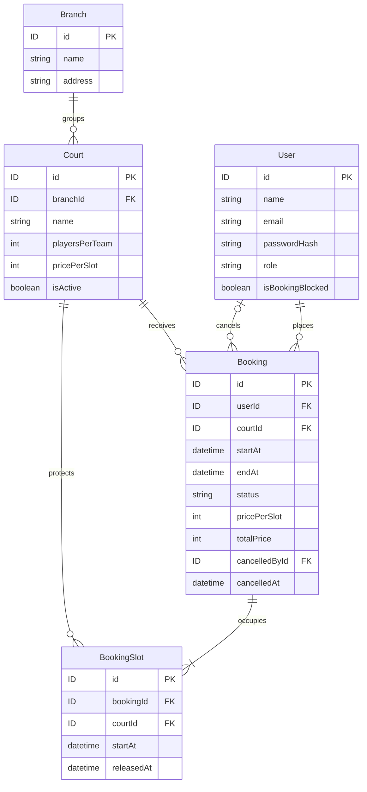

# Mô hình dữ liệu và giá lịch sử

[Chỉ mục thiết kế](../DESIGN.md) · Cập nhật 2026-11-04 · Chưa có code/migration/test.

Các quyết định nghiệp vụ/mô hình đã review được giữ nguyên. UUID đã duyệt. Kiểu cột thời gian và ERD đầy đủ bảy bảng vẫn cần hoàn thiện; xem [ràng buộc](constraints.md).

## ERD cốt lõi — bản tổng hợp để review 2026-11-04

Tổng hợp các quyết định đã có, không thêm bảng hoặc thay quy tắc. Sơ đồ đầu tài liệu giữ vai trò phác thảo quan hệ ban đầu; bản dưới bổ sung trường liên kết và quan hệ người hủy. ID đã chốt UUID ngày 2026-11-04; ký hiệu ID trong sơ đồ tương ứng PostgreSQL uuid/Prisma String @db.Uuid. Sơ đồ này chưa là Prisma schema/migration và chưa chứng minh các ràng buộc đã hoạt động.

- Ký hiệu || là đúng một; o| là không có hoặc một; o{ là không có hoặc nhiều; |{ là một hoặc nhiều. Một booking thành công có 1–4 slot theo thời lượng, nhưng ký hiệu Mermaid chỉ biểu diễn một hoặc nhiều, không tự giới hạn tối đa 4.
- User–Booking có hai quan hệ: userId là khách đặt bắt buộc; cancelledById là người hủy có thể null. Người hủy có thể là khách hoặc admin. Với booking chưa hủy, cancelledById/cancelledAt là null; không nhầm người hủy với chủ booking.
- Court.branchId lấy địa điểm từ Branch, không lặp address trên Court. Court.pricePerSlot là giá hiện hành; Booking.pricePerSlot/totalPrice là snapshot lịch sử. Timestamps tạo/cập nhật vẫn giữ như bảng chi tiết dù lược bớt khỏi sơ đồ để dễ đọc.
- BookingSlot.courtId lặp có chủ đích để bảo vệ trùng sân/slot. FK kép đã đề xuất bảo đảm bookingId/courtId khớp Booking; partial unique index (courtId, startAt) WHERE releasedAt IS NULL bảo vệ slot hiệu lực. Quan hệ sơ đồ một mình không thay thế các ràng buộc đó.
- Sau hủy vẫn giữ Booking và các dòng BookingSlot; cập nhật status/cancelledAt/cancelledById và releasedAt của mọi slot trong cùng transaction. Không xóa dòng để giải phóng sân.

### Ví dụ dữ liệu để đọc sơ đồ, chưa phải test đã chạy

Một booking B1 của khách U1 trên sân C1, ngày 2026-11-05 từ 19:00 đến 20:30 giờ Việt Nam:

| BookingSlot | bookingId | courtId | startAt giờ Việt Nam | startAt UTC | releasedAt |
| --- | --- | --- | --- | --- | --- |
| S1 | B1 | C1 | 19:00 | 2026-11-05T12:00:00Z | null |
| S2 | B1 | C1 | 19:30 | 2026-11-05T12:30:00Z | null |
| S3 | B1 | C1 | 20:00 | 2026-11-05T13:00:00Z | null |

Booking có startAt=12:00Z, endAt=13:30Z. Không thêm slot 20:30 vì đây là giờ kết thúc của khoảng nửa mở. Chưa có BookingSlot nào được ghi thật. Giá lịch sử vẫn theo công thức giá mỗi slot tại lúc đặt nhân 3.

### Hai bảng hỗ trợ đã có trong thiết kế

- BookingBlockHistory: userId trỏ khách bị chặn/mở, actorId trỏ admin thao tác. Không gộp vào User hoặc BookingSlot; bộ trường chi tiết ở mục lịch sử chặn.
- RefreshToken: userId trỏ User, có thể nhiều dòng cho rotation/nhóm phiên. Không thêm bảng Session trong bước tổng hợp này; schema nhóm phiên và cơ chế khóa còn phải hoàn thiện theo mục auth.

Khi code cần demo các dòng trước/sau hủy và đặt lại; không dùng câu hỏi cũ làm điểm bàn giao hiện hành. UUID và hành vi FK đã duyệt tại constraints.md; FB-002 chưa hoàn tất.

## Dữ liệu thời gian Booking — mentor đề xuất theo yêu cầu người học

Người học yêu cầu đề xuất trực tiếp, chưa tự giải thích lựa chọn trường. Đây là phương án thiết kế để review, chưa phải schema/migration đã triển khai.

| Trường | Ý nghĩa | Nguồn giá trị |
| --- | --- | --- |
| `startAt` | Ngày/giờ bắt đầu, một thời điểm đầy đủ | Khách chọn, backend kiểm tra |
| `endAt` | Ngày/giờ kết thúc | Backend tính `startAt + durationMinutes` |
| `createdAt` | Thời điểm tạo booking | Backend/database gán, không lấy từ khách |

- Lưu và trao đổi các thời điểm có múi giờ rõ ràng; biểu diễn lưu trữ theo UTC. Kiểu cột PostgreSQL đã duyệt timestamptz(3); xem constraints.md. Không dùng chuỗi giờ địa phương làm dữ liệu chuẩn.
- Hiển thị và áp dụng giờ hoạt động/cửa sổ ngày theo `Asia/Ho_Chi_Minh`. Không tách `date`, `startTime`, `endTime` thành ba trường độc lập.
- Request vẫn gửi `courtId`, `startAt`, `durationMinutes` (tên minh họa). Backend chỉ chấp nhận thời lượng 30/60/90/120, tự tính `endAt`; không lấy `endAt` frontend làm nguồn quyết định.
- Không lưu thêm `durationMinutes` trong Booking ở phương án này; suy ra số phút bằng `endAt - startAt`, số slot bằng thời lượng / 30. Không lưu dữ liệu thời lượng lặp lại cần đồng bộ.
- Kiểm tra `endAt > startAt`, hiệu là một trong 30/60/90/120 phút, `startAt` trong tương lai và đúng mốc phút 00/30 (giây/phần lẻ giây bằng 0), khoảng trong cùng ngày Việt Nam từ 06:00 đến 22:00. Vị trí thực thi/ràng buộc DB sẽ chốt sau.
- Ví dụ minh họa: 03/11/2026 19:00–20:30 giờ Việt Nam tương ứng `startAt = 2026-11-03T12:00:00Z`, `endAt = 2026-11-03T13:30:00Z`; thời lượng suy ra 90 phút, 3 slot. Đây không phải booking thật hoặc kết quả test backend.
- Hạn tự hủy tính bằng `startAt - 60 phút`; `createdAt` không dùng để tính hạn. Chưa thêm thời gian ân hạn sau khi đặt. Các trường cancelledAt/cancelledById đã duyệt ở mục trạng thái bên dưới.

## Trạng thái và thông tin hủy — đã duyệt 2026-11-02

Người học đã duyệt phương án mentor đề xuất: CONFIRMED/CANCELLED, cancelledAt/cancelledById và nhãn thời gian suy ra. Đây là quyết định thiết kế, chưa phải bằng chứng người học tự giải thích cơ chế; chưa viết schema/API.

| Trường | Phương án | Ý nghĩa |
| --- | --- | --- |
| `status` | `CONFIRMED` hoặc `CANCELLED` | Booking đã được đặt thành công hoặc đã hủy |
| `cancelledAt` | Thời điểm, có thể null | Server gán khi hủy thành công; lưu UTC |
| `cancelledById` | FK tới `User.id`, có thể null | Người thực hiện hủy: khách sở hữu booking hoặc admin |

- Tạo booking thành công thì `CONFIRMED`, hai trường hủy null; chỉ lưu khi toàn bộ slot được đặt thành công. Không có trạng thái chờ thanh toán/xác nhận trong bản đầu. Request thất bại không tạo booking giữ chỗ.
- Khi hủy hợp lệ: chuyển một chiều `CONFIRMED` → `CANCELLED`, điền cả `cancelledAt` và `cancelledById` bằng dữ liệu backend. Không nhận danh tính người hủy từ body; không xóa lịch sử, không tự khôi phục booking đã hủy. Đặt lại tạo booking mới.
- Tính nhất quán dự kiến: CONFIRMED thì hai trường hủy null; CANCELLED thì cả hai có giá trị. Chốt ràng buộc SQL/migration sau; chưa tự tuyên bố DB đã bảo vệ.
- Hủy và giải phóng toàn bộ slot phải nguyên tử; việc kiểm tra quyền/thời gian, cập nhật status và xử lý request trùng cần thiết kế khi triển khai. Khách chỉ hủy booking của mình khi còn ít nhất 60 phút; admin hủy riêng không bị giới hạn này. Hủy thất bại giữ nguyên dữ liệu.
- Chưa bắt buộc thêm lý do hủy; không suy rộng yêu cầu ghi lý do của thao tác hạn chế tài khoản sang mọi lần hủy booking. Không thêm trạng thái thanh toán hoặc no-show.
- Không lưu thêm COMPLETED làm trạng thái trong phương án này. Nhãn thời gian được suy ra tại thời điểm đọc nếu status là CONFIRMED: sắp tới khi `now < startAt`, đang diễn ra khi `startAt <= now < endAt`, đã kết thúc khi `now >= endAt`. CANCELLED luôn hiển thị đã hủy. “Đã kết thúc” chỉ mô tả khoảng giờ đã qua, không chứng minh khách đã đến hoặc đã thanh toán.
- Không cần tác vụ nền chỉ để đổi status theo đồng hồ. Giới hạn 3 booking đếm `status = CONFIRMED` và `startAt > now`; booking đã bắt đầu không còn tính. Trạng thái không tự bảo vệ chống trùng slot; cơ chế đã chọn là BookingSlot với partial unique index trên courtId/startAt khi releasedAt null; chưa triển khai.
- Ví dụ hủy booking của khách: `cancelledById` bằng ID khách. Admin hủy hộ: `cancelledById` bằng ID admin, còn `userId` vẫn giữ ID khách đặt ban đầu. Vai trò, quyền và khóa ngoại này sẽ được thể hiện đầy đủ khi hoàn thiện ERD.

## Giá lịch sử — đã duyệt 2026-11-02

- Người học xác định admin sửa giá Court, Booking lấy nguồn giá từ Court. Đúng về nguồn giá; câu trả lời chưa nói rõ đọc tại lúc tạo hay mỗi lần xem, không suy diễn người học đã chọn giá động hoặc đã tự đề xuất snapshot.
- Mentor cụ thể hóa: khi tạo Booking, backend đọc giá hiện hành của Court, tự tính tổng và lưu bản sao giá vào Booking. Khi đọc Booking cũ dùng giá đã lưu trong Booking, không tính lại theo Court hiện tại. Không dùng giá frontend làm nguồn quyết định.

| Trường đề xuất | Ý nghĩa |
| --- | --- |
| `Court.pricePerSlot` | Giá niêm yết hiện tại cho mỗi 30 phút |
| `Booking.pricePerSlot` | Bản sao giá mỗi 30 phút tại thời điểm đặt |
| `Booking.totalPrice` | Tổng tiền đã chốt: giá bản sao × số slot |

- Người học đã hỏi lại và xác nhận: tăng giá Court thì dữ liệu giá Booking cũ giữ nguyên. Duyệt phương án mentor đề xuất gồm Court.pricePerSlot và Booking.pricePerSlot/totalPrice; chưa có lời giải thích độc lập về schema. Đã chốt đơn vị tiền là số nguyên VND và giá mỗi slot > 0; kiểu cột/trần kỹ thuật được mentor xác định theo yêu cầu làm trực tiếp ở mục dưới. Validation/ràng buộc/schema chưa triển khai.
- Ví dụ sân 150.000đ/slot: đặt 90 phút = 3 slot, lưu Booking.pricePerSlot = 150.000 và totalPrice = 450.000. Sau khi Court.pricePerSlot thành 175.000, booking cũ vẫn 150.000/450.000; booking mới cùng thời lượng có giá 525.000 nếu đủ điều kiện đặt.
- Đây là giá đã chốt, không phải tiền đã thu; chưa có thanh toán. Hủy booking giữ nguyên thông tin giá lịch sử. Admin hủy để khách đặt lại tạo booking mới theo giá hiện hành.
- Tính nhất quán đọc giá/ghi booking khi admin đổi giá đồng thời cần chốt khi thiết kế transaction; chưa coi đã giải quyết race condition.

## Biểu diễn tiền — đã duyệt 2026-11-02

- Người học đồng ý đề xuất lưu tiền bằng số nguyên theo đơn vị VND: `150000` tương ứng 150.000đ. Áp dụng cho Court.pricePerSlot, Booking.pricePerSlot và Booking.totalPrice.
- Không dùng số thực dấu phẩy động làm dữ liệu tiền chuẩn. Giá trị số không chứa dấu phân cách nghìn, ký hiệu đ hay chuỗi định dạng giao diện; định dạng hiển thị tách riêng.
- Backend tự tính tổng từ giá hiện hành mỗi slot và số slot (1–4), lưu snapshot như đã duyệt. Tổng giá là số nguyên VND; chưa có thanh toán.
- Người học đã đồng ý giá mỗi slot phải lớn hơn 0 sau khi làm rõ slot là khoảng 30 phút và pricePerSlot là trường giá, không phải slot. Court.pricePerSlot và bản sao Booking.pricePerSlot phải là số nguyên VND > 0; từ chối giá 0, số âm, phần lẻ đồng hoặc dữ liệu không phải số. Booking.totalPrice được backend tính từ giá này và số slot 1–4 nên cũng > 0.
- Theo yêu cầu “ừm làm đi”, mentor chọn PostgreSQL `integer`, Prisma `Int` cho cả ba trường tiền; chưa chọn phiên bản Prisma hoặc khởi tạo ứng dụng. Prisma Int ánh xạ mặc định sang PostgreSQL integer; không cần thêm dependency.
- PostgreSQL integer tối đa 2.147.483.647. Để một giá mỗi slot luôn tính được booking dài nhất 4 slot, đặt trần kỹ thuật `floor(2147483647 / 4) = 536870911` VND/slot. Miền giá mỗi slot là số nguyên từ 1 đến 536.870.911; tổng giá từ 1 đến 2.147.483.644, phải đúng giá snapshot × số slot. Đây là giới hạn biểu diễn, không phải đề xuất giá bán hoặc mức giá thị trường.
- Không dùng giá bán tối đa tự đặt như 1 triệu/slot khi chưa có nhu cầu nghiệp vụ. Nếu sau này cần số tiền vượt miền trên hoặc thay thời lượng tối đa, phải xem lại kiểu cột, validation và migration; không âm thầm đổi ngưỡng.
- Backend kiểm tra kiểu số/nguyên và miền giá trước khi ghi Court, từ chối chuỗi/boolean/null, số không hữu hạn, phần lẻ đồng, giá 0/âm/vượt trần. Không tự ép chuỗi thành số, làm tròn hoặc cắt giá. Khi tạo Booking đọc giá Court, kiểm tra thời lượng, tự tính và kiểm tra tổng; không lấy giá/tổng frontend làm nguồn quyết định. Mã lỗi/response chốt ở phần API.
- Khi triển khai schema/migration: ba cột tiền NOT NULL integer; CHECK miền giá cho Court.pricePerSlot và Booking.pricePerSlot; CHECK miền tổng và tổng đúng giá snapshot × số slot (suy ra từ thời gian hợp lệ). Khi viết CHECK có phép nhân, dùng toán hạng đủ rộng nếu cần, không dựa vào thứ tự đánh giá các CHECK để tránh tràn trước khi từ chối dữ liệu sai. Không tuyên bố đã có các ràng buộc khi chưa chạy migration thật.
- Các kiểm tra cần có khi triển khai: 1/150000/536870911 được nhận, 0/âm/phần lẻ/536870912/sai kiểu bị từ chối; thời lượng 30/60/90/120 cho hệ số 1/2/3/4; tại giá trần, tổng 4 slot là 2147483644. Kiểm tra snapshot khi đổi giá sân và không ghi dữ liệu/giữ slot nếu đầu vào sai.
- Nguồn kỹ thuật đã tra cứu: [PostgreSQL Numeric Types](https://www.postgresql.org/docs/current/datatype-numeric.html) và [Prisma PostgreSQL type mappings](https://docs.prisma.io/docs/orm/core-concepts/supported-databases/postgresql). Tài liệu Prisma chỉ dùng xác minh ánh xạ; chưa chốt phiên bản framework của app.
- Đây là quyết định kỹ thuật mentor thực hiện trong phạm vi FB-002 theo yêu cầu người học, không ghi là người học tự thiết kế hoặc giải thích được. Chưa tạo schema/migration/validation code.

## Thông tin Branch và Court — đã duyệt 2026-11-02

Người học yêu cầu đề xuất trực tiếp. Người học đã duyệt toàn bộ bộ trường sau khi phản biện và sửa địa chỉ về Branch. Đây là quyết định thiết kế, chưa phải schema/migration hoàn chỉnh.

### Branch

| Trường | Ý nghĩa |
| --- | --- |
| `id` | Định danh chi nhánh UUID |
| `name` | Tên để hiển thị trong bộ chọn chi nhánh |
| `address` | Địa chỉ chung nơi khách đến cho các sân trong chi nhánh |
| `createdAt` | Thời điểm tạo, server/DB gán |
| `updatedAt` | Thời điểm cập nhật thông tin, server/DB gán |

### Court

| Trường | Ý nghĩa |
| --- | --- |
| `id` | Định danh sân UUID |
| `branchId` | FK tới Branch.id theo quan hệ đã review |
| `name` | Tên sân để khách nhận diện trong chi nhánh |
| `playersPerTeam` | Số người mỗi đội: số nguyên bắt buộc 5, 7 hoặc 11; không tự mặc định; bổ sung đã duyệt 2026-11-03 |
| `pricePerSlot` | Giá hiện tại mỗi 30 phút, theo thiết kế tiền đã có |
| `isActive` | Có nhận booking mới không; đề xuất mặc định true khi admin tạo sân |
| `createdAt` | Thời điểm tạo, server/DB gán |
| `updatedAt` | Thời điểm cập nhật thông tin, server/DB gán |

- name/address bắt buộc, bỏ khoảng trắng đầu/cuối rồi không được rỗng. Court.name đã chốt chuẩn hóa khoảng trắng, duy nhất trong chi nhánh và dài 1–100; xem api-courts.md. Không tự áp quy tắc unique Court cho Branch.name. Kiểu ID đã chốt UUID; hành vi ON DELETE/UPDATE đã duyệt, xem constraints.md.
- Branch.address là nguồn địa chỉ duy nhất; không có Court.address. Ví dụ một Branch có ba Court A/B/C tại cùng địa điểm thì lưu địa chỉ một lần. Khi xem sân, API/giao diện lấy Branch.address qua liên kết Court.branchId; cập nhật địa chỉ chung chỉ sửa Branch. Không tự thêm địa chỉ riêng/ngoại lệ cho Court.
- Không thêm isActive cho Branch trong bản đầu: nhu cầu hiện tại vô hiệu hóa từng Court; chưa có quyết định vô hiệu hóa cả chi nhánh và tác động dây chuyền.
- Court.isActive=false chỉ ngừng nhận booking mới, giữ booking có sẵn/lịch sử. Không coi false tự chứng minh bảo trì; không tự hủy booking hoặc thêm trạng thái bảo trì riêng.
- createdAt/updatedAt lưu thời điểm UTC; không nhận giá trị do frontend gửi làm nguồn chuẩn. updatedAt chỉ là lần cập nhật gần nhất, không phải lịch sử audit hoặc snapshot giá.
- Chưa cần ảnh sân, mô tả dài, tiện ích, tọa độ, số điện thoại chi nhánh hoặc giờ mở cửa riêng. Giữ giờ chung 06:00–22:00. Nếu có nhu cầu bổ sung phải chốt nghiệp vụ trước.

## Trường User — đã duyệt 2026-11-02

Người học đã duyệt khung User sau khi bỏ mức khóa tài khoản ngày 2026-11-02; đăng nhập bằng email; lý do chặn chỉ lưu trong BookingBlockHistory, không trên User. Sau đó người học yêu cầu bổ sung refresh token, thiết kế riêng trong [auth](auth.md); không thêm token rõ vào User.

| Trường | Ý nghĩa |
| --- | --- |
| `id` | Mã tài khoản UUID |
| `name` | Tên hiển thị, không dùng làm danh tính xác thực |
| `email` | Định danh đăng nhập duy nhất đã duyệt; chuẩn hóa/validation đã duyệt ở POST /auth/register trong [auth](auth.md) |
| `passwordHash` | Mật khẩu đã hash; không lưu/trả mật khẩu rõ hoặc hash ra API |
| `role` | CUSTOMER hoặc ADMIN; đăng ký công khai chỉ tạo CUSTOMER |
| `isBookingBlocked` | Chặn đặt mới, đề xuất mặc định false |
| `createdAt`, `updatedAt` | Thời điểm server/DB gán, lưu UTC |

- Chỉ admin được chặn/mở chặn đặt của tài khoản khách. Backend đọc isBookingBlocked hiện hành khi tạo booking, kể cả token cấp trước khi chặn; không chỉ tin role/flag cũ trong JWT. Khách bị chặn vẫn được đăng nhập/xem/hủy booking hợp lệ.
- Chặn không tự hủy booking. Mỗi lần thực sự thay đổi trạng thái chặn/mở cập nhật User.isBookingBlocked và thêm BookingBlockHistory với lý do không rỗng trong cùng transaction; gửi lại trạng thái sẵn có trả changed=false và không thêm lịch sử; lý do chỉ lưu trên lịch sử, không có trường lý do trên User.
- Ghi chú khách đã chuyển ngoài phạm vi app theo quyết định người học; không có bảng CustomerNote hoặc tích hợp bên ngoài. BookingBlockHistory giữ lịch sử thao tác, không phụ thuộc ghi chú.
- Chưa thêm phone, avatar, soft-delete hoặc chức năng quên mật khẩu. Refresh token đã được yêu cầu bổ sung, đang thiết kế riêng trong [auth](auth.md). Validation đăng ký tên/email/password đã chốt ở mục auth; kiểu ID đã chốt UUID. Thuật toán hash còn cần chọn. Không dùng name/email do body đặt sân gửi để thay cho danh tính từ token đã xác thực.
- Các trường User trên đã được duyệt; schema/FK/index/ràng buộc và an toàn response chưa triển khai.

## Lịch sử chặn — giữ BookingBlockHistory, bỏ CustomerNote

Người học xác định ghi chú khách có thể quản lý ở app khác và chỉ giữ BookingBlockHistory trong hệ thống. Không chọn hay tích hợp app khác. Không có bảng/API/UI CustomerNote trong phạm vi bản đầu.

| Trường BookingBlockHistory | Ý nghĩa |
| --- | --- |
| `id` | Mã bản ghi UUID |
| `userId` | FK tới User.id: khách bị chặn/mở chặn |
| `actorId` | FK tới User.id: admin thao tác, backend lấy từ danh tính đã xác thực |
| `action` | BLOCK hoặc UNBLOCK |
| `reason` | Lý do không rỗng cho mỗi thao tác thành công |
| `createdAt` | Thời điểm server gán, lưu UTC |

- Các trường lịch sử đều bắt buộc; tên trường do mentor cụ thể hóa, kiểu ID đã chốt UUID, reason đã chốt 1–500; ràng buộc DB còn hoàn thiện. Hai FK cùng trỏ User nhưng có vai trò khác nhau, không nhầm actorId với khách.
- User.isBookingBlocked giữ trạng thái hiện tại; lý do từng thao tác chỉ lưu trong BookingBlockHistory.reason. Cập nhật cờ cùng việc thêm lịch sử phải nguyên tử; lỗi thì không có cập nhật hoặc lịch sử thành công một phần. Chưa triển khai transaction.
- Chỉ admin được chặn/mở chặn và xem lịch sử; lịch sử được thêm tự động từ thao tác, không có API sửa/xóa lịch sử riêng trong bản đầu. Không trả lịch sử/lý do nội bộ trong hồ sơ khách thông thường.
- Khách bị từ chối đặt đọc trạng thái chặn hiện hành của User; không ghi dòng lịch sử chặn mới cho mỗi lần thử đặt. Không tự gửi cảnh báo khi thêm lịch sử; UI đặt hiển thị thông báo bị chặn thích hợp.
- Không có noteId hoặc yêu cầu phải tạo ghi chú trước khi chặn. Lý do nhập ngay khi admin thao tác. Chính sách gửi lại cùng trạng thái đã duyệt changed=false/không thêm lịch sử; chi tiết concurrency xem api-customers.md.

## Lý do chỉ lưu trên lịch sử — đã duyệt 2026-11-02

- Sau phản biện về reason còn trên User khi mở chặn, người học duyệt bỏ User.bookingBlockReason. Khung User chỉ giữ isBookingBlocked cho trạng thái chặn; lý do mọi lần BLOCK/UNBLOCK bắt buộc lưu trong BookingBlockHistory.reason.
- BookingBlockHistory.userId → User.id đủ liên kết; không thêm FK ngược hoặc noteId. Mở chặn đặt cờ false và thêm UNBLOCK với lý do mới, giữ nguyên lý do BLOCK trước đó trong lịch sử. Cờ false nghĩa hiện không bị chặn, lý do cũ không phải hạn chế hiện hành.
- Chỉ cần đọc cờ hiện hành để kiểm tra quyền đặt; không query lịch sử cho mỗi lần đặt. Admin xem lịch sử khi cần biết ai xử lý và vì sao, không trả lý do nội bộ cho khách. Truy vấn lý do hiện hành nếu bổ sung vào UI admin phải lấy đúng sự kiện BLOCK, không dùng lý do UNBLOCK như đang bị chặn.
- Cập nhật cờ và thêm dòng lịch sử phải cùng thành công hoặc cùng thất bại. Kiểu ID UUID, reason 1–500 và API gửi lại trạng thái đã duyệt; index và phối hợp request đồng thời còn hoàn thiện trong api-customers.md/transactions.md. Chưa có code/ràng buộc DB.
