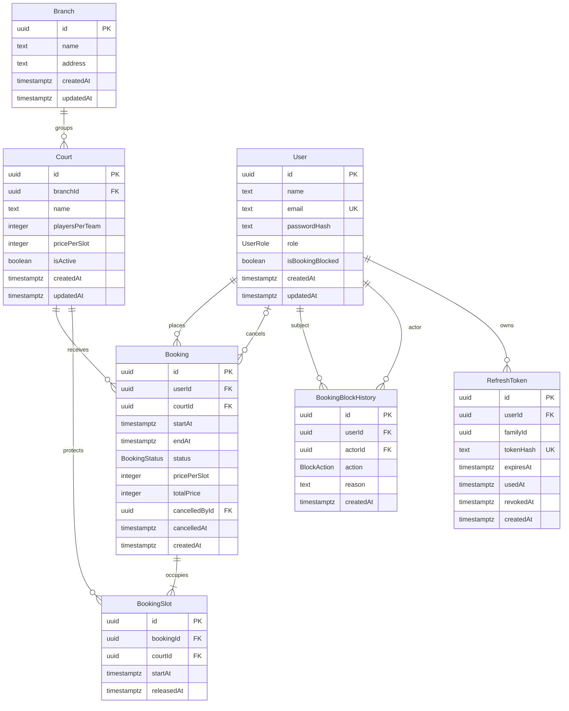

# Review tổng hợp FB-002

[Chỉ mục thiết kế](../DESIGN.md) · 2026-11-04 · **IN_REVIEW**

Đã review G1-04–06 và nhận lượt áp dụng nguồn userId/không giữ slot khi 409; xem bằng chứng tại learning/stage-1.md. Chờ xác nhận cuối phần chính; chưa DONE. Phần B giữ rõ quyết định mở và ranh giới bàn giao.

Bản tổng hợp phục vụ review cuối ticket, không phải schema/migration hoặc bằng chứng test. Phần A giữ các quyết định đã duyệt; phần B là đề xuất/câu hỏi còn mở, chưa được người học duyệt. Chi tiết API vẫn ở các chương hiện hành.

## A. Thiết kế hiện hành

### ERD đủ bảy bảng

Mọi thời điểm là `timestamptz(3)`; Mermaid viết gọn kiểu. `familyId` là mã nhóm, không phải FK đến bảng thứ tám. Quan hệ Booking–BookingSlot dùng FK kép `(bookingId,courtId) → Booking(id,courtId)`; sơ đồ không tự biểu diễn ràng buộc này hoặc giới hạn 1–4 slot.

### Bảng quy ước cột và ràng buộc

| Nội dung | Thiết kế đã duyệt |
| --- | --- |
| Required | Tất cả NOT NULL, trừ các trường nullable ở dòng kế |
| Nullable, ban đầu null | Booking.cancelledById/cancelledAt; BookingSlot.releasedAt; RefreshToken.usedAt/revokedAt |
| Default DB | User.role=CUSTOMER, isBookingBlocked=false; Court.isActive=true; Booking.status=CONFIRMED; createdAt=thời gian hiện tại ở bảng có trường này |
| Backend điền | updatedAt khi tạo/sửa User/Branch/Court; endAt, giá snapshot/tổng, các slot; thông tin hủy; familyId khi login và giữ qua rotation; expiresAt lúc cấp token + 7 ngày |
| ID | UUID hệ thống sinh; cơ chế sinh Prisma/DB cụ thể xác nhận khi triển khai |
| Enum | CUSTOMER/ADMIN; CONFIRMED/CANCELLED; BLOCK/UNBLOCK |
| CHECK | Loại sân 5/7/11; giá slot 1–536870911; tổng 1–2147483644 và bằng giá snapshot × số slot; tính toán tránh tràn số |
| CHECK thời gian/trạng thái | Booking dài 30/60/90/120 phút, mốc 00/30, trong một ngày Việt Nam 06:00–22:00; slot đúng mốc; CONFIRMED không có thông tin hủy, CANCELLED có đủ người/thời điểm hủy |
| Unique | Email chuẩn hóa; tokenHash; Booking(id,courtId); BookingSlot(bookingId,startAt); tên sân chuẩn hóa trong chi nhánh |
| Chống trùng | Unique BookingSlot(courtId,startAt) chỉ khi releasedAt IS NULL; tranh bất kỳ slot nào trả 409, rollback toàn bộ |
| FK | Chín FK: ON UPDATE RESTRICT; ON DELETE RESTRICT cho tám FK, riêng RefreshToken.userId CASCADE |
| Index truy vấn | Chỉ dự kiến tại constraints.md; demo query/kế hoạch thực thi trước–sau rồi quyết định khi triển khai |

CHECK không tự kiểm tra đủ dãy slot, quyền sở hữu, hạn mức 3 hay đồng bộ trạng thái giữa bảng. Các phần này cần validation/transaction và test. Quy tắc startAt còn ở tương lai được kiểm tra lúc đặt; không dùng CHECK phụ thuộc now().

Nguồn chi tiết: [cột/FK/CHECK/index](constraints.md), [mô hình/giá](data-model.md), [slot](booking-slots.md), [transaction](transactions.md), [auth](auth.md).

### Ba mô phỏng nghiệm thu từ FB-001

Giả định cùng sân C1, ngày 05/11/2026, giờ Việt Nam; các điều kiện quyền/thời gian/hạn mức khác đều hợp lệ. Đây là dữ liệu minh họa, chưa chạy DB/API.

| Tình huống | Dữ liệu và kết quả mong đợi |
| --- | --- |
| Chồng lấn / tiếp giáp | A 19:00–20:00 giữ slot 19:00,19:30. B 19:30–21:00 tranh 19:30 → 409, không giữ slot 20:00/20:30. Nếu B chọn 20:00–21:30 thì ba slot 20:00,20:30,21:00 không trùng A |
| Hủy rồi đặt lại | A hủy đúng 18:00: status=CANCELLED, thông tin hủy đủ, hai slot có releasedAt=18:00. B đặt lúc 18:05 cùng giờ: tạo Booking/slot mới với releasedAt=null; dòng A vẫn còn và không gây xung đột |
| Hai request đồng thời | A/B cùng thấy trống và tranh cùng slot: chỉ một transaction commit booking hiệu lực; bên thua 409 và rollback mọi slot. Không cam kết request đến trước luôn thắng |

Các yêu cầu nghiệm thu khác: đổi giá chỉ đổi Court và booking mới; vô hiệu hóa không hủy booking cũ; Court.branchId phục vụ lọc địa điểm; User.isBookingBlocked cùng BookingBlockHistory phục vụ quản lý khách; kiểm tra chủ sở hữu/admin ở backend. Đã có thiết kế, chưa phải kết quả thực thi.

## B. Các quyết định còn mở — gom để review

| Nhóm | Đề xuất mentor / ranh giới cần chốt | Lý do và trạng thái |
| --- | --- | --- |
| Thứ tự khóa chung | Đặt: User → Court → ghi Booking/slot. Hủy: xác định chủ booking → khóa User chủ booking → khóa/đọc lại Booking → cập nhật Booking/slot. Chặn/mở: khóa User đích → đọc lại cờ → cập nhật/ghi lịch sử. Auth: khóa User → đọc lại token/nhóm → rotate/revoke. Các luồng này không lấy thêm khóa User sau khi đã giữ Court/Booking | Hướng đặt/auth đã duyệt; phần hợp nhất với hủy/admin **chưa duyệt**. Mục đích tránh các luồng lấy khóa ngược nhau; chưa chứng minh hết deadlock. SQL, thao tác admin thực tế và test vẫn cần rà khi triển khai |
| Logout đa tab | Dọn access và dừng nhu cầu refresh ở mọi tab dùng chung phiên; refresh/login/logout đi qua cùng vùng điều phối auth; logout thông báo qua BroadcastChannel, không truyền token; request chờ phải đọc lại trạng thái trước khi gửi | **Đề xuất chưa duyệt.** Khớp cookie dùng chung và logout thu hồi cả nhóm; phiên đăng nhập riêng ở browser/profile khác vẫn giữ |
| Reload / response cũ / trình duyệt thiếu Web Locks | Phải thiết kế trạng thái dừng auth tồn tại qua reload, nhận diện thế hệ đăng nhập, xử lý response cũ và chính sách browser hỗ trợ trước khi code luồng đó. BroadcastChannel một lần không đủ; JS bỏ response cũ không tự ngăn browser áp dụng Set-Cookie | **Còn mở, chưa có giải pháp đầy đủ để duyệt.** Đề xuất học qua demo ở FB-004 và chốt trước khi triển khai các nhánh này; cần người học đồng ý ranh giới bàn giao, không tự coi đã giải quyết |
| Auth backend còn lại | Chốt thứ tự kiểm tra token/nhóm/expiry/reuse, cookie ở từng nhánh lỗi, phiên hiện hành khi login lại, hash mật khẩu/rate limit và giữ/dọn hash cũ theo hạn trượt | **Còn mở.** Có thể gom thành một lượt thiết kế trước code auth; không thêm dependency hoặc chính sách cụ thể chỉ từ bản tổng hợp |

Điều chỉnh bàn giao 2026-11-04: người học trả lời “Okay” sau đề xuất chuyển auth còn mở sang chốt qua demo trước code tương ứng ở FB-004. Ghi nhận đồng ý hướng chuyển giao; ROADMAP đã cập nhật. Không ghi thành duyệt chi tiết giao thức hoặc bằng chứng hiểu. Thứ tự khóa booking/hủy/admin vẫn là đề xuất cần chốt trước triển khai liên quan; các chính sách đã duyệt giữ nguyên.

## C. Bước review kế tiếp

Người học trả lời lượt review G1-04–06: quan hệ User/Court/Booking và lịch sử hủy; snapshot giá; API đặt/hủy, quyền sở hữu và lỗi đầu vào/xung đột/hạn hủy. Mentor nhận xét đúng/thiếu/cần sửa theo câu trả lời thực tế rồi mới cập nhật trạng thái ticket. Không yêu cầu duyệt lại phần A; chưa tự đánh dấu DONE/IN_REVIEW.

Demo khóa/index/auth/BookingSlot khi code vẫn bắt buộc theo [chỉ mục học tập](../INTERVIEW_PREP.md); mức hiểu chưa thay đổi từ việc có bản tổng hợp.
